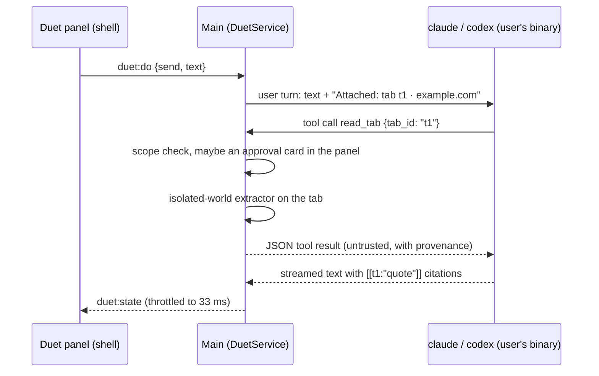

# Chord — Architecture

Status: **draft for review** · Last updated 2026-10-22 · Companion docs: [DESIGN.md](DESIGN.md), ROADMAP.md (next step)

Chord is an open-source (MIT) desktop browser for people leaving Arc. It keeps the sidebar-first workflow and the delight, with no Chord account, no telemetry, no cloud, and no lock-in. Windows, macOS, and Linux (X11 and Wayland) are equal targets.

Every library, API, and version below was checked on 2026-10-22. Anything not confirmed from a primary source is marked **⚠ unverified** and has a spike or test that settles it. [§16](#16-decisions-needed-from-you) lists the decisions that need your call.

---

## Contents

1. [Scope](#1-scope)
2. [Stack](#2-stack)
3. [Repository layout](#3-repository-layout)
4. [Process model](#4-process-model)
5. [Window composition](#5-window-composition)
6. [State model and data flow](#6-state-model-and-data-flow)
7. [Data schema](#7-data-schema)
8. [IPC contract](#8-ipc-contract)
9. [Browser engine services](#9-browser-engine-services)
10. [Command bar and search](#10-command-bar-and-search)
11. [Duet — the assistant panel](#11-duet--the-assistant-panel)
12. [Extensions](#12-extensions)
13. [Cross-platform abstractions](#13-cross-platform-abstractions)
14. [Security, updates, and the 72-hour patch process](#14-security-updates-and-the-72-hour-patch-process)
15. [Packaging, distribution, CI, testing](#15-packaging-distribution-ci-testing)
16. [Decisions needed from you](#16-decisions-needed-from-you)
17. [Risks](#17-risks)

---

## 1. Scope

**In scope**, in the priority order from the brief: vertical sidebar (pinned and Today tabs), chords with optional per-chord profiles, nestable folders, auto-archive, command bar, split view, mini window plus default-browser registration, Peek, and hidden-chrome mode. Hidden-chrome is now a **fully collapsible sidebar**: every sidebar feature folds away, leaving one Dia-style bar with basic controls and a combined `domain / title` field (DESIGN.md §3.3). Two additions:

- **Duet**, a right-side chat panel that can read your tabs when you let it. It uses your own Claude Code or Codex install and spawns nothing until you send a message ([§11](#11-duet--the-assistant-panel)).
- **Extensions**, needed for password managers ([§12](#12-extensions)).

**Not in 0.1:** browser-data import, ad and tracker blocking, Effects (per-site page styles, in place of Boosts) and sync. All four are planned after 0.1 (ROADMAP.md *After 0.1*; D5, D13, D14). Never planned: Arc import, Easels, mobile, background AI of any kind, and a Chord account or server.

**Performance budgets.** These are acceptance criteria, measured as described in [§15.5](#155-testing):

| Budget | Target | How it's measured |
|---|---|---|
| Cold launch to usable window | < 1.5 s on a mid-range machine | Main's first line (`src/main/perf.ts`) → the shell's first commit with an interactive sidebar, and its first paint (`performance.mark` + IPC timestamp) |
| Command bar open | < 50 ms keydown → first painted frame | Main's open request (a key's `before-input-event`, or the shell's button) → overlay `requestAnimationFrame` after `open` |
| Command bar keystroke | Results paint in the same frame as the keystroke for in-memory sources; ≤ 16 ms for history and archive | `input` event → results committed before the next frame (in-memory) or within 16 ms (history), and → next rAF; the chord-data round trip is logged |
| New tab ready to type | 0 extra frames: ⌘T opens the command bar, which is always mounted | same as command bar |
| Shell UI frame rate | 120 fps where the display supports it, never < 60 fps | Chromium trace during scripted interactions: each frame's main-thread work and the longest task. (The Long Animation Frames API only reports frames over 50 ms.) |

**Performance rules** (agreed 2026-10-24). Every change keeps to these; a review that finds one broken treats it as a bug.

1. **Main never does heavy or blocking work.** It routes, lays out and answers events. Anything that can take more than about a millisecond goes to a utility process or a worker thread: SQLite (chord-data, §4), PDF text (the PDF reader), Safe Browsing's lists and hashing (a worker), and later filter-list compiling, import parsing and sync's encryption. Synchronous file I/O on main is for startup and quit only.
2. **No per-request JavaScript where Chromium can decide alone.** A `webRequest` listener sends every request of every page through main's JavaScript thread. Use one only when nothing else can do the job, keep its work to microseconds, filter it by URL pattern, and share one dispatcher per session (Electron keeps a single listener per event). Prefer what runs inside Chromium's network process, such as `declarativeNetRequest` rules.
3. **Measure before going native.** Native Node modules are a last resort: each must be rebuilt for six targets on every Electron major, signed, and built offline for Flathub, all inside the 72-hour patch window (§14.3). If a measurement shows JavaScript isn't fast enough, try WebAssembly first. A native module needs a decision in §16.
4. **Small, batched IPC.** Messages carry what changed, not whole state: state patches, coalesced per animation frame in the renderers (§6.2), and layout over its own `MessagePort`. Large data stays where it's used. Main applies page styles itself (`insertCSS`) instead of sending them through a renderer, and bulk reads go through chord-data's own queries.
5. **Lazy by default.** Renderers load code for a panel, window or page when it's first opened, except the command bar, which stays loaded so it opens at once. Hidden tabs sleep (§9), and nothing polls on a timer faster than it needs to.
6. **Budgets are tests.** `perf.spec.ts` measures the budgets above on every CI run and reports them, and enforces them on reference hardware (`CHORD_PERF_ENFORCE=1`, [docs/testing/performance.md](docs/testing/performance.md)); CI's shared machines are too noisy to fail on. A change that needs more time on a frame or at launch makes its case against a budget, not around it.

---

## 2. Stack

| Concern | Choice | Version today | Status / notes |
|---|---|---|---|
| Runtime | **Electron 45** (Chromium 156, Node 24.22, V8 15.6) | 45.0.0, released 2026-10-20 | ✅ Supported lines: 45, 44, 43. Electron 46 stable is expected 2027-01-05. Chrome moved to 2-week releases, so each Electron major now jumps 4 Chromium milestones. |
| Language | TypeScript, strict | **6.0.x** | ✅ TypeScript 7.0.2 (the Go-native compiler) is out, but typescript-eslint 8.72 supports only TS `<6.1`, and TS 7's JS API is still `unstable/*`. We revisit once typescript-eslint supports 7. |
| UI | React 19 + React Compiler 1.0 | Compiler 1.0 stable since 2025-10-07 | ✅ Wired through plugin-react 6's documented `reactCompilerPreset` + `@rolldown/plugin-babel`. Its other route, `compiler: true` on `oxc-transform-react`, is marked experimental in the plugin README, so we don't use it. |
| Build | Vite 8 via **electron-vite 6.0** | 6.0.0, 2026-10-14 | ✅ Works with Electron 45, verified in M1.0, with two adjustments. First, Electron 45 downloads its binary lazily and has no install script, but electron-vite looks for the `path.txt` that download writes; so `apps/desktop` runs `install-electron` on postinstall. Second, a wrapper script clears `ELECTRON_RUN_AS_NODE`, which some Electron-based hosts leak and which makes Electron start as plain Node. Sandboxed preloads are built as one self-contained CJS file each (`isolatedEntries`, no externalized deps). electron-vite has one maintainer; fallback is plain Vite configs. Forge 8's Vite plugin brings Forge's packager, which we don't want. |
| Packaging | **electron-builder 26.18.0** (pinned) | 26.18.0 is on the `v26` dist-tag | ✅ npm's `latest` tag still points at 26.15.3, so pin exact versions. v27 is in alpha. Config: `apps/desktop/electron-builder.config.ts` ([§15](#15-packaging-distribution-ci-testing)). |
| Widevine (Chord Player only) | **castLabs ECS 44.9.3+wvcus** (Electron 44 with Widevine), pinned by each zip's SHA-256 in `apps/player/ecs.json` | 44.9.3+wvcus, 2026-10-22 | ✅ Never Chord's own engine (D4): only the companion app `apps/player` runs on it. A scheduled workflow opens a pull request for each newer stable `+wvcus` build ([§9, Chord Player](#chord-player)). |
| Updates | **electron-updater 6.8.11** + Chord's Ed25519 manifest check | 6.8.11 (`v26` tag) | ✅ Signed manifests are built into v27 alpha only. Until then we verify through a custom provider ([§14.4](#144-auto-updates)). |
| Database | **`node:sqlite`** in a utility process, with FTS5 | Node 24 marks it "Release candidate" (1.2) | ✅ Works in Electron main without flags since 35. FTS5 is compiled in. ⚠ **utilityProcess use is inferred, not documented**; spike S1 settles it. Fallback: better-sqlite3 v13 (N-API, prebuilds bundled). A thin `Db` interface keeps the swap cheap. |
| Motion | **motion** (motion.dev, MIT) | 14.6.0 | ✅ Majors ship fast (13.0 on 2026-08-05, 14.0 on 2026-10-02), so pin. Only the MIT core is used; no Motion+ components. |
| Drag and drop | **@dnd-kit/react** | 0.5.1 (pre-1.0) | ✅ The only option with live "make room" shifting for nested trees. The legacy `@dnd-kit/core` is frozen. Pinned and wrapped behind our `SortableTree` so churn stays contained. |
| Validation | zod | 4.6.7 | ✅ |
| Ordering | fractional-indexing (CC0) | 4.0.0 (ESM-only) | ✅ |
| Fuzzy match | @leeoniya/ufuzzy (MIT) | 1.0.19 | ✅ About 0.15 ms per search over 5k items (extrapolated from the author's benchmark; we'll measure). |
| Icons | lucide-react (ISC) | 1.61.0 | ✅ Phosphor was considered and rejected: no release in 17 months. |
| UI typeface | **Onest** (SIL OFL), variable 100–900, `tnum` | — | ✅ See DESIGN.md §4.2. |
| Extensions | electron-chrome-extensions, the iamEvanYT fork, **vendored** as `packages/chrome-extensions` | 4.9.5 (fork commit `25cf4d7`) | ✅ Used under GPL-3.0 (decision D1); Chord's changes are listed in its CHORD-CHANGES.md. See [§12](#12-extensions). |
| Ad blocking | **@ghostery/adblocker** (MPL-2.0) with EasyList and EasyPrivacy | 2.20.1, 2026-10-09 | ✅ Private windows' requests and every page's element hiding, in a worker thread; chords use the same lists as `declarativeNetRequest` rules (§9, S11). Pinned. |
| Reader view | **@mozilla/readability** (Apache-2.0) | 0.6.0, 2025-03-03 | ✅ Firefox's reader view code, run as source text in Chord's isolated world in the page; its output is cleaned in a worker (§9). Pinned. |
| CSS parsing (Effects) | **@csstools/css-tokenizer** and **@csstools/css-parser-algorithms** (MIT) | 4.0.2 | ✅ The CSS Syntax spec's own tokenizer and parser, which read CSS as Chromium does; Effects' sanitizer parses with them in a worker (§9). Already in the tree through stylelint. Pinned. |
| Tests | Vitest 5, Playwright `_electron` 1.64 | — | Playwright's Electron support is still experimental. See [§15.5](#155-testing). |
| Lint | ESLint 10 + typescript-eslint 8.72, stylelint 17 | — | — |
| Package manager | pnpm 10 | 10.33 locally | Electron packaging needs the hoisted layout (`nodeLinker: hoisted` in `pnpm-workspace.yaml`). Electron 45 no longer has an install script (verified in its package.json), so pnpm 10's build-script allow-list doesn't apply to it. |

---

## 3. Repository layout

The monorepo exists to enforce boundaries: `@chord/core` cannot import Electron, and renderers cannot import main.

```
chord-browser/
├─ apps/desktop/
│  ├─ src/main/                 Electron main process
│  │  ├─ app/                   lifecycle, single-instance, open-url / second-instance
│  │  ├─ windows/               WindowManager, view composition, materials
│  │  ├─ tabs/                  TabManager: WebContentsView lifecycle, navigation, sleeping
│  │  ├─ sessions/              profiles→partitions, permissions, downloads, certificates
│  │  ├─ store/                 authoritative Store (wraps @chord/core)
│  │  ├─ ipc/                   router + sender validation (one role per preload)
│  │  ├─ shortcuts/             single registry → app menu (macOS) + before-input-event
│  │  ├─ platform/              darwin.ts · win32.ts · linux.ts (see §13)
│  │  ├─ updates/               electron-updater + Ed25519 manifest verification
│  │  └─ duet/                  supervisor for the agent utility process
│  ├─ src/preload/              shell.ts · overlay.ts · popover.ts · internal.ts
│  ├─ src/renderer/
│  │  ├─ shell/                 sidebar, content frame chrome, Duet panel, onboarding
│  │  ├─ overlay/               command bar, Peek chrome, split drop zones
│  │  ├─ popover/               hover previews, permission prompts
│  │  └─ pages/                 chord://settings, chord://archive
│  ├─ src/data/                 "chord-data" utility process: SQLite, search, favicons
│  ├─ src/main/duet/            Duet: CLI adapters, its tools and page extraction (in main, §11.2)
│  ├─ src/main/reader/          reader view: Readability's scripts for the page, the view and its images; cleaning in a worker (§9)
│  ├─ src/main/effects/         Effects: the service, the sanitizer and its worker, the outline and picker scripts (§9)
│  ├─ src/pdf/                  Duet's PDF reader: pdf.js in a utility process, one per PDF read (§11.4)
│  ├─ test/                     unit · e2e (dev build) · packaged (smoke test of a packaged build)
│  ├─ build/                    packaging resources: app icon; later NSIS include, entitlements
│  └─ electron-builder.config.ts
├─ apps/player/                Chord Player: the Widevine companion on castLabs ECS (§9), its packaging and smoke test
├─ packages/
│  ├─ core/                     pure domain model: entities, commands, reducer, policies
│  ├─ player-protocol/          what Chord and Chord Player share: the services and the lock, the channel, manifests, the zip format
│  ├─ ipc/                      channel contract, zod schemas, typed client/server helpers
│  ├─ db/                       schema, migrations, prepared queries
│  ├─ tokens/                   design tokens → CSS vars + TS; chord theme generator
│  └─ ui/                       shared React primitives (Button, Keycap, Favicon, Toast…)
├─ flatpak/                     Flatpak manifest (built from source), metainfo, .desktop, build.sh (§15.1)
├─ scripts/                     asset generators (grain, icon); later release, manifest signing, Electron release watcher
├─ docs/                        releasing/ (patch runbook, Flathub, apt/dnf), decision records, design QA captures
└─ .github/workflows/           ci.yml · release.yml · electron-watch.yml · linux-repos.yml · player.yml · player-release.yml · ecs-bump.yml
```

---

## 4. Process model

```mermaid
flowchart LR
  subgraph Main["Main process (Node, privileged)"]
    Store[(Store<br/>@chord/core)]
    WM[WindowManager]
    TM[TabManager]
    SM[Sessions / Permissions / Downloads]
    SR[ShortcutRouter]
    UP[Updater]
  end
  subgraph Data["chord-data utilityProcess"]
    DB[(SQLite + FTS5)]
  end
  subgraph Duet["Duet, in main (spawns nothing until a message)"]
    PA[Provider adapters + Chord's tools]
  end
  PA -- stdio stream-json, tools on the control channel --> CC[[user's own `claude` CLI]]
  PA -- stdio JSON-RPC, tools as dynamicTools --> CX[[user's own `codex app-server`]]
  Shell[Shell renderer<br/>sidebar · Duet panel] <-- invoke + patches --> Main
  Overlay[Overlay renderer<br/>command bar · Peek chrome] <-- invoke --> Main
  Overlay <-- MessagePort --> Data
  Main <-- MessagePort --> Data
  Web[Web content renderers<br/>sandboxed, no preload] -. CDP/events only .- TM
```

| Process | Responsibilities | Why it's separate |
|---|---|---|
| **Main** | Lifecycle, windows, WebContentsView creation and placement, sessions and profiles, navigation policy, permissions, downloads, shortcuts, menus, default browser, updates. Holds the **authoritative in-memory Store**. | Owns every native object. It is never allowed to block: no SQLite, no search. Duet only pipes stdio to the CLIs (§11.2). Safe Browsing's lists and hashing are on a worker thread of main's (§14.5), and so are ad blocking's engine and list compiling, reader view's cleaning and Effects' sanitizer (§9). |
| **chord-data** (utilityProcess) | SQLite connection (WAL), migrations, write-behind persistence, history, archive, FTS5 search, favicon cache, backups. | Synchronous SQLite stays off main. A crash here doesn't take down windows: main buffers writes and respawns it. |
| **Duet's CLIs** (the user's `claude` / `codex`, lazy) | One per active chat, at most 3; each answers through stdio, and Duet (in main) answers their tool calls and streams replies to the shell. On Windows a CLI installed only inside WSL runs through `wsl.exe` (§11.1). | The CLIs are third-party processes doing the network and model I/O. **Nothing is spawned** until a message is sent, and each is killed after 10 minutes idle. A planned `chord-agent` utility process proved unnecessary (§11.2). |
| **PDF reader** (utilityProcess, one per PDF read) | pdf.js turns a PDF's bytes into each page's text when Duet reads a PDF tab (§11.4). | Parsing a file from the web is untrusted work: it stays off main, gets 30 seconds, and the process is thrown away after each read. |
| **Import** (utilityProcess: one to find browsers, one per profile read) | Finds other browsers' profiles, copies a profile's databases to a temp folder, reads bookmarks, open tabs and history from the copies, plans where they land, and sends the history straight to chord-data over a port ([§9, Import from other browsers](#import-from-other-browsers)). | Another program's files can be large, damaged or newer than Chord knows: reading them is slow, untrusted work, kept off main, and the process is thrown away afterwards with its copies. |
| **Shell renderer** (1 per window) | React UI: sidebar, content-frame shadows and placeholders, Win/Linux top strip, Duet panel, toasts, onboarding. | Our trusted UI, still sandboxed. |
| **Overlay renderer** (1 per window, pre-warmed) | Command bar, Peek frame chrome, split-view drop zones. | Must paint above web content ([§5](#5-window-composition)). Kept mounted and hidden so it opens in < 50 ms. |
| **Popover renderer** (1 per window, pre-warmed) | Hover previews, permission prompts. Its bounds are sized to the card. | Electron views can't pass clicks through (see [§5](#5-window-composition)), so popovers must not cover the sidebar. |
| **Web content** | One WebContentsView per live tab; Chromium site isolation decides the processes. | `sandbox`, `contextIsolation`, no `nodeIntegration`, **no preload**, no `webviewTag`. |
| **Internal pages** (`chord://settings`, `chord://archive`) | Settings is its own window (⌘, / Ctrl+,), one at a time: the preferences convention on every OS, and it keeps a privileged page out of browsing tabs entirely. The archive renders as a normal tab. | Separate in-memory `chord-ui` session; each page has its own narrow preload and IPC role. Settings (`internal.ts`, role `internal`) sees settings and one chord's theme, never tabs or history. The archive page (`archive.ts`, role `archive`) lists, restores and removes archived tabs, and sees its chord's colors. A tab showing it is made by TabManager on the UI session; navigating it to a web address (or a web tab to it) replaces the view. A tab's reader view (`chord://reader`, `reader.ts`, role `reader`) sees that tab's cleaned article and how it should look, changes only reader view's own settings, and closes itself; nothing else (§9). |

| **Chord Player** (a separate app, started on demand) | Plays the streaming services that need Widevine, in a window of its own, on castLabs ECS ([§9, Chord Player](#chord-player)). Chord starts it from the DRM notice and talks to it over a local pipe or socket. | ECS trails Chromium's security fixes by weeks (S12), so it never shows anything but a dozen first-party sites, and Chord itself stays on stock Electron (D4). It quits when its window closes, or when Chord goes. |

All Chord UI views use one in-memory session, `chord-ui`. The `chord://` and `chord-favicon://` protocols are registered **only on that session**, so web pages can't reach them (this also prevents history-sniffing through favicons).

---

## 5. Window composition

Each window is a `BaseWindow` whose `contentView` holds views in this z-order, bottom to top:

```
┌─ BaseWindow (material: vibrancy / Mica / solid) ───────────────────────────┐
│ 1. shellView      full window, transparent bg: sidebar, frame shadow,      │
│                   top strip (Win/Linux), Duet panel, toasts                │
│ 2. tabViews       active tab (or 2–4 split panes) at the content-frame     │
│                   rect, setBorderRadius(frame radius); background tabs     │
│                   are removed from the tree but stay alive                 │
│ 3. popoverView    hidden; when shown, bounds = card rect only              │
│ 4. overlayView    hidden; when shown, full window (command bar is modal)   │
│ 5. peekView       Peek's page, placed above the overlay's scrim + chrome   │
│                   (as built: the find bar's popover moves above it)        │
└────────────────────────────────────────────────────────────────────────────┘
```

Verified constraints and how they shape this:

- **No per-view mouse pass-through.** A transparent region of a view still swallows clicks. Electron #23863 is open; PR #53841 `View.setInteractive(false)` is open. So the overlay view covers the window only for modal moments: the command bar and Peek, where clicking outside closes them. Hover previews live in a separate popover view sized to the card so the sidebar keeps receiving hover events. If #53841 lands, the two collapse into one view.
- `View.setBorderRadius` (Electron 33+) takes one radius for all corners, and the cut-out corners still capture clicks. That's acceptable: the shell draws the frame's hairline and shadow beneath it. Per-corner radii are PR #51472, still open.
- `WebContentsView` starts with a **white** background. Chord views call `setBackgroundColor('#00000000')`. Each tab view starts with the page's last-known background color to avoid white flashes in dark mode.
- `View.setBackgroundBlur` (43+) blurs what is behind a view inside the window. ⚠ Whether it blurs a tab view under the overlay view convincingly is **unverified**; spike S4. Without it the command bar uses a dim scrim and no blur (DESIGN.md §6.3).
- **Layout sync.** The shell renderer owns layout. It measures the content-frame placeholder with a `ResizeObserver` and posts rects over a dedicated `MessagePort`, coalesced to one per animation frame. Main calls `setBounds`. Expect about one frame of lag during sidebar-resize drags; the placeholder is painted in the page's background color to hide it.
- **Animating the frame size** (Duet panel open/close, sidebar dock/undock) never calls `setBounds` per frame, because each call relayouts the page. Instead we capture the page with `capturePage()` (cached when the tab was last shown), animate the bitmap in the shell, then set the final bounds once and swap. Split-view divider drags do resize live, as Chrome does. *As built:* see [The frame snapshot](#the-frame-snapshot) below; the capture is taken when the change starts, not cached.
- **Minimal mode (sidebar collapsed)** needs no extra view.
  - The 40 px bar is part of the shell view and lies above the frame rect, so no tab view ever covers it.
  - Collapsing changes the frame rect; the change is animated with the snapshot technique below.
- **Sidebar peek in minimal mode** reorders views rather than adding one.
  - The shell view moves *above* the tab views, with its bounds shrunk to a 6 px hot strip at the left edge (plus the bar).
  - On hover-intent its bounds grow to the sidebar rect, and CSS slides the sidebar in over the page.
  - When the peek ends, the bounds shrink back.
  - The cost is that the page's leftmost 6 px don't receive clicks while peek-on-hover is enabled.
  - The peek setting can be turned off.
  - *As built (M1.2), simpler and with no cost to the page:*
    - The hot strip is the 4 px bezel left of the frame, which is already the shell's. Hovering the bar's toggle for 300 ms also peeks.
    - Peeking lifts the shell above the page (`AppWindow.setPeek`) at full size. While it's lifted the shell paints nothing over the page: the backdrop is clipped to the bar, and the frame placeholder is hidden.
    - The pointer resting over the page, a click there, or Esc puts it away. The shell goes back under the page once the slide-out finishes.
    - There's no setting to turn it off yet.
- **Closing a tab really releases it.** `removeChildView` alone does not free the renderer; `webContents.close()` does. The `WebContentsView.destroy()` request (#42884) was closed without explanation on 2026-09-25.
- **A shared tab off screen stays in the tree** (2026-10-24, §9 Screen sharing). A detached view has no compositor, so a page capturing it would get a frozen picture. `AppWindow.park` keeps it just above the shell, at the frame's size, where `offscreen()` puts the frame snapshot's pages: all but its own top-left pixel past the window's corner, which its rounded corner cuts away. It stays in the window it was shown in, and `Browser.syncParking` decides again whenever panes change, a share starts or ends, or a window closes.

### The frame snapshot

How the content frame changes size without moving web content every frame (DESIGN.md §6.1 rule 4). It's used when the sidebar docks or collapses and when Duet's panel opens or closes. Main's half is `src/main/frame-snapshot.ts` (`FrameSnapshots`, one per `AppWindow`); the shell's is `src/renderer/shell/FrameSnapshot.tsx`. They talk over `frame:snapshot` (main → shell: `show`, `move`, `drop`) and `layout:snapshot` (shell → main: `shown`, `moved`).

1. **Picture first, then change.** A dock, collapse or Duet toggle goes through `AppWindow.changeFrame(change, animate)`. Main captures every page in the frame (`capturePage()` on each pane of a split) *before* the state changes, so nothing on screen moves early. The pixels go as captured (BGRA, Skia's N32 order on every desktop platform), with each page's current rect, over a `MessagePort` of the shell's own: main makes one whenever the shell asks (`layout:snapshotPort`, on every load) and the preload hands it to the page untouched, so the pictures never pass through the preload or `contextBridge`. In the shell a worker (`renderer/shell/snapshot-worker.ts`) takes the port, swaps the pixels to RGBA and makes an `ImageBitmap`, and passes it on without a copy; the snapshot's events keep their order through it. Until the port arrives, events come over IPC and the shell converts them itself. *Measured 2026-10-24* (200 tabs, Linux container): the shell's worst frame collapsing the sidebar went from 17.1 to 8.1 ms and docking from 14.5 to 6.3 ms; the copy across `contextBridge` (4–5 ms), `putImageData` (1–2 ms) and most of the garbage collection after it are gone. Every rect the shell gets is in its own CSS pixels, from the layout's math (`frameRect`, `paneRects`), not the views' window bounds; only main's placing of the views is in window pixels.
2. **The shell paints the pictures where the pages are.** Each picture is a `<canvas>` (device pixels; a `bitmaprenderer` context takes the worker's `ImageBitmap` as it is) drawn as the frame's card: `radius-frame` and `shadow-frame`, in a layer above the frame placeholder and the sidebar and below Duet's panel, `aria-hidden` and never focusable. While pictures show, `:root[data-frame-snapshot]` hides the real frame placeholder, which jumps to its new size underneath. Once a frame with the pictures has been painted, the shell replies `shown`.
3. **The pages step out of sight, already at their final size.** Main sets the transition running and applies the change (it dispatches `window.sidebar`, or sets Duet's width and publishes the panel's state). The layout that follows places each page at its *new* size, but with all of it except its top-left pixel past the window's bottom-right corner. That's the page's first move, and its one relayout, hidden behind its picture. A view entirely outside its window is hidden by Chromium (the page stops painting, goes `hidden`, and loses the keyboard), so one pixel stays inside: the page's own top-left corner, which its rounded corner (`setBorderRadius`, 8–12 px on every platform) cuts away, so nothing of the page shows even in a square-cornered (maximized, or Linux) window. The page keeps painting, keeps its focus, and never hears a `visibilitychange`.
4. **The pictures glide.** Main sends `move` with the new pane rects (the frame rect through the same `paneRects` math the shell uses). The shell applies a `translate() scale()` transform per picture, in the same frame as the shell's own change renders (both go through `shared/frames.ts`), on a CSS transition with the `smooth` spring's `linear()` easing: compositor-only, at the display's own rate. A change that comes while pictures glide (a second toggle) sends them on from where they are, without a new capture; the pages move once more, to the newest size.
5. **The pages come back.** When the transition ends, the shell replies `moved`; main moves each page into place (its second move: same size, so no relayout, and it's already painted) and sends `drop`. The shell drops the pictures two frames later, once the pages, which sit above it, have painted.

What the snapshot never does, and what it does instead:

- **Motion off.** "Animate the sidebar" off (it covers Duet's panel too) or reduced motion: no capture at all, and the change happens at once.
- **Nothing to picture.** No page in the frame (the empty state), a page in HTML fullscreen, a page hidden behind its error or crash explanation, or a minimized or hidden window: the change happens at once. The shell's own frame placeholder still animates its size in CSS.
- **A capture that fails or is slow.** If the pictures aren't on screen within `PREPARE_TIMEOUT_MS` (200 ms) of asking, or a capture fails, the pictures are dropped and the change happens at once. If the shell never says the pictures arrived, the pages come back after the spring's duration plus 300 ms.
- **Input.** The shell stays interactive throughout (the pictures don't take the pointer). A key typed into the page while its picture glides brings the page back at once, before the key reaches it. Resizing the window, switching tabs, a page entering fullscreen or failing, resizing the sidebar by dragging, peeking the sidebar in minimal mode and dragging a tab (its split drop zones) all end the glide immediately: the pictures sit above the sidebar, as the pages do, so a peek or drop zones drawn over them wouldn't show. Dragging the sidebar's edge never animates: the page follows the pointer.
- **Private windows.** The pictures exist only in memory: main's `NativeImage` and byte array, and the shell's canvases (the shell is on the in-memory `chord-ui` session). Nothing is written to disk, and hover-preview captures (the only ones kept, on disk) are never taken of private windows.
- **IPC replies.** `action:run` and a renderer's `window.sidebar` dispatch reply once the change has happened (after the capture), not when the glide ends.

Each page moves exactly twice per change, whatever the display's refresh rate; the perf spec checks it ("page view moves").

---

## 6. State model and data flow

### 6.1 One reducer, used on both sides

`@chord/core` is pure TypeScript (no Electron, no DOM). It defines:

- **Entities:** `Profile`, `Chord`, `Node` (folder | tab | split), `WindowState`, `ArchiveItem`, `Settings`.
- **Commands:** a discriminated union describing user intent.
- **`apply(state, command, ctx) → { state, patches, inverse, effects }`**, built on Immer's `produceWithPatches`.
- **Policies:** auto-archive eligibility, ordering (fractional ranks), the profile-boundary rule for moving tabs across chords, and frecency.

```ts
type Command =
  | { t: 'tab.open'; chordId: ChordId; url: string; at?: Position; activate?: boolean }
  | { t: 'tab.activate'; nodeId: NodeId }
  | { t: 'tab.close'; nodeId: NodeId }          // pinned → unload; today → archive('closed')
  | { t: 'tab.pin'; nodeId: NodeId; at: Position }
  | { t: 'tab.unpin'; nodeId: NodeId; at?: Position }
  | { t: 'tab.resetToPinned'; nodeId: NodeId }
  | { t: 'node.move'; nodeId: NodeId; to: Position }   // Position = {chordId, section, parentId, rank}
  | { t: 'folder.create' | 'folder.rename' | 'folder.toggle' | 'folder.delete'; /* … */ }
  | { t: 'chord.create' | 'chord.update' | 'chord.delete' | 'chord.reorder'; /* … */ }
  | { t: 'chord.activate'; windowId: WindowId; chordId: ChordId }
  | { t: 'today.clear'; chordId: ChordId }
  | { t: 'archive.restore'; archiveId: ArchiveId }
  | { t: 'split.create' | 'split.resize' | 'split.dissolve'; /* … */ }
  | { t: 'undo'; token: UndoToken };

type Effect =
  | { e: 'view.create' | 'view.destroy' | 'view.attach' | 'view.detach'; nodeId: NodeId }
  | { e: 'navigate'; nodeId: NodeId; url: string }
  | { e: 'persist'; ops: PersistOp[] }
  | { e: 'toast'; undo: UndoToken; copy: ToastCopy };
```

### 6.2 Flow

1. The renderer dispatches a `Command`. For drag-and-drop and other latency-sensitive actions, it **applies the same reducer locally first** (optimistic). Because the reducer is shared and deterministic, the optimistic state equals the authoritative one, so nothing flickers.
2. Main validates the command (zod plus semantic checks), applies it, runs the effects (view lifecycle, navigation), bumps `version`, and broadcasts `{version, patches}` to every Chord renderer.
3. Renderers apply the patches. On a version gap they request a fresh snapshot. *As built:* the shell applies each patch as it arrives but renders once a frame (`renderer/shared/frames.ts`): the patches, Duet's and the extension bar's updates, and the frame snapshot's moves that arrive before a frame run together in its `requestAnimationFrame`, in one React pass (`flushSync`). A tab switch sends several patches; they used to render the shell two or three times inside one frame. A key press or click first renders whatever is waiting, so handlers never act on a stale frame; a hidden shell renders at once. Input feedback (a click's own state) renders at once too, and a frame that has rendered already leaves the batch for the next frame, once.
4. `persist` effects go to chord-data. Writes are coalesced and committed every 250 ms or when idle, flushed on quit (2-second cap), and written in WAL mode. Worst case on a hard crash is about 250 ms of sidebar edits lost. *As built (2026-10-24):* each open tab's back/forward history (`navigationHistory` entries with Chromium's `pageState`, so the scroll position and form fields; trimmed as for the archive) is a `nav` write op into `tab.nav_state`, as UTF-8 JSON in that BLOB column. `main/history-saver.ts` writes a tab about 2 s after it navigates, at the next 30-second save after you scroll, type or click in it, when it falls asleep, and on quit, and only when its history changed (a SHA-1 of it is kept per tab). Private windows' tabs are never saved. At launch a tab gets its saved history back if it still ends on the tab's address. A hard crash loses at most the last 30 seconds of scrolling, and about 2 seconds of navigation; an E2E test kills Chord and checks a tab comes back with its history and scroll.

Live-only fields are never persisted: loading, audible, crashed, sharing and shared, the attached-view handle, the capture cache, presenting mode and the windows being shared (§9).

### 6.3 Undo

Every destructive command returns inverse patches plus an `UndoToken`. A toast holds the token for 6 s (paused while hovered); undo replays the inverse. Behind the toast, data is also soft-retained:

- Closed Today tabs go to the archive (`reason='closed'`) with their navigation history, which `webContents.navigationHistory.restore()` brings back ✅.
- Deleted folders and chords are soft-deleted (`deleted_at`) and kept 30 days. They can be restored from Settings → Recently deleted.
- Reopen-closed-tab (⌘⇧T) walks the same archive: this session's closed (and cleared) tabs first, back in their exact place, then what the archive remembers you closed or cleared, newest first, across restarts. Tabs tidied away automatically aren't reopened by ⌘⇧T; they're in the archive page and the command bar.

---

## 7. Data schema

**Files:** `<userData>/chord.db` plus `-wal`/`-shm`. Thumbnails for hover previews are files under `<userData>/Captures/` (JPEG: Electron's `nativeImage` can't encode WebP ✅), not blobs. Chromium's own data (cookies, cache) lives under `<userData>/Partitions/<profile>`.

| OS | `userData` |
|---|---|
| macOS | `~/Library/Application Support/Chord` (Electron default) |
| Windows | `%LOCALAPPDATA%\Chord\User Data`, set via `app.setPath` before ready. Browsers don't roam multi-GB profiles, which is why Electron's `%APPDATA%` default is wrong here. Chrome uses the same location. |
| Linux | `$XDG_CONFIG_HOME/Chord` (default `~/.config/Chord`) |

**Throwaway profiles.** A Chrome-style `--user-data-dir=<path>` replaces `userData` in every build, so packaged builds can be smoke-tested without touching a real profile. Chromium parses it: only the `=` form counts, an empty value is ignored, and a relative path resolves against the working directory ✅. Development builds also read `CHORD_USER_DATA`. The single-instance lock follows `userData`, so such a run doesn't hand off to a running Chord (✅ two packaged instances with different profiles ran side by side on Windows).

**Conventions:**
- IDs are UUIDv7 `TEXT`.
- Times are `INTEGER` Unix ms, UTC.
- Order is a fractional-index `TEXT rank`, so a drag-and-drop move is one row update.
- All tables are `STRICT`.
- JSON columns are validated by zod at the boundary.
- Pragmas: `journal_mode=WAL`, `synchronous=NORMAL`, `foreign_keys=ON`.

```sql
CREATE TABLE profile (
  id TEXT PRIMARY KEY, name TEXT NOT NULL,
  partition TEXT NOT NULL UNIQUE,              -- 'persist:default' | 'persist:p-<id>'
  is_default INTEGER NOT NULL DEFAULT 0, created_at INTEGER NOT NULL
) STRICT;

CREATE TABLE chord (
  id TEXT PRIMARY KEY, profile_id TEXT NOT NULL REFERENCES profile(id),
  name TEXT NOT NULL,
  icon TEXT NOT NULL,                          -- {kind:'emoji'|'symbol'|'letter', value}
  theme TEXT NOT NULL,                         -- ChordTheme {stops[1..3], grain, appearance}
  rank TEXT NOT NULL,
  duet_enabled INTEGER NOT NULL DEFAULT 1,     -- per-chord opt-out (global switch in settings)
  created_at INTEGER NOT NULL, updated_at INTEGER NOT NULL, deleted_at INTEGER
) STRICT;

-- The sidebar tree. Folders only in 'pinned'; splits in either section; tabs anywhere.
CREATE TABLE node (
  id TEXT PRIMARY KEY, chord_id TEXT NOT NULL REFERENCES chord(id),
  parent_id TEXT REFERENCES node(id),          -- NULL = section root
  section TEXT NOT NULL CHECK (section IN ('pinned','today')),
  kind TEXT NOT NULL CHECK (kind IN ('folder','tab','split')),
  rank TEXT NOT NULL,
  created_at INTEGER NOT NULL, updated_at INTEGER NOT NULL, deleted_at INTEGER
) STRICT;
CREATE INDEX node_children ON node(chord_id, section, parent_id, rank) WHERE deleted_at IS NULL;

CREATE TABLE folder (
  node_id TEXT PRIMARY KEY REFERENCES node(id),
  title TEXT NOT NULL, collapsed INTEGER NOT NULL DEFAULT 0
) STRICT;

CREATE TABLE tab (
  node_id TEXT PRIMARY KEY REFERENCES node(id),
  pinned_url TEXT,                             -- the pinned "home" URL; NULL for Today tabs
  custom_title TEXT,
  url TEXT NOT NULL, title TEXT NOT NULL DEFAULT '',
  favicon_key TEXT,
  nav_state BLOB,                              -- navigationHistory entries + index (for restore)
  last_active_at INTEGER NOT NULL,             -- drives auto-archive
  muted INTEGER NOT NULL DEFAULT 0,            -- you muted it: silent through sleep and restarts (2026-10-24)
  zoom REAL
) STRICT;

CREATE TABLE split (
  node_id TEXT PRIMARY KEY REFERENCES node(id),
  layout TEXT NOT NULL                         -- {dir:'row'|'column', sizes:number[]}; children = tab nodes
) STRICT;

CREATE TABLE window_state (
  id TEXT PRIMARY KEY,
  bounds TEXT NOT NULL,                        -- {x,y,w,h,displayId,maximized,fullscreen}
  active_chord_id TEXT REFERENCES chord(id),
  sidebar_width INTEGER NOT NULL,
  sidebar_mode TEXT NOT NULL DEFAULT 'docked' CHECK (sidebar_mode IN ('docked','collapsed')),
  duet_width INTEGER,                          -- NULL = panel closed
  active_tab_by_chord TEXT NOT NULL DEFAULT '{}'
) STRICT;

CREATE TABLE archive_item (
  id TEXT PRIMARY KEY, chord_id TEXT NOT NULL, url TEXT NOT NULL, title TEXT NOT NULL,
  favicon_key TEXT, nav_state BLOB,
  reason TEXT NOT NULL CHECK (reason IN ('auto','closed','cleared','folder-deleted','chord-deleted')),
  archived_at INTEGER NOT NULL, restored_at INTEGER
) STRICT;
CREATE INDEX archive_recent ON archive_item(archived_at DESC);

CREATE TABLE history_url (
  id INTEGER PRIMARY KEY, profile_id TEXT NOT NULL REFERENCES profile(id),
  url TEXT NOT NULL, title TEXT NOT NULL DEFAULT '',
  visit_count INTEGER NOT NULL DEFAULT 0, typed_count INTEGER NOT NULL DEFAULT 0,
  last_visit_at INTEGER NOT NULL, frecency REAL NOT NULL DEFAULT 0,
  UNIQUE (profile_id, url)
) STRICT;
CREATE TABLE history_visit (
  id INTEGER PRIMARY KEY, url_id INTEGER NOT NULL REFERENCES history_url(id) ON DELETE CASCADE,
  visited_at INTEGER NOT NULL, transition TEXT NOT NULL
) STRICT;

-- One FTS index for history, archive, pinned tabs and Duet thread titles; triggers keep it in sync.
CREATE VIRTUAL TABLE search_fts USING fts5(
  title, url, kind UNINDEXED, ref UNINDEXED, profile_id UNINDEXED,
  tokenize = 'unicode61 remove_diacritics 2', prefix = '2 3 4'
);

CREATE TABLE favicon (
  key TEXT PRIMARY KEY,                        -- sha256(icon URL)
  icon_url TEXT, data BLOB NOT NULL, mime TEXT NOT NULL,
  dominant_color TEXT, fetched_at INTEGER NOT NULL
) STRICT;

CREATE TABLE site_permission (
  profile_id TEXT NOT NULL, origin TEXT NOT NULL, permission TEXT NOT NULL,
  decision TEXT NOT NULL CHECK (decision IN ('allow','deny')), updated_at INTEGER NOT NULL,
  PRIMARY KEY (profile_id, origin, permission)
) STRICT;

CREATE TABLE download (
  id TEXT PRIMARY KEY, profile_id TEXT NOT NULL, url TEXT NOT NULL, path TEXT NOT NULL,
  state TEXT NOT NULL, received INTEGER, total INTEGER, started_at INTEGER NOT NULL, ended_at INTEGER
) STRICT;

CREATE TABLE setting (key TEXT PRIMARY KEY, value TEXT NOT NULL) STRICT;   -- zod schema per key

-- Duet (§11)
CREATE TABLE duet_thread (
  id TEXT PRIMARY KEY, chord_id TEXT REFERENCES chord(id),
  provider TEXT NOT NULL,                      -- 'claude-code' | 'codex' | later: 'anthropic-api' | 'openai-api' | 'local'
  model TEXT, provider_session_id TEXT,        -- for resume
  mode TEXT NOT NULL DEFAULT 'browse' CHECK (mode IN ('browse','developer')),
  project_dir TEXT,                            -- developer mode only
  title TEXT NOT NULL DEFAULT '',
  created_at INTEGER NOT NULL, updated_at INTEGER NOT NULL, deleted_at INTEGER
) STRICT;
CREATE TABLE duet_message (
  id TEXT PRIMARY KEY, thread_id TEXT NOT NULL REFERENCES duet_thread(id) ON DELETE CASCADE,
  role TEXT NOT NULL CHECK (role IN ('user','assistant','tool','approval')),
  body TEXT NOT NULL,                          -- JSON blocks: text, citations, tool calls, context refs
  created_at INTEGER NOT NULL
) STRICT;
CREATE TABLE duet_site_rule (
  origin TEXT PRIMARY KEY, rule TEXT NOT NULL CHECK (rule IN ('never','ask'))
) STRICT;
```

**As built (migration 1, `packages/data/src/migrations.ts`):** the profile, chord, node, folder, tab, window_state, favicon and setting tables. Three deliberate differences from the sketch above:

- `node.chord_id` is `DEFERRABLE INITIALLY DEFERRED`, because a batch writes whole entities in any order.
- `parent_id` and `active_chord_id` aren't foreign keys. `restoreState()` in `@chord/core` repairs dangling references on load (an orphaned tab moves to its section root; a missing active chord falls back to the first).
- `tab` and `folder` rows cascade from `node`.

Favicons are stored once per distinct icon, keyed by content hash, and unused ones (no tab or archived tab uses them) are dropped on open.

**The archive, as built (migration 5):** `archive_item` with an explicit integer `rid` (so its external-content FTS5 index, `archive_fts`, survives `VACUUM`), `reason` of `auto`, `closed` or `cleared`, and `nav_state` as JSON: the tab's `navigationHistory` entries (with Chromium's `pageState`, which holds the scroll position) and index, at most 50 entries around the current one, web pages only, and capped at 1 MB. An entry is deleted when its tab comes back. Entries older than 30 days go on open. Archive writes ride the history event stream (`HistoryEvent` `archive` / `unarchive`), in order and in the same transaction as the batch they arrive with.

**Duet, as built (migration 9):** `duet_thread` has no `mode` or `project_dir` (there is no developer mode), adds `scope` (`ask`, `chord`, `all`) and `last_used_at`, and takes `provider` `claude` or `codex`. `duet_message` gets an integer `rid` for its external-content FTS5 index (`duet_fts`, what `@duet` searches), a `text` column, and the `divider` role. There is no `duet_site_rule` table: the *Never* list lives in settings (`settings.duet.neverSites`), next to the per-chord off list. Deleting a thread deletes its rows; there is no soft delete (§11.5).

**Favorites, as built (migration 6):** `favorite` (id, url, title, `favicon_key` into `favicon`, rank, created_at), shared by every chord and profile; the favicon clean-up keeps their icons. **Folders** use the `folder` table from migration 1, Pinned only (a tab moved into a folder is pinned there). **Sidebar width** uses `window_state.sidebar_width` from migration 1, 200–400 px.

**Link routes, as built (migration 11, after Duet's 9 and split view's 10):** `link_route` (host, chord_id, created_at), one route per host.

**Effects, as built (migration 13):** `effect` (host, wet, css, hidden, presets, duet, compiled, sanitizer, created_at, updated_at), one row per site (the host without `www.`, with its port), shared by every chord and profile. `hidden`, `presets` and `duet` are JSON, checked as they're read (`cleanSiteEffects`); `compiled` is the stylesheet the sanitizer made from the rest, and `sanitizer` its version (§9). Main's Effects write them (`Persistence.effect`), not the store's patches, and never a private window's.

**Migrations** are forward-only numbered SQL files, each run in a transaction. Before every migration, and as a daily rolling copy (keep 3), we take a backup with `VACUUM INTO`. A failed migration restores the backup and opens in a read-only "something went wrong" state rather than losing data.

**Profiles.** Chords share the default profile unless "Keep sign-ins separate" is on. That creates a profile with its own persistent partition: cookies, storage, cache, extensions. Moving a tab to a chord with a **different profile** recreates it in the target session and reloads it, because a WebContents can't change session. The UI says so before the drop completes.

*As built:*
- **Where to switch:** the chord's ⋯ menu, the command bar action, and Settings → General → Sign-ins. That Settings group also has a "New chords keep their own sign-ins" default.
- **What happens:** `chord.profile` sets the chord's profile. Its open pages close, the page on screen reloads in the new session, and the window offers Undo.
- **Cleanup:** a profile no chord uses is deleted at the next launch, both its `profile` row and its `Partitions/p-<id>` folder. That's when the sign-ins of a chord that was deleted or switched back to shared disappear.
- **Still shared across profiles, on purpose:** history, permission decisions and downloads. They're about sites and you, not accounts.

**Auto-archive.** A main-process timer runs every 5 minutes and on `powerMonitor` `resume`. It archives Today tabs whose `last_active_at` is older than the chord's threshold (12 h by default; 24 h, 7 d, 30 d, or never). It skips tabs that are audible, visible in any window, part of a split, or playing media. Archived items are kept 30 days by default.

As built (`core/idle.ts`, `main/idle.ts`):
- The threshold is one setting for now (Settings → General → "Archive Today tabs after"), not per chord.
- `last_active_at` is when you last *left* the tab (the reducer stamps the tab a window stops showing), so idle time runs from then, not from when you opened it.
- Busy tabs are skipped: audible; playing (`media-started-playing` until `media-paused`, so muted video counts); given the camera or microphone, until the page goes (Electron can't say when capture ends); and in picture-in-picture (asked in an isolated world just before acting).
- Candidates are checked again against fresh state right before acting, and the reducer never auto-archives a tab on screen.
- `CHORD_ARCHIVE_AFTER_MS`, `CHORD_SLEEP_AFTER_MS` and `CHORD_IDLE_CHECK_MS` shorten the times in development and tests (ignored when packaged).

---

## 8. IPC contract

**Principles:**

1. **One preload per trust role:** shell, overlay, popover, internal. Each exposes a frozen `window.chord` object through `contextBridge` with explicit methods. Raw `ipcRenderer` is never exposed.
2. **Every channel is declared once** in `@chord/ipc/contract.ts`: name, allowed roles, zod request and response schemas. Both sides import the same contract, so types and runtime validation can't drift.
3. **Main checks the sender on every message.** `event.sender.id` must be registered under an allowed role, `event.senderFrame` must be the main frame, and `senderFrame.url` must be the expected `chord://<surface>` origin. Unknown channels are dropped and logged; payloads over 256 KB are rejected. Large data (attachments, screenshots) moves by reference ID, never inline.
4. **Web content gets nothing:** no preload, no IPC. The exception is the extension library's preload: it runs in every page of a profile that has extensions, and does nothing outside extension pages and extensions' isolated worlds. Extension pages get only what it injects ([§12](#12-extensions)).
5. **Electron 45 constraint:** sandboxed preloads no longer have the `events`, `timers`, `url`, or `Buffer` modules, so preloads are written against browser APIs only.

**Transports:**

| Kind | Transport | Examples |
|---|---|---|
| Commands and queries | `ipcRenderer.invoke` → `ipcMain.handle` | `cmd.dispatch`, `settings.get` |
| State fan-out | `webContents.send('state.patch', {version, patches})` | sidebar updates |
| High-frequency streams | `MessagePort`. Main creates a `MessageChannelMain` and hands one end to a utility process and the other to the renderer's preload. Ports arrive in the isolated world and are wrapped there; they are not forwarded to the main world. | layout rects (shell→main), search (overlay↔data) |

**Channels, by role:**

| Channel | shell | overlay | popover | internal | Notes |
|---|:-:|:-:|:-:|:-:|---|
| `state.snapshot` / `state.patch` | ✓ | ✓ | ✓ (subset) | — | |
| `cmd.dispatch(Command)` | ✓ | ✓ (open/activate/actions subset) | — | — | |
| `layout.port` | ✓ | — | — | — | frame rects, Duet width |
| `nav.back/forward/reload/stop` | ✓ | ✓ | — | — | |
| `search.port` | — | ✓ | — | — | direct to chord-data |
| `archive:list/restore/remove/snapshot` | — | restore only | — | — | the archive page's own role, `archive`; as built these are `invoke` channels through main, which flushes pending writes first |
| `system.info` | ✓ | ✓ | ✓ | ✓ | platform, accent, reduced motion and transparency, forced colors, window-controls geometry |
| `overlay.open/close` | ✓ | ✓ | — | — | |
| `permission.respond` | — | — | ✓ | — | |
| `settings.get/set` | read | read | — | ✓ | |
| `defaultBrowser.status/request` | ✓ (onboarding) | — | — | ✓ | |
| `updates.status/check/install` | — | — | — | ✓ | |
| `duet:view` / `duet:do` / event `duet:state` | ✓ | — | — | — | as built: one zod-checked action union (send, stop, approve, attach…); main pushes the panel's view, throttled to 33 ms |
| `duet:search` / `duet:openHit` | — | ✓ | — | — | the `@duet` filter; empty from private windows |
| `settings:duet` | — | — | — | ✓ | detect, sign in, clear all |
| `safeBrowsing:status` | ✓ (first run) | — | — | ✓ | available in this build; the lists' state |
| `safeBrowsing:choose` | ✓ (first run) | — | ✓ (the offer) | — | on or off, with the notice seen |
| `safeBrowsing:back` / `safeBrowsing:proceed` | ✓ | — | — | — | the warning's buttons, for a tab the sender's window shows |
| `adBlocking:status` | — | — | — | ✓ | ad blocking's lists: versions, last check, failing |
| `drm:open` / `drm:dismiss` | — | — | ✓ | — | the DRM notice's buttons, for the page the sender's window shows: another browser by id (one main found, never a path), or Not now |
| `drm:player` | — | — | ✓ | — | the notice's Chord Player button (install, open, try again) for the page the sender's window shows; refused from a private window, in Google-free mode, or on a page that isn't a service's |
| `player:do` | ✓ | — | — | — | a tab that plays in Chord Player: back to the player, or show its page here; only the tab Chord Player plays for, in the sender's chords |
| `settings:player` / `settings:removePlayer` | — | — | — | ✓ | Settings → General → Chord Player: its state, and removing it with its profile |
| `import:sources` / `import:preview` / `import:run` | ✓ (first run) | — | — | ✓ | other browsers' profiles by key, never a path; nothing from a private window; `run` answers at once and pushes `import:progress` to its caller ([§9](#import-from-other-browsers)) |
| `import:undo` | — | — | — | ✓ | Settings' Undo; the window's toast sends the renderer command `import.undo`, which main takes over |
| `import:openAccess` | ✓ (first run) | — | — | ✓ | macOS's Full Disk Access pane, for Safari |
| `share:respond` | — | — | ✓ | — | the share picker's answer: a source's id (`tab:<id>` for a tab), `system` for the system's own picker, or null to refuse; main gives the page only what its picker offered |
| `share:stop` | ✓ | — | — | — | Stop on a sharing tab's row, or on a shared tab's (the pages sharing it stop). Presenting mode has no channel: it's in the state patches, and the indicator turns it off with `cmd.dispatch({ t: 'presenting.set', on: false, by: 'you' })` |
| `reader:page` / `reader:look` / `reader:ready` / `reader:set` / `reader:close`, event `reader:look` | — | — | — | — | the reader view's own role, `reader`: its own tab's article (JSON text, cleaned already) and look; `set` takes only reader view's controls (`settings.reader`), checked again by core |
| `effects:view` / `effects:do` / event `effects:state` | — | — | ✓ | — | the Effects card (DESIGN.md §7.15): its own site's Effects, pushed while it's open; every action is checked again in main against the card's site, and the card closes when another tab or site comes in front |
| `capture:hide` | — | ✓ | — | — | the picker's click when it picks for Effects: hides the element under the pointer on the site it was started for, and answers its name |
| `settings:effects` | — | — | — | ✓ | Settings → Effects: a site dry or wet, or its Effects removed. The list itself is in Settings' snapshot (`effects`) |
| `media:view` / `media:do` / event `media:state` | ✓ | — | — | — | Now playing: the tabs in the window's chords that play and you left playing (or played from a card), newest first, pushed when what the window's card could show changes; and the card's Play, Pause and picture-in-picture, for a tab in those chords. Mute and Go to tab are commands (`tab.mute`, `tab.activate`). Chord Player's entry (for the tab it plays for) takes Play, Pause, `mute` and `unmute` here, and *Back to the player* is `player:do` |

Navigation guards: every Chord UI view rejects `will-navigate`, `will-frame-navigate`, and `setWindowOpenHandler` for anything other than its own `chord://` URL. Web content can never navigate to `chord://` or `chord-favicon://`, and isn't served them anyway (separate session, [§4](#4-process-model)).

---

## 9. Browser engine services

| Service | Approach |
|---|---|
| **Tabs** | TabManager owns `nodeId → WebContentsView`. Views are created lazily: on restart only the active tab of each window loads. Others load on activation (pinned tabs show their cached favicon and title until then). |
| **Sleeping tabs** | Electron has no Chromium tab discarding. Tabs hidden for more than 60 minutes (configurable) get their `nav_state` saved and `webContents.close()` called. Activation restores them with `navigationHistory.restore()` ✅. **Never slept or auto-archived** (rule borrowed from Crest): tabs that are playing media, in picture-in-picture, sharing the screen or camera, being shared by another page (`live.shared`, 2026-10-24), being used by an agent, or holding a pending `beforeunload`. A check that has to ask pages about picture-in-picture looks again before acting, busy as things are by then, since a share can start meanwhile. **As built:** 60 minutes hidden, checked with auto-archive; on by default, with a switch in Settings → General. *Low on memory* (2026-10-24): main asks the OS every 30 seconds what it could hand out without swapping (`main/memory.ts`: Linux's MemAvailable, Windows' available physical memory, macOS's free plus file-backed and purgeable memory). Under a tenth of the memory, or under 2 GB on bigger machines, background tabs hidden for 5 minutes sleep at once instead of after an hour, with the same exceptions. The switch turns this off too. The history (with `pageState`, so the scroll position comes back) stays in memory until the tab is shown; a sleeping tab is one with no live entry, and its icon fades to 70 %. ⚠ Not yet: detecting a pending `beforeunload` (a page with unsaved form input can be slept; `pageState` usually brings the input back). |
| **Popups / OAuth** | `setWindowOpenHandler`: a plain `target=_blank` becomes a new Today tab, or opens in Peek when it comes from a pinned tab and leads to another site. `window.open` with features, as OAuth and payment popups use, gets a real child popup window so `window.opener` keeps working. Peek's page and mini windows keep their links to themselves: a `target=_blank` there loads in place. |
| **Peek** (DESIGN.md §8.5) | A link you follow in a pinned tab to another site (its registrable domain, `core/links.ts`) opens in Peek, not in place: `will-navigate` is cancelled when the navigation comes within 1.5 s of a click or Enter in the page (`input-event`), so a page redirecting itself (sign-in flows) still navigates. Any tab, a private window's too, can also open a link in Peek from its right-click menu. Peek's page is a tab's view made ahead of time (`TabManager.createFloating`, under the id it will have as a tab), on the pinned tab's session, wired like a tab but not in the store. It sits above the overlay, which draws the scrim and the card's header (`AppWindow.openPeek`; the find bar moves above it, to the card's corner, and the hover preview hides). In a split, the card floats over the focused pane; *Open in Today* grows it into the whole frame, as the tab it becomes replaces the split on screen. A mini window's page is never a pane of a main window. Esc and ⌘↵ are caught in `before-input-event` before the page sees them; ⌘W, find, zoom, print and copy act on Peek's page while it's open. *Open in Today* grows the page into the frame on the `smooth` spring, then `tab.adopt` makes it the top Today tab with the same `WebContents`, so its back stack comes along. Its visits are history like any page's, except in a private window. Permission requests from Peek's page are denied until it's a tab. |
| **Mini windows** (DESIGN.md §7.9) | Links from other apps (`openExternalUrls`) open each in a mini window of its own (`main/mini-window.ts`): a `BaseWindow` with a 36 px bar view (`chord://mini`, role `mini`) above a floating page made the same way as Peek's, on the sign-ins of the chord *Open in* points at (the last-used normal window's). Mini windows cascade 24 px from the display center; on Wayland they're left to the compositor. The size you last gave one is remembered (`settings.miniWindowSize`). Launched just to open a link, Chord opens only the mini window; your windows come back on *Open in*, from the Dock, or on a plain relaunch. *Open in* (⌘↵) moves the live page into the chosen chord's Today in a normal window (one on that chord, else the last used, else a restored one) with `tab.adopt`, history and all; across different sign-ins it loads again there instead. Settings → General → *Links from other apps open in* can make them plain tabs. |
| **Link routes** (from Crest) | `linkRoutes` in the store, by host (`link_route`, migration 11): a route covers its host, `www.` and subdomains, and the most specific route wins (`core/links.ts`). *Paths, 2026-10-24:* a route can name a path too (`github.com/acme/*`, keyed `github.com/acme` by `routeKey`, in the same column): it covers that path and those under it, without case, and as the longer key it beats its site's route. Links from other apps with a route open as a tab in that chord, skipping the mini window; `tab.open` with `route: true` (the command bar's new tabs) lands in the route's chord and switches the window there. Links clicked inside pages don't follow routes. Chord learns a site's chord as an offer, never silently: the second time this session a site's page is moved to the same chord, Chord asks: moving a tab, as a second line on the move's toast ("Moved to Work · Undo" over "Always open linear.app here? · Always"); from a mini window's *Open in*, as a toast of its own ("Always open linear.app in Work?"). Settings → General → Link routes lists, changes, adds and removes them. A route whose chord is deleted is dropped at the next restore. |
| **Navigation events** | `did-navigate`, `page-title-updated`, `page-favicon-updated`, loading and audible changes are coalesced per tab (≤ 1 update per 50 ms) into store commands. History visits go to chord-data. |
| **Favicons** | Fetched through the tab's own session (`session.fetch`, so partition cookies apply), size-capped at 64 KB, sanitized (SVG rasterized to PNG in a sandboxed context), and stored by key. The shell loads them via `chord-favicon://<key>`. Fallback monograms are generated client-side (DESIGN.md §7.4). |
| **Permissions** | `setPermissionRequestHandler` and `setPermissionCheckHandler` on every profile session (`main/permissions.ts`). Camera, microphone, location, notifications and clipboard-read prompt in the popover, but only for the tab you're looking at. Allow and Block are remembered per origin (`site_permission`, migration 2); ✕ denies this time only. Pending requests are denied when their tab navigates away or closes. Fullscreen, pointer lock, sanitized clipboard writes, persistent storage and storage access are allowed. `display-capture` is let through to Chord's screen-share picker (below), which asks. Everything else is denied. In presenting mode (below) notification checks and requests answer no, without asking or remembering anything. **Settings → Site permissions** lists what you decided, site by site: change an answer, set it back to Ask, or Forget the site. ⚠ Not yet: MIDI. |
| **Downloads** | `will-download` saves straight to the Downloads folder (no dialog, as Chrome does by default), as `name (1).ext` rather than overwriting (`main/downloads.ts`). Progress reaches the store at most every 250 ms and is persisted (`download` table, migration 3). Downloads cut off by quitting come back as interrupted, with Retry. The sidebar footer's Downloads button fills a ring while files download and shows a dot for unseen finished ones. It opens the downloads panel in the overlay, anchored to the button. In minimal mode the button appears in the bar only while something is downloading or just finished. ✅ On Windows, downloaded files get the mark of the web (`Zone.Identifier`, `ZoneId=3`), so SmartScreen and Office's Protected View still apply; an E2E test checks it. With Safe Browsing on, a download from a suspected address is held as `.crdownload` until you keep or delete it ([§14.5](#145-safe-browsing)). ⚠ Not yet: warnings by file type, and asking where to save. |
| **Certificates** | Electron refuses untrusted certificates by default, and the load fails with an `ERR_CERT_*` code. The frame then explains it with "Go back" (or "Close tab") and no way through. A bypass for non-HSTS hosts may come later. |
| **Load errors** | `did-fail-load` on the main frame (except `ERR_ABORTED`) records the error on the tab. The tab's view is hidden, and the frame shows plain-language copy from `describeLoadError()` in `@chord/core` with Try again, plus the `ERR_` name in small type. The next navigation clears it. |
| **Screen sharing** (screens, windows and tabs) | `getDisplayMedia` goes to Chord's own picker, a card in the window's popover (`main/screen-share.ts`, `setDisplayMediaRequestHandler`). *Tabs added 2026-10-24.* It lists Chord's tabs first, the asking tab leading, then the most recently used (`shareableTabs`, `core/sharing.ts`: web pages that have a page, never Chord's own; a private window's page sees only its own window's tabs, and no other page ever sees them). Then screens and windows from `desktopCapturer`, named at once by a listing without pictures and pictured when a second listing arrives: picturing every window takes 1–3 s on Windows. A tab's sound comes with it unless you untick it; "Share your computer's sound too" is offered only on Windows, the one OS Electron can loop system audio on. **macOS 15+ and Wayland** pick screens and windows in the system's own picker. Listing them through `desktopCapturer` would have macOS warn every month that Chord bypasses its picker, and on Wayland opens the portal's dialog at once. There Chord's picker lists tabs, and *Screen or window…* hands over: on macOS it answers with the stand-in source Electron itself answers with for `useSystemPicker` (`window:-4:<n>`, Electron 45's `lib/browser/api/session.ts`, which Chromium reads as "ask the native picker"); on Wayland it lists sources then, which opens the portal, and if that's cancelled Chord's picker is still up. Chord no longer passes `useSystemPicker` itself: with it, Electron answers before Chord's handler is ever called. Refusing reaches the page as `AbortError`: Electron's only refusal is `callback(null)`, where Chrome says `NotAllowedError`. **A shared tab** goes out as its page alone, from its main frame: `{ video, audio: mainFrame, enableLocalEcho: true }` (Electron captures the whole page of a frame's tab; without local echo you'd stop hearing the tab you share). While it's shared (`live.shared`) it's never slept or archived, its background throttling is off, and when it isn't on screen it stays attached to the window that has it (one it was never shown in goes to the sharing page's window), out of sight where the frame snapshot keeps pages (`AppWindow.park`, `Browser.syncParking`; §5); in reader view its page waits behind the article the same way. A detached view has no compositor, and the stream would freeze. A still page (slides, a document) sends no new frame by itself, and a stream can start after its last one, so in its first seconds a parked shared tab grows a pixel out of sight and back, three times (`AppWindow.repaintParked`), painting a fresh frame each time. A tab picked that fell asleep while the picker was up wakes to be shared. Its page closing ends the share. Moving it to a chord with other sign-ins (or giving its chord other sign-ins) makes a new page, so the share ends, and the window says so in a toast that shows even in presenting mode. While a tab shares, its sidebar row shows a red Stop button (`live.sharing`), and so does a shared tab's (*Stop sharing this tab* stops the pages sharing it); the tab is never slept or archived. **Electron can't end a share from outside the page**, so when one is granted Chord adds a small hook to that frame's own script world. It keeps the shared screen's tracks as the page uses them (`RTCPeerConnection.addTrack`/`addTransceiver`, `RTCRtpSender.replaceTrack`, a video's `srcObject`, `MediaRecorder`, `MediaStreamTrackProcessor`, later `getDisplayMedia` calls). Stop then ends those tracks and fires `ended`, as when the OS ends a share. Chord checks every 2 s whether any are still live. A page that never uses its stream that way can't be stopped from Chord, and a toast says to use the site's own Stop. The hook gives the page nothing it didn't have. | *Hardened 2026-10-24:* the hook's two functions are under names new each launch, never in the global symbol registry, so a page can't define them first to fake an ended share (which would hide the sidebar's sharing state while it still captured); it lets go of ended tracks, and counts copies made with `MediaStreamTrack.clone()`. The hook lives in the page's own world, so the sidebar's state is Chord's best knowledge, with the OS's own capture indicator (macOS's menu bar, Windows' border) as the backstop.
| **Presenting mode** | *Built 2026-10-24* (DESIGN.md §7.13). Hides what Chord knows is private while something is shared: history, archive and Duet suggestions in the command bar (actions and typed addresses still work), hover previews, websites' notifications and Chord's own toasts. `state.presenting` is `share` while any page in Chord shares anything (on with the first share, off with the last: `Browser.syncSharing`), `you` when you turned it on (the switch in the command bar or the menu, or ⌘⇧P / Ctrl+Shift+P, page-first), for when another app such as Zoom or Teams shares Chord's window, which Chord can't detect; null when off. Turned off during a share, it stays off until a share starts again. It's live only, never saved, and reaches the views in the usual state patches, with no channel of its own. **Main refuses at the source**, so a keystroke the command bar sends before it hears of the mode can't show anything: `history:search` and `duet:search` answer nothing (and check again once chord-data has answered); the preview view gets no card; notification permission checks and requests answer no, so pages see "denied" for that while (the OS's own notifications are out of reach: no public API on macOS, nothing usable on Windows); `AppWindow.toast` drops toasts except those about the share itself (`whilePresenting`), and the shell takes away the ones on screen when the mode starts. Settings → General → *Hide the sidebar while presenting* collapses each docked sidebar and docks it again after. **What's shared, shown:** a tinted edge (`danger`, the Stop button's color) just outside a shared tab's frame or split pane, and around a window a page is sharing: shared as a window (its `getMediaSourceId()`), or on a shared screen (by `display_id`; every window when the OS doesn't say which screen), kept in `state.sharedWindows`. What the system's picker chose, Chord can't know, so it draws no window edge then. Not done: swapping the shared tab mid-call (the page would have to ask again). |
| **Sites that ask for a password** (decision D12) | HTTP Basic, Digest and NTLM challenges, a 401 from a site or a 407 from a proxy, reach the app's `login` event, and `main/http-auth.ts` answers it. A tab's challenge becomes a sign-in box in the window's popover (`AuthPrompt`: the origin, or a proxy's host and port, the site's realm trimmed to 120 characters, whether the last answer failed, and a warning when the site is plain HTTP and not this computer). The box shows over the tab that asked, only while it's the tab on screen, and takes the keyboard. Requests waiting on the same origin and realm share one box. What's typed goes to main once, over `auth:respond`, straight into Chromium's callback; Chord keeps nothing, and Chromium's own cache keeps a sign-in that worked until you quit. Cancelled, the site shows its own 401 page. Peek's page asks the same way, its box shown while Peek is open. Cancelled without asking: requests from anything else (Chord's pages, extensions, Duet, mini windows, which have no popover), a page's requests to other sites for images or scripts (as in Chrome), and a tab's box when it navigates away or closes. |
| **PDFs** | ✅ Already worked: Electron 45's built-in viewer (the `mhjfbmdgcfjbbpaeojofohoefgiehjai` extension inside the tab) shows a PDF in its tab, with or without `webPreferences.plugins`. A PDF sent as an attachment (`Content-Disposition: attachment`) downloads like any file. |
| **Import from other browsers** | *Built 2026-10-24.* Bookmarks, history and open tabs from Chrome, Edge, Brave, Firefox and Safari, read in a utility process from copies of their files; never passwords, cookies, autofill or extensions. First run and Settings → Import map each top-level folder to a chord. See [Import from other browsers](#import-from-other-browsers) below. |
| **Spelling** | ✅ Suggestions and Add to dictionary were already at the top of the right-click menu. Settings → General → Spelling turns it on or off and, on Windows and Linux, picks a dictionary language ("Same as your computer" by default; `main/spellcheck.ts`). On Linux, Chromium uses Hunspell dictionaries it downloads the first time a language is used, from `SPELLCHECK_DICTIONARIES_URL` (Chromium's own Google CDN, `redirector.gvt1.com`, confirmed in a net log). That's one constant, for the Google-free mode. On Windows, en-US was checked on a fresh profile without any download. macOS uses its own spellchecker and chooses its own languages. |
| **Page zoom** | Chromium already shares a zoom level between a session's tabs on the same host. Chord remembers it across launches per host (`site_zoom`, migration 8, shared by every chord like permissions) and applies it when a tab arrives at the host (`main/site-zoom.ts`). ⌘+ / ⌘− / ⌘0 and Ctrl + wheel all go through it; Electron only *reports* the wheel (`zoom-changed`), so Chord does the zooming. A private window uses what you saved, but saves nothing. |
| **Printing** | ⌘P calls `webContents.print()`, which opens the system's print dialog. That's a system dialog, like a file picker, not one of Chord's. ⚠ Untested from automation; check by hand for pages and PDFs. |
| **Find in page** | `webContents.findInPage`, with a find bar in the **popover** view at the frame's top-right. The overlay would have blocked the page while it's open; the popover is sized to its cards, so the page stays scrollable and clickable. The bar follows its tab and closes when another tab is shown. |
| **Fullscreen** | *As built:* a page's `requestFullscreen` (a video) makes the window fullscreen (Electron does that itself), and on `enter-html-full-screen` `AppWindow.setPageFullScreen` lifts the page above Chord's views to fill the window, with square corners. Esc (Electron handles it) or the page itself brings the frame back, and switching tabs leaves it too. |
| **Crashes** | `render-process-gone` reloads the page automatically, at most twice per tab (Crest's rule). After that the frame shows a friendly "This page stopped" state with Reload. *Chord's own views (2026-10-24):* the shell, command bar, popover, preview, Settings and the mini window's bar reload when their renderer dies, at most 3 times a minute (`reloadOnCrash` in `window.ts`); the window resets what it knew of a view as the view starts loading, and anything main waits for from one (the frame snapshot's replies) has a time limit. |
| **Hung pages** | A call into a page (`executeJavaScript`, `capturePage`) never settles while its renderer hangs, so main never awaits one without a limit: `pageCall` (`main/page-call.ts`, 2 s; Duet's reads 8 s) gives a fallback past it. Before it, one hung tab held the idle check's picture-in-picture question forever, and nothing was archived or slept again that session (an E2E test hangs a page to check). Repeating checks (a share's) skip a round while one is still out. |
| **Auto picture-in-picture** | When you leave a tab whose video is playing (switch tab or chord), the video pops out into a floating player, like Dia. **Off by default** since 2026-10-25 (`settings.autoPip`): profiles from before get it switched off once at launch, through the store so it's saved (`autoPipDefaultOff` marks it done); turned on after that, it stays on. Now playing's own picture-in-picture button works either way. **As built (spike S7, docs/decisions/S7-auto-pip.md; `main/auto-pip.ts`):**<br>1. The switch happens first; nothing waits.<br>2. In the outgoing tab's isolated world, `executeJavaScriptInIsolatedWorld(…, userGesture = true)` calls `requestPictureInPicture()` on the largest playing video. Embedded frames are asked in their own main world. `userGesture` meets the user-activation rule, and it works on a tab that's already off screen ✅.<br>3. The video keeps playing and drawing in the PiP window after its view is detached ✅. The tab's `live.pip` is set, so it's never slept or archived.<br>4. Returning to the tab, or clicking the PiP glyph in its row, calls `document.exitPictureInPicture()`, so the video continues inline. Coming back to a tab also brings back a video the site itself popped out (its own button), from each of its frames (up to 16), for a page that has made sound (`AutoPip.cameBack`, asked only of tabs that weren't on screen).<br>**Why Chord does it itself:** Chrome's auto-PiP lives in Chrome's browser layer, which Electron doesn't ship. The Media Session `enterpictureinpicture` action is never fired by Electron ✅.<br>**The floating window** is Chromium's own video PiP window, the same one Chrome and Dia show. ✅ Its hover controls in Electron 45: *Back to tab*, Close, Minimize, the origin, play/pause, ±10 s, previous/next track, a time scrubber, Mute, and the video-call buttons.<br>*Back to tab* sends Chord no event ✅. Chord recognizes it as PiP ending with the video still playing, when Chord didn't end it and no other video took the window, and brings the tab forward. ✕ ends PiP and Chromium pauses the video ✅, which Chord can't prevent; Chord leaves you where you are.<br>Chord can't restyle the window. Document Picture-in-Picture's `requestWindow()` resolves but shows no window (#39633) ✅.<br>**Skipped when:** the video is muted and the page hasn't made sound since it loaded; it's smaller than 200×112; it has `disablePictureInPicture`; something on the page is already in PiP; another tab's video is popped out; or *Pop out playing videos when you switch away* is off.<br>⚠ Not yet: the per-site "Don't pop out" list. On Wayland the compositor places the PiP window. |
| **Search by image** | *Built 2026-10-25* (DESIGN.md §7.3; `main/image-search.ts`, `renderer/overlay/image.ts`). An image pasted or dropped into the command bar is made ready in the overlay: decoded off its main thread (`createImageBitmap`), drawn on white at most 1,000 px a side and encoded as a JPEG (`OffscreenCanvas`), with a data-URL preview (the overlay's CSP allows `data:`, not `blob:`). Nothing is sent until a row is chosen. Then main opens a new tab (or uses the current one) and loads the engine's upload as its first page, so Back never sends it again: Google Lens gets `encoded_image` with its sizes, and Bing's Visual Search gets `imageBin` base64-encoded. Both are the forms Chromium's own engine definitions send (`prepopulated_engines.json`); of Chord's engines, only these two define image search. Google-free mode never sends to Google (core's `imageSearchFor`). Development builds can send it to a local server instead (`CHORD_IMAGE_SEARCH_ORIGIN`) for `image-search.spec.ts`, which checks each engine's form. |
| **Preconnect from the command bar** | *Built 2026-10-25* (ROADMAP P0 Performance). While you type, the row Enter would open, if it's a page (a typed address, a search, a history entry; not a tab, which is open already), is sent to main after a 150 ms pause (`overlay:preconnect`). Main opens one connection to its origin in the session the page would load in (the window's chord's profile, a private window's own): `session.preconnect({ url: origin, numSockets: 1 })`, Chromium's own DNS, TCP and TLS, as Chrome's address bar does. At most once per profile and origin every 10 s; web addresses only. It sends no request: the server learns a connection was opened, as with Chrome. *Test:* `launch.spec.ts` (a fresh server sees a connection while the address is typed, and no request until Enter). |
| **Counts on tabs** | *Built 2026-10-25* (DESIGN.md §7.2; `core/tab-counts.ts`, `main/app-badge.ts`). The web's Badging API (`navigator.setAppBadge(n)`), which installed web apps use for unread messages and Telegram, WhatsApp and Slack call in a tab too, goes in Electron to the app's own icon: one page's over another's, whichever called last. Chord's page preload (`preload/page.ts`) wraps `setAppBadge` and `clearAppBadge` in the page's world (Proxies, as its other changes are) so they report to the tab instead, through a function from Chord's isolated world: nothing is exposed to the page. Only the tab's own page counts (`window.top === window`, and main checks the sending frame has no parent); a frame inside it resolves and does nothing, so an ad can't set Chord's icon. Main keeps each tab's count (`TabManager.badges`), drops it with a new document or a crash, and puts it in `live.badge` unless counts are off or hidden for the page's host (`settings.tabCounts`, hosts not sites, so hiding Gmail leaves Google Chat). `watchAppBadge` sets the icon to the total once per turn (`app.setBadgeCount`; Electron draws it on each window's taskbar button on Windows, so a new window gets it again), counting each site once, at its highest (`appCount`: Telegram in two tabs isn't twice its unread messages). A tab with a count is busy to the idle sweep: it doesn't sleep or archive. **Service workers** (*built 2026-10-25*): a site's worker can set the badge too, on a push while its tab sleeps. A service-worker preload (`preload/service-worker.ts`, Electron 35+'s `registerPreloadScript({ type: 'service-worker' })`) wraps `WorkerNavigator`'s methods the same way; its IPC reaches only that worker's `ServiceWorkerMain.ipc`, which main listens on as each worker starts (`serviceWorkers`' `running-status-changed`). Main keeps one count per scope, per session (`TabManager.scopeBadges`), and a tab under the scope shows it when its page has none of its own. ⚠ The wrappers' `toString()` reads `function () { [native code] }`, without the name, as the passkey ones do. *Tests:* `test/e2e/tab-counts.spec.ts` (a row, the icon's total, a frame's ignored, a dot, clearing, a new page, staying awake, hiding a site and showing it again, a closed folder, a tile, another chord, the switch; a service worker's count on its site's tabs, the page's first, the site counted once) and `core/test/tab-counts.test.ts`. |
| **Screenshots** | *Built 2026-10-24* (DESIGN.md §7.12; `main/screenshots/`, `renderer/overlay/Capture.tsx`). ⌘⇧2 opens the overlay's capture mode over the page in front (`AppWindow.captureTarget`: the focused pane, Peek's page, or the window in fullscreen).<br>**Choosing.** The page never sees the pointer. The overlay asks main what's under it, at most one question in flight with only the newest point waiting, and main asks the page from its own isolated world (4420, `scripts.ts`): `elementFromPoint` into open shadow roots, and ↑/↓ to the parent or child, kept in that world as `__chordShot`. Rects go between UI units and the page's CSS pixels with the interface size and the page's zoom (core's `uiToPage`/`pageToUi`). The wheel is passed on to the page with `sendInputEvent`.<br>**Taking.** Every kind goes through `webContents.debugger` and `Page.captureScreenshot` with `captureBeyondViewport` and a clip in the page's CSS pixels from the top of the document: what's on screen, a dragged area, the picked element (all of it, past the screen), or the whole page (`Page.getLayoutMetrics`). Chromium pictures only the page's surface, so the overlay is never in it; zoom is included; the PNG is made outside main. The debugger is attached for the capture only, and works with the page's DevTools open ✅. A capture past 16,384 px a side or 64 Mi pixels is made smaller to fit (`captureScale`). A second, small JPEG capture is the thumbnail, and a third, at most 1,568 px a side, is what Duet gets if asked.<br>**After.** The PNG goes on the clipboard as it is (Electron 45's `clipboard.write` with a `ClipboardItem`), so main never decodes it. The toast's Save writes it to Downloads under a name that overwrites nothing and lists it as a finished download (`DownloadManager.addFile`). Recent ones: files in `<userData>/Screenshots/` (PNG, JPEG thumbnail, `index.json`) for normal windows, memory for private ones, trimmed to 50 and 256 MB (`store.ts`); *Keep recent screenshots* off deletes them. **Ask Duet** (the toast's second button, a button in the list) puts that third picture in Duet's composer, offered only where Duet may read the page (`DuetService.canAskAbout`: set up, on in the window's chord, not private, not a Never site). Screenboard's geometry and history rule are ported (`core/screenshot.ts`). *Tests:* `test/e2e/screenshots.spec.ts` (every kind by its picture's size and color, Save, the list, Esc, a private window) and unit tests for the geometry, scaling, names, trimming and the store. |
| **Passkeys** | *2026-10-24* (`main/passkeys.ts`, `preload/page.ts`; hand checks in docs/testing/passkeys.md).<br>**What Electron 45 gives, by OS.**<br>• **Windows:** its own WebAuthn dialog does everything: Windows Hello passkeys, security keys with their PIN, and a phone over QR. Chord adds nothing.<br>• **macOS:** security keys work, but not ones that need a PIN (Electron has no PIN entry). Touch ID works only after `app.configureWebAuthn({ touchID: { keychainAccessGroup } })`, which needs a signed build with the `keychain-access-groups` entitlement (the maintainer's Apple Developer account), and its passkeys stay on that Mac, per sign-in. Electron's `platformPasskeys` (iCloud Keychain, 1Password…) uses a site's Associated Domains, which every site would have to grant Chord, so it can't serve a browser; browsers use Apple's `com.apple.developer.web-browser.public-key-credential` entitlement instead, which Electron doesn't use yet.<br>• **Linux:** security keys without a PIN only. Electron declines a PIN, a phone and the computer's own.<br>**Choosing an account.** When an authenticator returns passkeys for a site, Electron asks the app which to use (`select-webauthn-account`). With nobody listening, it cancels the sign-in, even with one passkey: measured in Chord, where signing in with a security key's passkey failed. Chord answers: one passkey signs in as it is (you chose a passkey and touched the key), and several are offered on a card in the popover over the tab that asked, like the sign-in box. Mini windows can't be asked, so theirs are declined.<br>**Autofill** (`mediation: 'conditional'`) is off (Page compatibility above): Chrome lists passkeys in its autofill dropdown, Electron has no such list, and the request opened the system dialog by itself.<br>*Tests:* `passkeys.spec.ts` makes and uses passkeys on Chromium's virtual authenticator (one, two with the card, Cancel). Later: Touch ID once builds are signed; PIN entry and autofill when Electron offers them. |
| **Page compatibility** | *Built 2026-10-24* (`preload/page.ts`, registered on every web session, chords' and private windows', with `session.registerPreloadScript`). Before a page's own scripts, in its main world (`contextBridge.executeInMainWorld`), Chord gives web pages two things Electron lacks and every Chromium browser has. It gives the page nothing of Chord's; extension pages and Chord's own pages are left alone.<br>**`window.chrome.app`.** Electron leaves `window.chrome` empty, and Google's sign-in turns away a browser that says it's Chromium without `chrome.app` ("This browser or app may not be secure"). Measured on Electron 45 by another project ([opencx-labs/catamorphic#260](https://github.com/opencx-labs/catamorphic/pull/260)): admitted 5 of 5 with it, refused with Chord's identity as it was, a Firefox user agent, `chrome.csi`, `chrome.loadTimes`, or client hints on page loads. Its shape is Chromium's for a page that isn't an installed app. ✅ The maintainer signed in to Google by hand on Windows with it (2026-10-24), and the passkey dialog no longer popped up; automated browsers are refused by design, so this stays a hand check.<br>**No passkey autofill.** Chrome lists passkeys in its autofill dropdown; Electron has none, so a site's autofill request (`mediation: 'conditional'`, Google's sign-in makes one) opened the system's passkey dialog by itself, every time (Windows Security on Windows). `isConditionalMediationAvailable()` now says false, `getClientCapabilities()` says no conditional get or create, and an autofill request a site makes anyway waits, as Chrome's does until you pick a passkey (aborting ends it). A passkey you ask for (the site's own button) still opens the system's dialog. The changed functions are wrapped in a Proxy or bound, so they still read as built-in. `test/e2e/web.spec.ts` checks all of it, and that Chord's own pages are untouched. Later: Chord's own passkey list, like Chrome's. |
| **Media: mute, Now playing, and the OS's controls** | *Built 2026-10-24* (DESIGN.md §7.2, §7.10).<br>**Mute.** `tab.mute` sets `TabNode.muted`, saved in `tab.muted` (the column was there from migration 1; a private window's never is), and main calls `webContents.setAudioMuted`. TabManager mutes each new page of a muted tab as it's made, so muting lasts through sleep, a restart and a move to other sign-ins. Chromium goes on reporting a muted tab's sound (`audio-state-changed` stays audible) ✅, which is what lets the row show a muted tab that plays. Muted tabs that play are still never slept or archived.<br>**Now playing** (`main/media.ts`). A tab joins when it makes sound; the card offers it once it's wanted: playing when you left it (`Browser.showPanes` tells the watcher which tabs left the screen, and a read from then, not the last one, decides, so a pause a moment before counts), or played or paused from a card. Wanted is kept by tab, not by session, so a playlist's next page still counts; a background tab's own autoplay never is. Electron says nothing about what's playing, so Chord reads `navigator.mediaSession.metadata` (title, artist, album, artwork) and the page's `<video>` and `<audio>` elements from an isolated world (world 1008: the page's DOM and Media Session, none of its scripts) ✅. That gives the page nothing and reads no form. It reads 150 ms after Electron reports a change (sound starting or stopping, a player starting or pausing, a new title, an in-page navigation), and every 5 s while the tab plays, since a playlist can move on without telling Electron. While nothing plays, nothing runs. A page's own players say whether it plays: Electron's sound report lags a pause by under a second ✅, and sound that lasts longer comes from elsewhere (an embedded frame, Web Audio), which counts as playing. A paused tab stays a minute, then goes; a new document or closing the tab ends it at once. Play and Pause run in the same isolated world, Play with `userGesture`: Pause stops the players the page hasn't silenced itself, and Play resumes those (or, paused in the page, the one it got furthest into). Sites whose player keeps its own state get their own button read and pressed instead, from the same world (`main/media-sites.ts`: Twitch, whose player pauses its `<video>` again when it's played from outside; SoundCloud, which plays from an element outside the page; Bandcamp). YouTube's player follows its element, so it needs none; docs/testing/media-sites.md lists the hand checks, as their markup changes. Electron has isolated worlds only in a tab's main frame, so a player in an embedded frame can be muted from the card but not paused, and a player outside the page's document (`new Audio()`) can't be reached either. Artwork: the smallest image of at least 128 px the page offers, fetched through the tab's own session like a favicon, only PNG, JPEG, WebP, GIF or AVIF (never SVG), at most 256 KB, and sent as a data URL. Each window's shell hears the tabs in its own chords (`media:state`), only when something it would show changed: compared by a version number, never the artwork's bytes. The shell leaves out the tabs it shows. The card's picture-in-picture is auto-PiP's own request, made on demand (`AutoPip.toggle`).<br>**The OS's own controls** need nothing from Chord. Electron 45 keeps Chromium's integration with Windows' media flyout (SMTC), macOS's Now Playing and Linux's MPRIS. Checked on Linux (MPRIS, 2026-10-24) ✅: the tab's Media Session shows under the app's name with its title, artist and album, following the tab that started playing most recently, and the OS's play and pause reached that page (Chromium calls the page's own action handlers when it set them). A tab muted in Chord drops out, and the OS shows another playing tab. Players under 5 seconds don't count: Chromium treats them as short sounds. ⚠ Windows and macOS: the same Chromium code, not yet checked by hand. |
| **Chord Player** (D4, DESIGN.md §7.14) | *Built 2026-10-25.* A companion app on castLabs ECS for Netflix, Spotify and the other services that need Widevine, installed per user from the DRM notice and driven over a local channel. See [Chord Player](#chord-player) below. |
| **Reader view** (DESIGN.md §7.11) | *Built 2026-10-24* (`main/reader/`).<br>**When it's offered.** 0.3 s after a tab's page stops loading (and once more 3 s later, for pages that fill in their article late), main asks Mozilla's Readability (`@mozilla/readability`, Apache-2.0) whether it reads as an article: `isProbablyReaderable`, which adds up the visible paragraphs' text, run as source text in Chord's isolated world 4410 (the page's DOM, none of its scripts) through `pageCall`. Only HTML pages on `http(s)`. The answer is the tab's `live.readable`: the address shows the reader view button, and the tab's menu and the command bar offer it. F9 (⌘⌥R on macOS), page-first, asks on any web page; one with no article gets a toast.<br>**Where it lives.** A view of Chord's own, `chord://reader` (role `reader`, on the in-memory `chord-ui` session), that takes the page's place among its window's panes: `showPanes` puts it where the tab's view was, so the layout, splits, the frame snapshot, F6 and focus need nothing new. The page stays alive, detached and untouched, and counts as shown (for sleeping, archiving and picture-in-picture); closing reader view (Esc, its ✕, the button, the key) puts it back, its scroll and state as they were. Reader view closes when the page starts loading another document or moves to another place by `pushState`, crashes or closes. Find, print and the zoom keys (and Ctrl + wheel) act on reader view, zoom as its text size; back, forward, reload and developer tools act on the page. It's one view per tab that has it open, made when opened (nothing is pre-warmed) and put in front once its article is laid out (`reader:ready`, at most 2 s), so no blank frame shows. Duet reads the page as before; its screenshot and citations use reader view while it's open.<br>**The article.** Readability runs, as source text, in the same isolated world on a copy of the document (the page is never changed) and returns the article as a small tree (tags, a few attributes, text; each image's best address from its `srcset`), as JSON text, at most 8 s (`pageCall`). The page wrote all of it, and a compromised renderer could send anything, so it's untrusted: a worker thread (`out/main/reader.js`, started for each article and ended after) runs core's `sanitizeArticle`, which keeps only an allow-list of elements (paragraphs and plain blocks, headings, lists, quotes, code, tables, figures, images, links and inline emphasis), and of attributes per element (`href`, `src`, `alt`, `title`, image sizes, list and cell numbers, `datetime`, `id`, `dir`, `lang`), with links and images on `http(s)` only (never `javascript:`, `data:`, `file:`, `blob:` or `chord:`). Everything else goes, with what's inside for scripts, styles, frames, embeds, forms, SVG, MathML and media; unknown elements give way to their text. Ids get an `r-` prefix (with in-page links to match), so the article can't name the reader's own elements; misplaced list items, cells and rows become blocks, so lists and tables stay well-formed; headings start at h2 under the title and never skip a level; walking stops at 60,000 nodes, depth 48 and 2 MB of text. Measured 2026-10-24 (Node 24, a fast PC): 1.5 ms for a 300-paragraph article, 6.5 ms for 1,500, 22 ms for 5,000, hence the worker (performance rule 1); main only passes strings along. The view builds React elements from the cleaned tree with a second allow-list of elements and properties, never markup from a string.<br>**No script from the article runs.** Its scripts never leave the page; the cleaned tree has no script, handler, style, frame, form or SVG; and the reader page's CSP runs only Chord's own bundle: `script-src 'self'`, `require-trusted-types-for 'script'` with no policy (no string can become markup), `img-src 'self'`, `connect-src 'none'`, nothing framed or embedded. The view never navigates: its links are followed from the tab (below), and its in-article links stay on the page.<br>**Images** load from `chord://reader/image/<key>/<n>`: the protocol handler fetches the article's nth image through the tab's own session (`session.fetch` with credentials, so its cookies apply, as on the page, and a private window's stay in memory), 20 s, at most 25 MB, image types only (SVG draws without scripts in an ``), `no-store`, and a sandboxing CSP should one be opened as a page. The key is random per reader view and dies with it; nothing but the article's images can be fetched, and nothing loads through `chord-ui`'s own network. This is per-request JavaScript in main (performance rule 2), for one view's images, as favicons and Now playing's artwork are.<br>**Links** go where a click in the tab would: in the tab (reader view closes as the page goes), in Peek when the tab is pinned and the link leaves its site (§8.5), or a new tab (⌘/Ctrl-click and the middle button behind, ⇧ in front). The right-click menu offers the link's new tab and copying.<br>**Private windows.** The article exists only in main's memory and the view's renderer (on the in-memory UI session); its images come through the window's own in-memory session; it's never history. The reader's controls (text size, line width, colors, font) are Chord settings like any other, and are kept from any window: they say nothing about what was read.<br>**Ad blocking** needs nothing of its own: the page behind keeps its blocking, and Readability leaves out what isn't the article. |
| **Hover previews** | Resting on a pinned tab or folder shows a card beside the sidebar (DESIGN.md §7.6). The card is its own small view (`preview`, above the page and the popover), placed by main next to the hovered row and gliding between rows on `snappy`. The shell only reports which row the pointer rests on (`preview:hover`); main builds the card and sends it. **Pictures** (`main/previews.ts`, `main/captures.ts`): one per pinned tab, `<userData>/Captures/<node id>.jpg`. The top of the page at the card's shape, 560 px wide, JPEG at 72. Taken when you leave the tab (just before its view is swapped out), 1.2 s after it's shown and 0.6 s after a load finishes while it's on screen, at most every 5 s. ✅ `capturePage` on a detached view never settles in Electron 45, so Chord only pictures attached views, with a 3 s timeout. Never a private window's tab, an error page or a crashed one. Pictures of closed, archived or unpinned tabs are deleted; the folder keeps under 16 MB, oldest first. **Settings → Privacy → Show page previews** (on by default) turns it all off and deletes the pictures. In presenting mode (below) main sends no card at all, and the one showing goes. |
| **Context menus** | Native `Menu.popup()` built from the `context-menu` params. This is platform-correct, accessible, and avoids overlay z-order problems. |
| **Internal pages** | `chord://settings` and `chord://archive` are served by `protocol.handle` from inside the asar, with CSP `default-src 'self'; img-src 'self' chord-favicon:; style-src 'self'; script-src 'self'`. React sets styles through the CSSOM, so no `'unsafe-inline'` is needed. A library that adds a `<style>` element of its own is refused, so its rules ship as Chord's own stylesheet instead: dnd-kit's rules for a dragged row are in `shell/dnd-kit.css`, and a unit test checks them against the installed dnd-kit. Reader view's page gets a stricter one (below). |
| **Search engine** | **Google by default** (decided 2026-10-22); DuckDuckGo, Bing, Kagi, Ecosia and custom engines selectable in Settings and from the command bar. Search suggestions while typing send keystrokes to the engine; their default is open question Q2 in ROADMAP.md. |
| **User agent** | **Decided (S2):** the standard Chromium user agent, Electron's default minus the `Electron/…` and app-name tokens (`src/main/user-agent.ts`). Client-hint brands still say `Chromium`, so we don't claim to be Google Chrome. ✅ Google sign-in works by hand on Windows with this UA, and also with Electron's default. Automated (Playwright) sign-in is always blocked, because Google flags debugger-driven browsers. ⚠ Still to check by hand: Microsoft, Apple, GitHub, Cloudflare Turnstile, and Google on macOS/Linux. Electron sends no `Sec-CH-UA` on navigations (PR #53519). See docs/decisions/S2-google-signin.md. |
| **Several windows** | ⌘N opens a window on the chord you're in, with the command bar open (`window.create`; the overlay says `overlay:ready` before its first opening is sent). **A tab shows in one window at a time**, because a view has one parent. Activating a tab another window shows moves it: that window falls back to its most recent free tab, and its `view.show` runs first. Landing on a chord, or after a close or archive, never takes a tab from another window. Closing one of several windows forgets it (`window.close`). The last normal window, and every window open at quit, comes back next launch. Restore gives a tab shown twice to the first window only. |
| **Private windows** | ⌘⇧N. Each has one chord of its own (`private: true`, "Private", graphite and always dark, an eye-off glyph) on an in-memory partition, `chord-private-<windowId>`. Main empties it when the window closes. Nothing of it is ever saved: `opsFromPatches` and `opsForState` skip it, and restore drops it. Other windows, the command bar, Settings and the archive page never see its chord or tabs (`chordsFor`, `sortedChords`). Inside it, rules are enforced in the reducer: no pinning, no archive, and ⌘⇧T remembers its tabs only while it's open. History and command-bar picks aren't recorded, and searches return nothing from history or the archive. Permission prompts work, but the answers live in memory for the window's life and it never reads your saved ones. Downloads are saved to disk but listed only in that window (`Download.privateWindow`) and forgotten with it. No extensions: Electron refuses to load them into an in-memory session, and Chord refuses to install there. Ads and trackers are still blocked, through the session's request dispatcher (below). Links from other apps and Settings go to a normal window. Duet is unavailable. |
| **Ad and tracker blocking** (decision D5, [S11](docs/decisions/S11-ad-blocking.md)) | **As built 2026-10-24:** EasyList and EasyPrivacy, on by default in every chord and private window (`main/ad-blocking/`).<br>**Chords' sessions** get Chord's blocker extension: the lists as `declarativeNetRequest` rules (`rules.ts` converts each filter; filters that differ only in their host share a rule, about 12,900 rules in all). Chromium matches them in its own code: no JavaScript per request, and nothing in other extensions' way. One copy per profile, in `<userData>/Ad Blocking/Extension/<profile>`, since Chromium writes its index into the extension's folder. Electron leaves its rulesets off at load (S9), so main turns them on, and sets the sites you turned off, from the extension's **control page**: an empty page of its own, opened for a change and closed after, where main runs `declarativeNetRequest` calls (no preload, no IPC). Chromium keeps both across launches; once a launch, 30 s in, main checks they're there.<br>**Private windows**, where no extension loads, go through their session's request dispatcher (`main/requests.ts`) to Ghostery's engine (MPL-2.0) in a worker thread (`worker.ts`, built as `out/main/ad-blocking.js`).<br>**Element hiding:** the same worker answers each page's site with `display: none` rules, filtered again there so no other declaration, at-rule, comment or `url(` gets through. Main inserts them as a user stylesheet on each navigation; no script goes into pages.<br>**A site turned off** (the page's right-click menu, *Block ads on this site*, with Undo; or Settings → Privacy) is an `allow` rule on requests whose top-level page is on that site (`topDomains`; Electron never applies `allowAllRequests` to what a page loads), and the dispatcher and element hiding skip it. Its pages on screen reload once the change is in. A private window's own exceptions live on its chord and go with it.<br>**Lists:** compiled at build time from the copies in `apps/desktop/build/ad-blocking` (`pnpm --filter @chord/desktop lists` refreshes them) into `out/main/ad-blocking`. Release builds refresh them from easylist.to when they say they expire (4 days), with `If-None-Match`, from an in-memory session of their own, never through a Chord server; development builds only from a test server (`CHORD_AD_BLOCKING_URL`), so they never need the network. A short-lived worker compiles them; each profile's extension is then removed, rewritten, loaded and turned on again (about 0.4 s without blocking there). Failures back off as Safe Browsing's do. Google-free mode leaves it on: the lists aren't Google's.<br>Launch waits for every chord's extension to load before any page does, as for other extensions (loading it beside the first navigation left restored tabs that never loaded on CI's macOS arm64 runner). ⚠ Its rules load a moment later (about 0.2 s); a page's first requests in that moment can get through. Not covered: generic element hiding by class and id, procedural filters and scriptlets (they need code in pages); `$redirect` and `$rewrite` filters block instead of serving a stand-in. |
| **Effects** (decision D13; DESIGN.md §7.15) | *Built 2026-10-25* (`main/effects/`, `core/effects.ts`). Your own styles for a site, in place of Arc's Boosts: your CSS, elements you hid with the picker, three presets (*Reading width*, *Dark*, *No sticky bars*) and patches Duet writes when you ask, joined into one stylesheet per site.<br>**Where they live.** By site: the page's host without a leading `www.`, with its port if it has one (`effectsHost`), so `blog.example.com`'s styles don't reach `shop.example.com`, and a dev server's on port 3000 don't reach port 8080's. One row per site in chord-data (`effect`, migration 13, §7), shared by every chord: your CSS as you wrote it, the hidden elements, presets and Duet's patches, and the stylesheet the sanitizer made from them, with its version. They read in with the rest at launch (`open`), checked as an import would be. They never pass through the store: renderers don't need the CSS, so it isn't in every snapshot and patch (rule 4). A tab gets only `live.effects` (`wet`, `dry` or null) for its button, sent when it changes; the card and Settings ask for what they show.<br>**Applying.** On each of a page's new documents (`did-navigate`: a tab, Peek, a mini window, a popup), main looks the site's stylesheet up in a map and inserts it with `insertCSS`, once. No script goes into a page for Effects, and nothing runs per request or per frame. Every declaration in a style rule is `!important` (the sanitizer makes it so; keyframes and `@font-face` stay as written), so your styles win over the page's normal ones whatever their specificity. It's an author-origin sheet: Electron's `removeInsertedCSS` passes no origin to Blink, which then looks only among author sheets, so a user-origin sheet stays until its document goes (`effects.spec.ts` caught Dry leaving a page styled; ad blocking's element hiding is user-origin, and its pages reload when it changes). A change swaps the stylesheet on the site's open pages, the new one in before the old one out, so nothing flashes; one that lands after its page moved on is taken out again.<br>**Dry/Wet.** Each site has its own switch (`wet`); Settings → Effects has one for every site (`settings.effects.wet`). Dry keeps everything and applies nothing, and the site's button stays, plain. ⌘⇧E / Ctrl+Shift+E, page-first, makes the site in front dry or wet.<br>**The sanitizer** (`main/effects/sanitize.ts`) runs in Effects' worker thread (`out/main/effects.js`), started by a change and let go after 30 s idle. It parses with the CSS Syntax spec's own tokenizer and parser (`@csstools/css-tokenizer`, `@csstools/css-parser-algorithms`, MIT), so it reads what Chromium reads (`\75 rl(x)` is a URL to both), then writes out, token by token, only what it allows: known at-rules (`@media`, `@supports`, `@container`, `@layer`, `@scope`, `@starting-style`, `@keyframes`, and `@font-face` with `local()` sources), known value functions (colors, math, gradients, transforms, filters, shapes, easing, grid, `var()`, `env()`, a plain `attr()`), and pseudo-classes' own functions in selectors. Whatever fetches goes, with the declaration or rule it's in: URL tokens, `url()`, `src()`, `image()`, `image-set()`, `cross-fade()`, `element()` and `paint()` with or without a vendor prefix, `@import`, `@namespace`, and a font source that isn't local. Escaped names are written again from their value; nothing it doesn't understand is kept. Then what it wrote is tokenized once more and checked (`verify`): any URL token, broken string or URL, fetching function or other at-rule anywhere, and nothing is used. Each part is sanitized on its own before they're joined, so none can leave a block open for the next. A selector can still match a field's attribute (`input[value^="a"]`), but with nothing able to fetch, nothing leaves the page. Stylesheets an older sanitizer made (`SANITIZER_VERSION`) are made again at launch before they apply. The card says what was left out, by line. *Measured 2026-10-25* (Node 24, the maintainer's PC): a typical 1.4 KB stylesheet 0.6 ms, 64 KB (the most your CSS may be) 9.2 ms, a whole site (three presets, 20 hidden elements, your CSS and a patch) 0.65 ms; off main by rule 1.<br>**Hiding an element.** The screenshot picker's layer (*Screenshots*, above) in a second mode (`CaptureStart.hide`): the page is asked what's under the pointer from screenshots' isolated world, and a click runs a script there that names the element with a selector (its id when unique and stable-looking, else a short chain of tags, stable classes and `:nth-of-type`; a shadow root's host). The selector becomes a `display: none` rule, through the sanitizer like everything else. One toast for what a picking hid, with Undo.<br>**Ask Duet.** Offered only where Duet may read the page (`DuetService.canAskAbout`: set up, on in the window's chord, not a Never site, not a private window). One request, no chat (`DuetService.oneShot`): the user's own CLI with Duet's browse-mode flags (§11.2), Effects' instructions (`effectsInstructions`) and one read-only tool, `read_page_outline`. The user's turn holds only Chord's label for the site and your words (*Restyle example.com: …*); the page reaches the model only in the tool's result, JSON marked untrusted (§11.4): an outline read from Effects' isolated world (4430, `main/effects/scripts.ts`: tags, ids, classes, roles, sizes, sticky and fixed elements and h1–h3 text, at most 600 lines; hidden elements left out; never a field's value or an editor's text), the page's origin and path, and the site's current stylesheet. It answers `{"css": …, "summary": …}` (`parseEffectsAnswer`); the CSS is sanitized and kept as a patch of its own, which you can remove. The instructions file goes, and so does the provider's copy of the session, as Delete does for a chat. Nothing runs in the background.<br>**Private windows.** They use what you saved; what you change there is kept in memory for that window only, over the saved site (an emptied one too), and goes when it closes. Ask Duet isn't offered there.<br>**Export (0.4).** One record per site (`effectsRecord`: the site, wet, your CSS, the hidden elements' selectors and names, presets, Duet's patches and `updatedAt`), replaced whole, last writer wins. The stylesheet main inserts isn't in it: an imported record is sanitized again before anything of it is used.<br>*Measured 2026-10-25* in the Linux container (software rendering), on a page of 24,005 elements with a 3.3 KB stylesheet (three presets and 41 rules), `effects.spec.ts`: main's part of a navigation, finding the stylesheet, 0.04 ms at most; `insertCSS` answered in 5.7 ms (median; a promise, main doesn't wait); the sanitizer 2.3 ms (median; 28 ms the first time, starting the worker). Style and layout while the page loads, median of three: 160 ms without Effects, 157 with your CSS, 159 with Reading width added, 194 with Dark, 161 with No sticky bars, 184 dry again at the end: within the noise of loading the page itself (longest task 128 to 164 ms throughout). An earlier No sticky bars set `overflow` on `html` and `body`, which made the body a scroll container of its own and doubled that page's style and layout (317 ms); it's gone. Applying all of it at once to the page already there (Dry, then Wet) is one restyle and relayout, 143 ms of style and layout in a 191 ms task, and happens only when you change something.<br>*Tests:* `test/e2e/effects.spec.ts` (your CSS, the picker, a preset, Dry/Wet for the site and everywhere, another page of the site and another site, a relaunch, an unsafe patch with a server that must never hear from Chord, Ask Duet with the fake Claude Code, a private window that keeps nothing; and the heavy page's costs), `test/unit/effects-sanitize.test.ts` (60 hostile stylesheets, what stays, idempotence), `core/test/effects.test.ts`, `data/test/db.test.ts`; `a11y.spec.ts` audits the card and Settings → Effects. ⚠ Not yet: a back/forward cache would bring a page back with the stylesheet it had then; moving a Duet patch into your CSS to edit it; one set of Effects for a site and its subdomains. |
| **`session.webRequest`** | **Only private windows' sessions get a listener**, one per session, through the request dispatcher (`main/requests.ts`), which ad blocking uses (above). A session with any listener goes through Electron's own proxy on main's thread, and extensions' `chrome.webRequest` listeners and `declarativeNetRequest` rules stop applying to it (`WillCreateURLLoaderFactory` in Electron 45's `electron_browser_client.cc`, S11; also the electron-chrome-extensions README and Flow Browser #153). Private windows have no extensions to break; chords' sessions never get one. Header and policy needs go through other hooks, and Safe Browsing checks at `did-start-navigation` and `did-redirect-navigation` rather than holding requests ([§14.5](#145-safe-browsing)). |

### Chord Player

*Built 2026-10-25* (D4; spike S14, docs/decisions/S14-widevine-player.md; DESIGN.md §7.1, §7.10, §7.14; hand checks in docs/testing/widevine-player.md). Chord stays on stock Electron and never loads ECS. The services that need Widevine play in **Chord Player**, a small app of its own on castLabs ECS (`apps/player`), which shows only their pages and hands everything else back to Chord.

**Pieces.**
- `packages/player-protocol`, shared by both sides (pure Node):
  - the services and the navigation lock (`services.ts`);
  - the channel and its messages (`channel.ts`, `messages.ts`);
  - release manifests (`release.ts`);
  - the zip format (`zip.ts`).
- `apps/player`: the player's main process, its bar (a sandboxed view with a two-message preload), and the scripts that package, sign and smoke-test it.
- In Chord, `src/main/player/`:
  - `installer.ts` and `install-state.ts`: finding, checking, installing, updating and removing it;
  - `unpack-worker.ts`: hashing and unpacking, in a worker;
  - `host.ts`: starting it and holding its channel;
  - `service.ts`: the notice's offer, the tab, the card, links and Settings.

**Where it lives** (`paths.ts`): per user, no installer, nothing registered with the OS.
- Windows: `%LOCALAPPDATA%\Chord Player`; macOS: `~/Library/Application Support/Chord Player`; Linux: `$XDG_DATA_HOME/chord-player`.
- Inside: `state.json` (the version that runs, one waiting to start, ones that failed to), a folder per version, `Profile/` (its cookies and the Widevine CDM), and `Downloads/` while a zip is on its way.
- Development builds use `Chord Player Dev`, or `CHORD_PLAYER_ROOT`.

**Installing and updating.**
- **Which release:** the newest published `player-v<version>` release of this repository (GitHub's `/releases`, from an in-memory session that sends no cookies). Chord's own update check ignores those tags.
- **Trust:**
  - The manifest for this OS and architecture (`chord-player-<target>.json`) must carry a valid Ed25519 signature from **Chord's update key**, the same key and check as Chord's own updates (§14.4).
  - It must name this target and this release's version, so an older signed manifest can't pass for a newer release.
  - Its protocol must be one this Chord speaks.
  - Then the zip must match the manifest's size and SHA-512 before anything is unpacked.
  - A build without the key (today's, until the key exists) offers no player.
- **Off main** (performance rule 1): main streams the download to a file (Chromium's network stack, so proxies and certificates are Chord's). A worker thread (`out/main/player-unpack.js`) hashes it, then unpacks it with the shared zip reader beside its final folder, and moves it into place once every file checked out.
  - The reader refuses names outside the folder, absolute or escaping symlinks, symlinks on Windows, sizes or CRCs that don't match, and more than the manifest's unpacked size.
  - A refused download leaves nothing installed, and the notice offers Try again.
- **Updates:** once a day while it's installed (first 60 s after launch), a newer release is downloaded and unpacked beside the running version. It starts the next time the player opens.
  - The previous version stays until the new one has started and proved the secret. Then older folders go.
  - An update that won't start is marked bad and skipped from then on, and the previous version runs instead: a rollback Chord's own updater doesn't have.
- **Which ECS:** the player follows castLabs' stable `+wvcus` builds.
  - `.github/workflows/ecs-bump.yml` runs daily. It reads `scripts/dev/ecs-lag.mjs`'s list of builds, pins a newer one's zips by the SHA-256 in castLabs' SHASUMS256.txt (cross-checked with GitHub's asset digests), bumps the player's version, opens a pull request and starts CI on it.
  - It never merges.
  - The player's version (`apps/player/package.json`) and manifests are separate from Chord's.

**Where it's offered.** The DRM notice offers Chord Player first, ahead of other browsers (DESIGN.md §7.1).
- Before it's installed: *Install Chord Player (about N MB)*, then progress, then the page opens in it.
- Once installed: *Open in Chord Player*.
- The card waits up to 3 s for Chord to learn what it can offer, so it arrives whole.
- **Never offered:**
  - in Google-free mode (the CDM comes from Google's component updater, S14 §7), and turning the mode on closes a running player;
  - in private windows (the player has one profile, which keeps sign-ins);
  - in a Flatpak;
  - on Linux arm64 and Windows arm64 (not built);
  - on Linux where AppArmor restricts unprivileged user namespaces (Ubuntu 23.10 and later, unless the sysctl is off): the player's sandbox couldn't start there, and it never runs unsandboxed.

**Starting it** (`host.ts`; the channel is S14 §4's).
- **The channel:** for each start, Chord makes a new pipe (`\\.\pipe\chord-player-<128 random bits>`) or a socket in a new 0700 folder, and a 256-bit secret.
- **The launch line** (the address, the secret, the profile folder, and on Windows Chord's AppUserModelID) goes on the player's stdin on macOS and Linux. On Windows, where an Electron app's main process has no stdin, it goes in the environment, and the player deletes it from its environment before Chromium starts any child process. Never on the command line.
- **The environment** is cleaned of what Electron added to Chord's own.
- **The handshake:** Chord sends a nonce and the protocol versions it accepts. The player answers with its own nonce, its protocol and version, and an HMAC-SHA256 over both nonces and its version. Chord answers with an HMAC the other way round, or refuses a version it doesn't speak (it then offers an update).
- **Limits:** nothing else is read before that. The first message has 3 s, a line is at most 512 KB, and Chord takes one player at a time.
- **Versioning:** `messages.ts` lists the messages and the rule. A newer Chord tells an older player by its protocol and sends only what that version knows. Within a version, unknown messages are ignored and unknown requests answer `unknown`.
- **Chord's lifetime:** the player quits when Chord's channel closes. On Windows and Linux, Chord stays running without windows while the player plays, and quits after it.

**The player** (`apps/player/src/main`).
- **Its window:** a frameless window of its own (S14's approach (a), on every OS). A 40 px bar in the chord's colors holds the service's name, *Back to Chord* and the OS's own window controls (the traffic lights; Windows' and Linux's caption buttons through the title bar overlay).
  - Chord sends the colors (`theme`): its chord's theme as a solid window draws it. The player keeps only known variables with values that can't load anything, and sets them through the CSSOM.
  - On Windows it takes Chord's AppUserModelID, so its window joins Chord's taskbar button (S14 measured one button, two windows).
  - Fullscreen and picture-in-picture are Chromium's own; fullscreen covers the bar.
- **The lock** (`lock.ts`, from S14's census):
  - `will-navigate` and `will-redirect` keep the service's page and hand the address to Chord.
  - `setWindowOpenHandler` opens a service's sign-in popups as windows of the player's and hands the rest to Chord.
  - `will-frame-navigate` and the session's request listener block frames from elsewhere. The listener is the backstop for main frames too, and stays a type check and a lookup per request.
  - Downloads and other apps' links go to Chord.
  - Permissions: only Widevine, fullscreen, pointer lock and sanitized clipboard writes, for the services' pages.
  - Hosts match themselves and their subdomains, over HTTPS on the default port, with no credentials in the address.
  - Hand-offs are http(s) only and at most 3 in 10 s, on both sides.
- **The CDM:** `components.whenReady()` before a page loads; the bar says *Getting Widevine ready…* meanwhile. Spellcheck is off, so ECS fetches no dictionary.
- **Now playing:** the player reads the page's Media Session and media elements from an isolated world, as Chord does for its tabs. It reports what changed (`media`, and `artwork` as a small data URL), and plays, pauses and mutes when asked.
- **In Chord:** the tab it plays for stays, its page hidden behind *Playing in Chord Player* (`LiveTab.player`) with *Back to the player* and *Show the page here*. The player shows on the Now playing card as that tab would, with *Back to the player* and its own mute. A link it hands back opens as a tab beside that tab, in its window, which comes forward. *Back to Chord* brings that tab forward, and a window back if none is open.
- **Settings → General → Chord Player:** the version and ECS build, an update waiting to start, and Remove (it and its sign-ins), asked twice inline.
- **Exits:** every uncaught error or rejection exits the player (`guard.ts`); it never shows Electron's error box.

**Packaging and signing** (`apps/player/scripts/package.mjs`, `.github/workflows/player.yml`; §15.1).
- **The steps:** check ECS's zip (`fetch-ecs.mjs`), build the bundles, let electron-builder put the app into ECS (`--dir`, `electronDist` = the checked zip), VMP-sign when asked, zip the folder with the shared writer, and write the manifest.
- **Fuses:** flipped in `afterPack`, since castLabs' VMP signature must cover the final binary.
  - EVS signs only binaries it recognizes: ECS's own, or ECS with exactly one other set of fuses (castLabs' FAQ; electron-releases#152).
  - That set is Chord's hardening (§14.1) except `GrantFileProtocolExtraPrivileges`, which stays on. The bar loads over a scheme of its own (`chord-player://`, `bar-protocol.ts`) rather than `file://`, so it doesn't rely on it.
  - Measured in CI: Chord's own set (that fuse off) made EVS answer *Binary signature denied* on Windows and macOS.
- **castLabs VMP signing** (EVS) runs in CI only when the `EVS_ACCOUNT_NAME` and `EVS_PASSWD` secrets exist, non-interactively (`--no-ask`, `EVS_NO_ASK`).
  - One step signs in (`account reauth`) and alone sees the password. EVS's token and signature caches live in the runner's temp folder, never in the workspace or an artifact, and go after the step.
  - The order is castLabs': on macOS before code signing (`afterPack`, before electron-builder's ad-hoc signature), on Windows after it (once electron-builder, which code-signs when it has a certificate, is done). Then `verify-pkg` checks it.
  - CI's own runs sign only when CI is started by hand; `player-v*` tags always do, and fail without the secrets.
- **Without the secrets,** the Windows and macOS binaries stay byte for byte as castLabs built them, so ECS's development signature stays valid: no fuses, no edited `.exe` resources, no asar integrity resource. Such builds are for tests: real services refuse development clients (S14 §1). Linux has no VMP, so its fuses are always flipped.
- **Code signing** stays off until the maintainer's certificates exist, as for Chord (§15.2): macOS gets an ad-hoc signature after VMP signing.
- **Targets:** Windows x64, macOS x64 and arm64, Linux x64. **Linux arm64 isn't built:** S14 found no Widevine CDM there it could test (ECS 44.9.3 lists one, untried).
- **Releases:** a `player-v<version>` tag runs `player-release.yml`: every target built and VMP-signed, the manifests signed with the update key in the protected `release` environment, and a draft prerelease made. A maintainer publishes it.

**What it can't do yet:**
- Chord's shortcuts while the player has focus (S14's `key` message) aren't forwarded.
- Real services aren't checked automatically (docs/testing/widevine-player.md).
- Password managers' browser extensions don't run in it (S14 §6).
- It has Chord's icon until it has one of its own.

### Import from other browsers

*Built 2026-10-24* (ROADMAP.md 0.2; DESIGN.md §8.7). Bookmarks, history, and open tabs where the files can be read, from Chrome, Edge, Brave, Firefox and Safari. Never passwords, cookies, autofill or extensions: Chrome ties its passwords and cookies to Chrome on Windows, and passwords are the password manager's job (D12), so first run and Settings point there instead. Arc isn't imported (ROADMAP.md, Not planned).

**How it flows.** Main only routes (performance rules 1 and 4): an import utility process (`src/import/worker.ts`, built as `out/main/import.js`) finds browsers, then one is started for the profile you pick, keeps what it read, plans the import, and sends the history. Main ends it afterwards, or after 10 minutes unused.

1. **Finding** (`detect.ts`): each browser's folders for this OS (table below), reading only profile names (Chromium's `Local State`, Firefox's `profiles.ini`) and whether files exist. A Chromium profile counts if it has `Bookmarks` or `History`, a Firefox one if it has `places.sqlite`. Renderers get each profile as a label and a key (a hash of its folder); main never takes a path from a renderer, and nothing comes from or goes to a private window.
2. **Reading** (`read.ts`): the process copies the profile's database into a temp folder of its own (`<tmp>/chord-import-*`) with its `-wal` file, where SQLite keeps changes a running Firefox or Safari hasn't written into the database yet, and opens the copy read-only with `node:sqlite`. Browsers keep their databases open, and Chrome locks them on Windows: a copy is the only way to read them without touching them. JSON, plist and session files are only read. Main removes the temp folder when the process exits, however it exits, and on quitting (step 8). A unit test checks every file in the source profile keeps its hash and modification time. Times convert in SQL (Chromium counts microseconds from 1601, Firefox from 1970, Safari seconds from 2001), so they never pass JavaScript's safe integers.
3. **Counting:** the process keeps the bookmark trees, the open tabs and the copies, and answers with counts and groups only (`ImportOverview`); main adds the key and passes it on (`ImportSummary`). The trees never reach main.
4. **Mapping** (`planImport` in `core/import.ts`, pure, run in the import process): each folder at the top of a root (the bookmarks bar, Other bookmarks, the Bookmarks Menu, Mobile, Safari's Reading List) is a group, and so are the bar's own links and other roots' own links. A group goes to a new chord named after it (its contents become that chord's Pinned), to a chord you have (one pinned folder named after it, at the end of Pinned), to Favorites (the bar's own links only: up to 24, never past the row's 48, the rest together in a folder), or nowhere. To start with, the bar goes to Favorites, the first six folders become chords, and the rest go to the chord you're in. Open tabs go to the top of a chord's Today, once each, at most 500, not loaded until opened. Only web addresses come across (no bookmarklets, `file:` or `place:` queries), and folders with nothing in them stay behind. Main sends the planner a summary of the state, not the state (`importContext`: your chords, where each one's Pinned ends and Today starts, the Favorites row), which never has a private window's chord in it; the reducer refuses one too.
5. **Landing:** the process answers with the new chords and favorites, then the folders and tabs 200 at a time, each part when main asks for it, parents before children. Each part is one `import.add` on main, a store change that fits in a frame, and asking for the next lets input and painting go first. Imported folders arrive closed. They're saved like any other change.
6. **History:** main asks chord-data for a port (`MessageChannelMain`, `import.port`) and hands the other end to the import process, so pages go straight from one to the other and never through main. The process reads its copy as one row per visit, a page's visits together (`history.ts`), and sends 500 pages or 10,000 visits at a time (`ImportBatch`); chord-data writes each batch in one transaction and answers, and only then comes the next, so memory stays flat however long the history is. Main hears the pages written after each batch, for the progress bar. Each visit becomes a `history_visit` row (transition `import`) and counts toward frecency as if Chord had seen it; a typed visit counts twice, as a typed pick does (`decayOfVisits` makes the same sum `used()` does one visit at a time). A page Chord already knows keeps its own title. Progress goes to the view that started the import (`import:progress`), and a toast in the window says what came across, with Undo.
7. **Undo**, from the toast (the renderer command `import.undo`, which main takes over) or Settings: a running import's process is stopped first. The chords it made go, and so do the folders, tabs and favorites it added to chords you had (`state.imports`, this session only, never saved), 200 at a time as they came, innermost first, so nothing is ever left without its folder; the chords go with the last part, and a split an imported tab had joined settles. chord-data takes back its history in one transaction: `TEMP` tables noted which visit ids the import wrote (imports run one at a time, so the ranges never overlap) and, for each page it touched, what it added (visits, typed visits, its frecency as a decay day, a title it gave). Its visits go, and the rest comes off each page; frecency is a sum of decaying uses, so the import's share subtracts exactly, and what Chord saw before or meanwhile (visits, typed picks) or another import added stays. A page nothing else has used goes. A batch still on its way when Undo arrives is ignored. Migration 12 indexes visits by page, without which removing pages scanned every visit (minutes after a big import). The tables last as long as chord-data's connection, so Undo lasts the session.
8. **Quitting** ends every import process and waits (at most 2 seconds, like the rest of quitting) for its copies to go; copies a killed Chord left are swept a minute after the next launch, once they're an hour old.

**What's read.**

| | Bookmarks | History | Open tabs |
|---|---|---|---|
| Chrome, Edge, Brave | `Bookmarks` (JSON): the bar, Other, Mobile, named as each browser names them | a copy of `History`: `urls` and `visits`, without frame visits (transition types 3 and 4) or hidden rows | **Not read.** They're in session files, an undocumented binary log of commands (SNSS) that changes between versions, and a wrong guess would be worse than none. The UI says so. |
| Firefox | a copy of `places.sqlite`: `moz_bookmarks` under the toolbar, menu, unfiled and mobile roots (by their fixed GUIDs; tags aren't bookmarks) | the same copy: `moz_places` and `moz_historyvisits`, without embeds, downloads or framed links (visit types 4, 7, 8) | `sessionstore-backups/recovery.jsonlz4` or `sessionstore.jsonlz4`, whichever is newer, then `previous.jsonlz4`: mozLz4 (a magic, the size, one LZ4 block; `lz4.ts`). Each tab's current page; private windows are skipped. |
| Safari | `Bookmarks.plist`, a binary plist (`plist.ts`): Favorites (the bar), the Bookmarks Menu, the Reading List and folders at the top | a copy of `History.db`: `history_items` and `history_visits`, the newest visit's title | Not read |

The LZ4 and plist readers are small and written here rather than added as dependencies; both refuse truncated, oversized or circular input.

**Where it looks.** On Linux, `$XDG_CONFIG_HOME` is looked in as well as `~/.config` (inside a Flatpak the variable is Chord's own).

| Browser | Windows | macOS | Linux |
|---|---|---|---|
| Chrome | `%LOCALAPPDATA%\Google\Chrome\User Data` | `~/Library/Application Support/Google/Chrome` | `~/.config/google-chrome`; Flatpak: `~/.var/app/com.google.Chrome/config/google-chrome` |
| Edge | `%LOCALAPPDATA%\Microsoft\Edge\User Data` | `~/Library/Application Support/Microsoft Edge` | `~/.config/microsoft-edge`; Flatpak: `~/.var/app/com.microsoft.Edge/config/microsoft-edge` |
| Brave | `%LOCALAPPDATA%\BraveSoftware\Brave-Browser\User Data` | `~/Library/Application Support/BraveSoftware/Brave-Browser` | `~/.config/BraveSoftware/Brave-Browser`; Flatpak: `~/.var/app/com.brave.Browser/config/BraveSoftware/Brave-Browser`; Snap: `~/snap/brave/current/.config/BraveSoftware/Brave-Browser` |
| Firefox | `%APPDATA%\Mozilla\Firefox` | `~/Library/Application Support/Firefox` | `~/.mozilla/firefox` and `~/.config/mozilla/firefox`; Flatpak: `~/.var/app/org.mozilla.firefox/.mozilla/firefox`; Snap: `~/snap/firefox/common/.mozilla/firefox` |
| Safari | — | `~/Library/Safari` | — |

**Safari and Full Disk Access.** macOS lets an app read `~/Library/Safari` only with Full Disk Access. Without it every read fails with `EPERM`: Safari is still listed, marked *Needs Full Disk Access*, and choosing it says where to turn access on, with a button that opens that pane (`x-apple.systempreferences:com.apple.preference.security?Privacy_AllFiles`, `import:openAccess`). macOS applies the change once Chord restarts.

**Flatpak.** The Flatpak can read the other browsers' folders under `~/.config` and `~/.mozilla`, read-only (`finish-args` in `flatpak/io.github.anaremore.chord-browser.yml`). Another Flatpak's data under `~/.var/app` stays out of its reach, so a Flatpak Chrome or Firefox isn't found from Chord's Flatpak.

**Known limit: very big imports.** Every bookmark becomes a sidebar node, and every store change costs time in proportion to the nodes in the state, since Immer finalizes the whole `nodes` map: an ordinary change measured 0.35 ms with 1,000 nodes, 6 ms with 10,000 and 21 ms with 30,000 (`apply` in Node 24 on a fast PC, 2026-10-24). The import and its Undo stay in parts, each a frame's worth on a normal profile, but after an import of tens of thousands of bookmarks every later change misses the 8 ms frame budget until the store stops copying the whole map on each change. *Measured further (2026-10-24, 30,000 nodes, one title change):* 22.4 ms with Immer's auto-freeze, 12.7 ms without, and 12.8 ms for a plain `{ ...nodes }` copy with no Immer at all. Freezing is half of it; the rest is the flat map itself, so the fix is structural (nodes kept per chord, or very big bookmark imports kept out of the sidebar's nodes), not a setting. Not done yet: a few thousand bookmarks cost 1–3 ms a change.

**Tests.** Development builds look under `CHORD_IMPORT_ROOT` instead of the home folder (ignored when packaged). `test/fixtures/browsers.ts` makes synthetic profiles there, laid out as each OS does: Chrome's `Local State`, `Bookmarks` and `History`, Firefox's `profiles.ini`, `places.sqlite` and a mozLz4 session, Safari's binary plist and `History.db`. Unit tests cover each reader, the formats, detection on all three layouts, the copies, the mapping and chord-data's import and Undo; `test/e2e/import.spec.ts` covers first run, Settings, a big import and Undo. The E2E launches that can show first run or Settings → Import point it at an empty folder unless a test brings fixtures, so no test reads the machine's own browsers.

---

## 10. Command bar and search

The command bar is the overlay renderer, **always mounted and hidden**:

1. ⌘T / Ctrl+T reaches main through `before-input-event` (from any focused view) or the app menu (macOS).
2. Main calls `overlayView.setVisible(true)`, focuses its webContents, and posts `open {mode, prefill}`. No React mount and no layout work happen at open time. Target: first frame under 16 ms, well inside the 50 ms budget.
3. ⌘L opens it pre-filled with the current URL, selected.

**Sources and latency per keystroke:**

| Source | Where it lives | Latency |
|---|---|---|
| Open tabs (all chords), pinned tabs, folders, chords | In-memory index in the overlay, updated from state patches | uFuzzy, about 0.15 ms per 5k items ⇒ painted the same frame |
| Actions ("New chord", "Pin this tab", "Copy URL", "Archive Today", "Split with…") | Static registry in the overlay | same frame |
| History, archive, Duet threads | chord-data FTS5 prefix query, `LIMIT 20`, ranked by `bm25 × frecency`, over the overlay's direct `MessagePort` | target ≤ 5 ms p95; merges in without reflowing rows above it |
| Inline URL autocompletion | Top host match from history (typed_count-weighted) | same frame |
| Web search row | Always last ("Search for “…”"); first if nothing else matches strongly | same frame |

Each query carries a sequence number; stale responses are dropped. The in-memory index is trimmed to what search needs (title, URL, chord, kind, favicon key).

**As built (M1.4 ranking, `core/rank.ts`, ported from Crest with attribution):**
- **Signals:**
  - **Text match:** start of the text 1000, start of a word 700, inside a word 300. A word found only in the address scores 150 less, and every typed word must match. Initials and letters in order count too ("tsv" finds Toggle Split View).
  - **Usage:** history earns `min(300, 60·log₂(1 + frecency))`.
  - **Recency:** an open tab earns up to 200 within the hour, fading over a day.
  - **Fixed points:** 150 for an open tab and 100 for a pinned one.
  - **Learned picks:** per chord, up to 1000 for an exact repeat.
- **Frecency** is stored as one number per page (`decay_day`, the day its score falls to 1). A visit adds 1, and a pick from the command bar adds another, so a typed visit counts twice. The score halves every 30 days.
- **One row per page:** an open tab beats its history entry, and the typed address is never repeated as history. A page is keyed by host without `www.`, port, path and query.
- **What leads (Return runs it):**
  - a pick made twice for exactly this text, or else
  - a pinned or recently used tab, or a well-used page (usage ≥ 120), that the text starts.

  Otherwise the address or search the text spells comes first. A typed address leads over pages unless habit says otherwise.
- **Transport:** history lives in chord-data (migration 4: `history_url`, `history_visit`, an external-content FTS5 index kept in sync by triggers, and `palette_choice`). The overlay asks through main (`history:search`), not yet over a direct MessagePort. The 50 best bm25 matches come back, and the overlay ranks them with everything else.
- **Inline autocomplete:** only the leading row completes, and only when it's a page whose address (its place key, or `www.` plus it) starts with the typed text. So the field never shows one place while Return opens another. The completed part stays selected: typing on replaces it, Tab accepts it. Deleting never brings it back until you type again. An address typed in full that is an open tab's leads with that tab ("Switch to tab"), so accepting a completion never opens a page twice.
- **Search suggestions** (Q4: on, with a switch in Settings → General):
  - Main asks the chosen engine's OpenSearch endpoint (`SEARCH_ENGINES[].suggest`). All six were checked with real requests through Chromium's network stack. Brave refuses curl but answers Chromium ✅.
  - The request goes through an in-memory `chord-suggest` session with `credentials: 'omit'`. A newer question from the same command bar aborts the older one; failures mean no suggestions.
  - Typed addresses and half-typed `@filters` never go out.
  - The overlay waits 120 ms after the last keystroke, drops stale replies, and appends suggestions below every local row, so nothing above them moves.
- **Scopes** (DESIGN.md §7.3):
  - **Site keywords** (`core/keywords.ts`): YouTube `yt`, GitHub `gh`, Wikipedia `wiki`, Google Maps `maps` and Reddit `reddit`, plus one per engine (`google`, `ddg`, `bing`, `brave`, `kagi`, `ecosia`).
    - Tab switches to the keyword. Space switches too, but only for abbreviations (`yt`, `gh`, `wiki`, `ddg`), so a search that starts with "maps" stays a search.
    - The keyword's search leads. Pages on that site follow, then the engine's suggestions when the keyword is an engine.
  - **Filters:** `@tabs`, `@pinned`, `@history` (recent pages before you type), `@archive` (the newest archived tabs before you type), `@chords` and `@actions`. Typing `@` lists them.
  - The keyword or filter shows as a chip; Backspace in the empty field removes it.
- **Where a result opens:** ↵ here, ⌘↵ / Ctrl+↵ in a new background tab, ⇧↵ in a new tab in front. ⇧↵ becomes "new window" once Chord has more than one window.
- **Archive (as built):** archived tabs come from chord-data with history, and replace the history row for the same page. They rank with that page's use (or recency of archiving) and picking one brings the tab back with its back/forward history.
- ⚠ **Not yet:** Crest's calculator, and the fading HintBar.

---

## 11. Duet — the assistant panel

Duet is a right-side panel for conversations on the fly, which can optionally read what's in the browser. It uses the user's **own** Claude Code or Codex installation and subscription. Chord runs no server, never reads or stores credentials, and spawns nothing until the user sends a message.

**Scope (set 2026-10-22, ROADMAP.md Phase 2):** *"basic chat is enough."* Duet chats and reads. It does not open, move, close or group tabs. The organize tier, acting on pages, developer mode, API keys and local models are **out of scope** (ROADMAP.md *Not planned*). *Connect an agent* is parked (§11.5).

Built in Phase 2 on spikes S10 ([docs/decisions/S10-claude-headless.md](docs/decisions/S10-claude-headless.md)) and S5 ([docs/decisions/S5-codex-restriction.md](docs/decisions/S5-codex-restriction.md)); the research behind it is [docs/research/duet.md](docs/research/duet.md).

### 11.1 Provider policy constraints (verified 2026-10-22)

**Anthropic** ([Claude Code legal and compliance](https://code.claude.com/docs/en/legal-and-compliance)):
- Third-party developers may not offer Claude.ai login, route requests through Free, Pro or Max credentials on users' behalf, or "collect, store, or intermediate Claude.ai credentials or session tokens".
- Products using the Agent SDK should use API keys.
- The page does **not** prevent "an end user from signing in to the unmodified Claude Code binary with their own Claude subscription".
- Running Claude Code in a product requires the Commercial Terms and that the binary be unmodified, with its authentication methods unrestricted.

**OpenAI** (app-server docs, *Auth endpoints*): *"If you've built a local or open-source application using Codex app-server authentication, you can continue using it … App-server authentication has never been permitted for commercial or hosted services."* A free, local, open-source Chord using the user's own `codex login` is inside that allowance (research §3.6).

**How Chord complies:**

| Rule | As built |
|---|---|
| Use the user's unmodified binary | Chord **bundles neither CLI and ships no Anthropic code** (no Agent SDK; it is proprietary and its products "should use API keys"). `detect.ts` finds `claude` / `codex` on the login shell's `PATH` and the standard install folders, follows npm shims to the real `.exe`, and spawns it with `shell: false`. Setup links to the official install instructions. |
| Sign-in completes through the provider's own flow | Chord has **no sign-in UI**. *Sign in* opens a terminal running `claude auth login` or `codex login`. Status comes from `claude auth status` (exit code, plus `authMethod` only) and `codex login status` (exit code). |
| No credential handling | Chord never reads `~/.claude` or `~/.codex` credentials, sets no token variables, and never logs CLI auth output. If `authMethod` is an API key, Setup says *Using your API key*, because Claude bills it instead of the subscription. |
| No provider branding as the feature | The feature is **Duet**. Copy names "Claude Code" and "Codex" in plain text, with no logos. |
| No Electron-as-Node | Chord spawns the native binaries. Chord's tools are served in-process over the CLI's own stdio (§11.2), so no helper needs the RunAsNode fuse, which is off ([§14.1](#141-hardening)). |
| Setup is the user's own step | D2: no provider agreement. Anthropic may enforce its terms "without prior notice"; R8 tracks policy changes. |

**Versions:** minimum Claude Code 2.1.268 and Codex 0.160.0; tested with **Claude Code 2.1.309** and **codex-cli 0.160.1**. An older CLI shows *Needs an update* but isn't blocked. Claude Code older than the minimum isn't asked `auth status` (1.x has no `auth` command and would take it as a prompt), so Setup offers *How to update* instead of *Sign in*. Features are detected from `system/init.capabilities` (Claude) and the app-server's responses (Codex).

**Installed only inside WSL (Windows, D11).** If `claude` or `codex` isn't found on Windows itself, Setup looks in the default WSL distro and offers *Claude Code in WSL (Ubuntu)* (`launch.ts`, `detect.ts`):
- **Finding it, cheaply.** The default distro's name comes from the registry (`HKCU\…\Lxss`), which doesn't start WSL; with no distro, nothing runs and nothing shows. Only then does one probe (`wsl.exe -d <distro> -e sh -c …`, 25-second timeout, never awaited by the UI) ask the user's login shell (`$SHELL -ilc`, since nvm lives in `.bashrc`) for its `PATH` and any `CLAUDE_CONFIG_DIR`, drop the Windows folders WSL appends (so a Windows CLI seen through interop doesn't count), and run `command -v`. Setup says *Looking in WSL…* meanwhile. WSL is looked at only when it matters: *Check again*, Settings → Duet, and opening the panel while Setup shows or when the provider in use lives in WSL; never at launch. What it found is kept in `panel.json`, so a WSL-only setup is ready at launch without starting WSL. (Cold start measured at 7 s on Windows 11.)
- **Running it.** `wsl.exe -d <distro> --cd <empty folder> -e env PATH=<shell PATH> [CLAUDE_CONFIG_DIR=…] CLAUDE_CODE_DISABLE_CLAUDE_MDS=1 CLAUDE_CODE_DISABLE_AUTO_MEMORY=1 <cli> <the same flags as above>`. `-e` hands every argument over as is, the empty `--tools ""` included (checked), with no shell. Windows variables don't cross into WSL, hence `env`. The empty folder and the instructions file are the same Windows files at their `/mnt/c/…` paths (`wslpath`'s mount root); Codex gets that path as its thread's `cwd`. Closing ends stdin first, which ends the CLI inside the distro, then the `wsl.exe` tree.
- **Sign in** opens a console running `wsl.exe -d <distro> -e <the user's shell> -lic "exec '<cli>' auth login"`, so the login runs where the CLI lives. **Resume** works unchanged. **Delete** removes `<config>/projects/<the distro's path to the empty folder>/<session>.jsonl` and its folder inside the distro (`wsl.exe -e rm -rf -- …`); Codex deletes through `thread/delete` as before.

### 11.2 Runtime



There is no `chord-agent` process. `DuetService` (`main/duet/service.ts`) owns threads, approvals, tool calls and the CLI processes; the adapters (`claude.ts`, `codex.ts`) are thin stdio translators. Heavy work happens in the CLIs.

**Processes:** one CLI per active thread, at most **3** (the least recently used is closed), each killed after **10 minutes** idle. Every exit kills the whole process tree (`taskkill /T` on Windows; Codex starts a helper). On quit, a reply in progress is saved as *Interrupted* with **Retry**.

**Claude Code adapter** (`claude.ts`). The working folder is an empty Chord-owned one (`userData/duet/empty`), so no project files, CLAUDE.md or `.mcp.json` load:

```
claude -p --input-format stream-json --output-format stream-json --verbose
       --include-partial-messages
       --session-id <uuid> | --resume <provider_session_id>
       [--model <alias>]
       --restricted --tools "" --disable-slash-commands --strict-mcp-config
       --allowedTools "mcp__chord__*" --permission-prompts none
       --append-system-prompt-file <userData/duet/instructions/<thread>.md, 0600>
       --system-prompt-snapshot off
env:   CLAUDE_CODE_DISABLE_CLAUDE_MDS=1  CLAUDE_CODE_DISABLE_AUTO_MEMORY=1
```

- Every flag was checked against 2.1.309 (`--append-system-prompt-file` is documented but hidden from `--help`). **Never `--bare`:** it ignores subscription sign-in.
- `--tools ""` removes every built-in tool; `--restricted` skips the user's settings, hooks and plugins; the two variables skip CLAUDE.md and auto memory; `--disable-slash-commands` skips skills. `--permission-prompts none` denies anything that would prompt, so Chord's own tool server is the only gate.
- `--system-prompt-snapshot off` makes a fix to Duet's prompt reach old threads on resume.
- **Tools travel on the control channel.** Chord's `initialize` request declares an in-process MCP server (`sdkMcpServers: ["chord"]`); the CLI sends `tools/list` and `tools/call` as `mcp_message` control requests on stdout, and Chord answers on stdin. Nothing is on argv, and there is no port or token. S10 showed it waits 75 s for an approval without timing out.
- **Stop:** an `interrupt` control request when `system/init.capabilities` includes `interrupt_receipt_v1` (2.1.309 does); otherwise the process tree is killed and the next message resumes the session. Both end the reply as *Interrupted*.
- **Resume:** `--resume <id>`. If the CLI exits before `init` (*"No conversation found"*), Chord starts a fresh session primed with a summary of its own transcript and shows a *Continued with a summary* divider.

**Codex adapter** (`codex.ts`):

```
codex app-server --disable shell_tool --disable unified_exec --disable view_image
                 --disable image_generation --disable multi_agent --disable apps
                 --disable plugins --disable tool_suggest --disable goals
                 --disable browser_use --disable computer_use --disable skill_search
                 --disable sleep_tool -c web_search="disabled"
```

- `initialize` (`clientInfo.name = "chord"`) → `initialized` → `mcpServerStatus/list`, then each of the user's own MCP servers is disabled by name in the thread's config (names only, never `config/read`, which can hold secrets).
- `model/list` picks the account's default model unless the user chose one (a plan may not support the global default).
- `thread/start` with `sandbox: "read-only"`, `approvalPolicy: "on-request"`, `cwd` = the empty folder, and Chord's tools as **`dynamicTools`** in the `chord` namespace (calls arrive as `item/tool/call`). `thread/resume` for later sessions.
- Command and file-change approvals are **declined without asking**. **Tripwire:** any item other than `agentMessage`, `reasoning`, `userMessage`, `dynamicToolCall` or `contextCompaction` interrupts the turn and says Codex *tried something Duet doesn't allow in browse mode*.
- **Stop:** `turn/interrupt`. **Delete:** `thread/delete`.
- ⚠ `apply_patch` can't be switched off (research §3.3); the read-only sandbox, the auto-decline and the tripwire contain it. S5's live-turn criteria are still open (the decision doc lists them).

**Errors** map to plain causes and fixes: signed out (*Run `claude auth login`*), usage limit (with Codex's reset time), rate limit, overloaded, model not available, the tripwire, and *Interrupted*.

**Context used.** A small meter in the panel's header shows how much of the model's context the chat holds, from the usage each CLI already streams; nothing is estimated, and a CLI that doesn't report the window gets no meter. Its tooltip says what happens next: both CLIs compact the conversation automatically when it fills up.
- **Claude Code** (checked against 2.1.309): each `result` has `modelUsage[<model>].contextWindow` (1,000,000 for the default `claude-opus-5-5`, checked live over two turns with Duet's flags) and `usage.iterations`, one entry per request in the turn. `usage` is that turn's alone; `modelUsage` adds up over the session and, from the second turn, also lists a background helper (`claude-haiku-5-5`). Used = the last request's `input_tokens + cache_creation_input_tokens + cache_read_input_tokens + output_tokens` (else the last `message_delta`'s usage). The model is `system/init.model`, then each reply's `message.model`; another model's entry (a background helper) never sets the window.
- **Codex** (0.160.1's generated schema): `thread/tokenUsage/updated {tokenUsage: {total, last, modelContextWindow: number | null}}`. Used = `last.totalTokens`; a null window hides the meter. Compaction shows up as a `contextCompaction` item, which the tripwire allows.
- The meter is per chat, in memory: it appears after the first answer, and resets when the provider changes or a session continues from a summary.

### 11.3 Tools and reading scope

All tools are **read-only** and named in snake_case (the Claude API's and Codex's name rules); Claude Code also sees them marked `readOnlyHint`.

| Tool | Reads |
|---|---|
| `list_tabs` | Titles and sites of the chord's tabs (all chords under *All my tabs*) |
| `read_tab {tab_id, start?}` | A tab's text in ranges of about **40,000 characters** (Claude Code saves larger results to a file a browse thread can't open). A PDF's text, with `[Page n]` markers (§11.4) |
| `read_selection {tab_id}` | The selected text |
| `tab_screenshot {tab_id}` | A PNG at most 1280 px wide |
| `search_history {query}` · `search_archive {query}` | Matching pages |

**Reading scope** (Settings → Duet, and per chat from the panel): **Ask first** (default), **Tabs in this chord**, **All my tabs**. Tabs attached to the message are always readable. Anything else follows the scope, and *Ask first* shows an inline card: **Allow once · Allow for this chat · No** (Esc says no, ⌘↵/Ctrl+↵ allows once). Listing tabs and searching history or the archive also ask under *Ask first*.

**Never readable**, whatever the scope: private windows, chords where Duet is off, sites on the *Never* list (and their subdomains), `chord://`, `chrome-extension://` and other non-web pages, and form field values. History and archive results leave out the same sites and chords.

**Citations:** the prompt asks for `[[t1:"exact quote"]]` after a claim. The panel shows a numbered pill; clicking it activates the tab and finds the quote, or, if the tab is gone, opens the page with a `#:~:text=` fragment. A PDF's pill also names the page (*1 · p. 3*), which Chord finds by searching the text it read, not by asking the model. Find in page works inside Chromium's PDF viewer (it goes to the page and marks the quote); if the viewer can't find the quote as written, the tab reloads at `#page=N` (the viewer reads the fragment only when it loads). A PDF whose tab is gone opens at `#page=N`.

### 11.4 Content extraction and prompt-injection posture

Page content is **untrusted input** handed to a model.

- **Extraction** (`extract.ts`) runs in an **isolated world** (4400), so page scripts can't tamper with it. It takes rendered text only. It skips `input`, `textarea`, `select`, `option`, `button`, a focused `contenteditable`, `script`/`style`/`template`/`noscript`, and what CSS hides (`hidden`, `display: none`, `visibility: hidden`, `opacity: 0`, and text positioned far off screen). Off screen isn't hidden: a long page's top after you've scrolled down and a `content-visibility: auto` section not yet rendered are read, and a `display: contents` wrapper (no box of its own, so `checkVisibility()` says no) is read through. Substack wraps whole pages in one; before this, Duet read only their footer, and MDN and BBC News lost most of their text the same way. *Tests:* the E2E types secrets into five kinds of field and checks none reach the model; another reads a page with each layout and each kind of hidden text.
- **PDFs.** Chromium's viewer shows a PDF inside the tab (its document says `application/pdf`), where the extractor sees only an empty viewer. So Duet (`pdf.ts`):
  - checks every rule first, exactly as for a page: Never sites, chords where Duet is off, private windows, the chat's scope and *Ask first*;
  - fetches the file again with **the tab's own session** (`session.fetch`, `credentials: 'include'`, the HTTP cache first), so the user's cookies apply and a private session would stay in memory; the address it ends at, after redirects, must still be readable;
  - refuses past **25 MB** (from `Content-Length`, or while streaming, so the rest is never downloaded), and anything that doesn't start like a PDF;
  - hands the bytes to a **PDF reader utility process** (`src/pdf/worker.ts`) running **pdf.js** (`pdfjs-dist`, Apache-2.0, shipped in `licenses/`) for text only: no worker file, no fetching (CMaps, fonts, wasm), no canvas, fonts, XFA or scripts. It reads at most **200 pages**, has 30 seconds, and is thrown away after each read;
  - returns the text with `[Page n]` markers as `{source: "pdf", …, pages: {total, read}, note?}`. The note says when only the first 200 pages were read, or that a PDF has no text (scanned pages: `tab_screenshot` shows the page). A password, a damaged file or a timeout is a plain refusal, shown in the activity line too (*Couldn't read “Report” · it's password-protected*). Later ranges of the same PDF reuse the read (three PDFs kept per chat).
  - `read_selection` can't see inside the viewer and says so. ⚠ PDFs that need Adobe's CMaps (some CJK text) may read incompletely: they aren't shipped.
- **Hidden characters** are stripped: Unicode tag characters (U+E0000–E007F), zero-width and bidi controls, soft hyphens.
- **Page text only arrives in tool results**, JSON-encoded with provenance: `{source: "web_page", tab_id, origin, url, retrieved_at, trust: "untrusted", range, content}`. The user's turn carries only opaque handles and Chord-made site labels (*Attached: tab t1 · example.com*), never titles or page text. Duet's instructions say tool results are data, never instructions. Handles are for the model: its instructions say to name tabs by title or site in its sentences, and a handle it writes anyway shows in the panel as the tab's title (core's `TAB_MENTION`; the view's `tabNames`, from the chat's open tabs, then what was attached or cited), never inside a word or a name like `t2.micro`.
- **Containment:** no shell, files, web fetch or other MCP servers in either CLI (§11.2); Duet's tools only read.
- **The transcript can't make requests:** no images or link unfurls. A link shows its full address and opens only on click.
- **Visibility:** chips show what will be attached; tool activity shows inline (*Read “Article”*); Duet's icon marks sidebar tabs Duet read while the chat is open; the first-use note and the chips' tooltip say that what's attached goes to the provider through the user's own account.
- **Off switches:** per chord (panel menu) and global (Settings → Duet → *Show Duet*), which removes the panel, button and shortcut; nothing is spawned.
- **Nothing in the background.** Duet only acts on a user message.

### 11.5 Storage, threads and deletion

- **Chord's transcript is the source of truth** (chord-data migration 9): `duet_thread` (chord, title, provider, model, provider session id, scope, times), `duet_message` (role and a JSON body) and `duet_fts`, which the command bar's **`@duet`** filter searches. A provider's session is a cache, resumed when it works.
- **Threads:** one per chord at a time. After **12 hours** idle the panel starts fresh and offers *Continue “title”*. The Chats menu has New chat, Rename, Export as Markdown (to Downloads), Delete this chat, recent chats, and *Turn off in this chord*. Titles come from the first message. Switching provider mid-chat continues from a summary (*Switched to Codex*).
- **Images Codex makes** (*built 2026-10-25*). Codex's own image tool stays on when *Codex can make images* is (the one feature `codex.ts` doesn't switch off; its `imageGeneration` item is allowed past the tripwire), and Duet's instructions tell each provider what it can do (`DuetImageMaking`). The item's `result` is the image in base64: main decodes it once, reads its type and size from the header (`imageInfo`, never decoding pixels), writes it with the chat's images, and the reply keeps it (`images` on the assistant body; the turn waits for the file). The panel loads it from `chord://shell/duet-image/<id>.<ext>`, served from disk by the `chord` protocol on the UI session, so no image crosses IPC. Copy turns a non-PNG into a PNG only when asked. Codex also saves its own copy (`savedPath`, under `$CODEX_HOME/generated_images/` or its working folder): Chord keeps that path and deletes the file with the chat when it's a picture in a `generated_images` folder on this computer (not inside WSL). A plan's image limit (`failure.usageLimitExceeded`) is the turn's error, with when it resets. Claude can't make images; its instructions ask for `[[make-image]]` after saying so, which the panel turns into *Make it with Codex* (`makeWithCodex`: the chat switches to Codex and the last message is asked again, its images included).
- **Images** sent with a message (DESIGN.md §7.8) are files, as Chord keeps its other pictures: `userData/duet/images/<id>.jpg`, the picture the model was sent, and `<id>.thumb.jpg`, what the panel shows; the message's body names them (`images`: id, type, size). Before sending they wait in memory, per window. Claude gets each as a base64 `image` block before the text; Codex's `turn/start`, a `data:` URL `image` input. Retry, and Edit and send again, send the same files again. Deleting a chat, its pruning, and *Clear all Duet chats* delete them (the data layer returns the removed chats' images).
- **Panel state** (drafts, whether the first-use note was seen, and any CLI found inside WSL: its distro, path, the shell's `PATH`) lives in `userData/duet/panel.json`.
- **Retention:** *Keep Duet chats: Forever · 90 days · 30 days*, pruned at launch; *Clear all Duet chats* (asks twice, in place).
- **Delete really deletes:** Chord removes its rows, then the provider's copy. For Claude, that's `<config>/projects/<Chord's empty folder>/<session>.jsonl` and its `<session>/` folder, found by exact id (inside the distro too, for Claude Code in WSL); for Codex, `thread/delete`. Chord reads nothing else there. Settings discloses that both CLIs keep their own copy while a chat exists. ⚠ Codex chats may also show in the user's own Codex history.

**Connect an agent (parked).** Offering Chord's tools to agents the user runs themselves (a `chord-mcp` helper, `claude mcp add …`) is parked, not deleted (ROADMAP.md). Duet doesn't need it: its tools ride the CLI's own stdio (§11.2).

**Built 2026-10-23** (once "not yet"): reading PDFs (§11.4), the context meter (§11.2) and CLIs installed only inside WSL (§11.1, D11).

---

## 12. Extensions

Chrome extension support is a **Phase 1 requirement** (decided 2026-10-22), built in M1.5 on spike S9 ([docs/decisions/S9-extensions.md](docs/decisions/S9-extensions.md)). Verified state (Electron 45, Chromium 156):

- **Electron's built-in support** (`session.extensions`) loads unpacked MV3 extensions, runs their service workers and content scripts, and covers `scripting`, `webRequest`, partial `extension`/`management`/`runtime`/`tabs`, `storage.local`, and **`declarativeNetRequest`**, which is present and enforcing.
  - Gaps: no `action` popups, `contextMenus`, `windows`, `cookies` or `commands`; no Web Store installer.
  - Electron skips Chrome's install step, so `runtime.onInstalled` never fires and manifest-enabled rulesets aren't turned on. Chord does both itself (below).
  - Electron refuses to load extensions into in-memory sessions.
  - Alone, it runs only 2 of S9's 6 test extensions.
- **The library:** electron-chrome-extensions, the iamEvanYT fork (4.9.5), **vendored** as `packages/chrome-extensions`.
  - It fills the gaps, and mirrors its APIs onto the native `browser` namespace that Chromium 148+ also exposes.
  - It runs all 6 test extensions.
  - Its `checkLicense()` needs only a declared license string (`'GPL-3.0'`), not a key. Chord uses it under GPL-3.0 (decision D1).
  - Chord's changes are listed in its `CHORD-CHANGES.md`. One upstream bug fix: `queueAndSendEvent()` now waits for the *target* extension's listener.
- **Issues worth knowing:** #172 (MV3 workers broke in Electron 40), #184 (breakage in 42+), #185 (an extension iframe inside a page can't reach its worker), #177 (Proton Pass popup sizing, fixed by Chord's own popups).

**How Chord integrates it:**
- **`ExtensionHost`** (`main/extensions/host.ts`) is the seam: one per profile that has extensions, and the only code that touches the library. Another implementation (the Patron License, or our own) only replaces this file.
  - The library's frame preload runs in every page of a profile with extensions (§8 notes the exception).
- **Tabs and windows:** `chrome.tabs` maps onto TabManager's pages (tab ID = `webContents.id`); pinned and index come from the sidebar. `chrome.windows` maps onto Chord windows; `windows.create({type: 'popup'})` opens a small window on the profile. Unloaded tabs aren't visible to extensions.
- **Context menus:** extensions' items join the page's native menu, before Inspect.
- **Popups:** a view on the profile session inside the window, sized like Chrome's (25×25 to 800×600) beside its button. It closes on Esc, a click elsewhere in Chord, or a tab or layout change, and stays open when focus leaves Chord.
  - Electron 45's `enablePreferredSizeMode` doesn't survive the cross-process navigation into an extension's process. So a script in Chord's own isolated world reports the page's size instead (`main/extensions/sizer.ts`).
- **Toolbar:** pinned extensions' buttons sit in the sidebar's shelf, or in the title bar by choice (DESIGN.md §3). The puzzle piece lists them all.
- **Web Store installer** (`main/extensions/crx.ts`, `webstore.ts`) is Chord's own, because electron-chrome-web-store verifies no signatures.
  - It asks Google's update service, downloads over HTTPS, and checks the announced SHA-256.
  - It verifies CRX3 as Chromium's `crx_verifier.cc` does: every signature, the developer key against the ID, and the store's publisher key.
  - It unpacks with a traversal-safe, size-limited ZIP reader, and writes the developer key into the manifest so the store ID holds.
  - Updates are checked a minute after launch, then every 5 hours, and roll back if a new version won't load.
- **The install step:** on install or update, Chord sends `runtime.onInstalled` (once per version, remembered across crashes) and, on first install, enables the manifest's rulesets through the library's worker preload.
- **Saved state:** installs, versions and pins live in chord-data's `extension` table, per profile.

**Ad blocking.** uBO Lite's `declarativeNetRequest` blocking works (S9). D5 (reversed 2026-10-24) builds blocking in (§9): chords' sessions get an extension of Chord's own whose rules are EasyList and EasyPrivacy. It isn't recorded with installed extensions, so Settings, the shelf and the library never list it. uBO Lite stays an option and works beside it: each extension's rules block on their own (`ad-blocking.spec.ts` checks the test extension's rule still applies).

**Electron #54685** (`session.fetch` breaking after extensions load) didn't reproduce on Windows with `persist:` partitions, which is Chord's favicon path. Recheck on macOS.

---

## 13. Cross-platform abstractions

All OS-specific code lives in `src/main/platform/{darwin,win32,linux}.ts` behind one interface. Renderers receive a `SystemInfo` snapshot and style themselves with `[data-platform]`, `[data-appearance]`, and design-token overrides. No `process.platform` checks in components.

```ts
interface PlatformServices {
  os: 'darwin' | 'win32' | 'linux';
  displayServer?: 'x11' | 'wayland';
  windowChrome(): { kind: 'traffic-lights'; inset: Rect } | { kind: 'wco'; height: number; side: 'left' | 'right' | 'both' };
  applyMaterial(win: BaseWindow, appearance: 'light' | 'dark'): 'vibrancy' | 'mica' | 'none';
  accentColor(): string | null;                 onAccentChange(cb: (hex: string) => void): void;
  prefersReducedMotion(): boolean;              prefersReducedTransparency(): boolean;
  forcedColors(): boolean;
  defaultBrowser: { status(): Promise<'yes' | 'no' | 'unknown'>; request(): Promise<'done' | 'opened-settings' | 'instructions'> };
  canPositionWindows: boolean;                  // false on Wayland
  modifier: 'Cmd' | 'Ctrl';
}
```

| Concern | macOS | Windows | Linux |
|---|---|---|---|
| Window controls | `titleBarStyle: 'hidden'`, traffic lights placed in the sidebar header via `trafficLightPosition` ✅ | `titleBarStyle: 'hidden'` + `titleBarOverlay` (Window Controls Overlay) in a 40 px top strip ✅. Snap Layouts per Microsoft for Electron 13+; ⚠ no WCO-specific confirmation, test on Win11. | WCO ✅. Button side follows the desktop's layout (43+), icons are themed from GTK/Breeze (44+), and Wayland client-side decorations work (41+). Layout reads `env(titlebar-area-*)`. |
| Material | `vibrancy: 'sidebar'` on BaseWindow ✅ | `backgroundMaterial: 'mica'` on Win11 22H2+ ✅. ⚠ Known bugs with frameless and maximize (#41824, #42393, #46753), so it's a runtime capability with a solid fallback. Win10 gets solid. | No OS material API ✅. Solid tint plus grain. |
| Accent color | `systemPreferences.getAccentColor()` ✅ | same, plus `accent-color-changed` ✅ | same (39+) ✅ |
| Reduce motion / transparency | `getAnimationSettings().prefersReducedMotion` + CSS `prefers-reduced-motion` (follows OS on all three ✅); `nativeTheme.prefersReducedTransparency` | same; `nativeTheme.inForcedColorsMode` for High Contrast | CSS follows `gtk-enable-animations` ✅ |
| Shortcuts | One registry (`packages/core/src/shortcuts.ts`, DESIGN.md §14) builds everything. Your changes (`settings.shortcuts`, portable `Mod+…` combinations per action) fold in through `keysFor(shortcut, platform, overrides)`, which every consumer uses. **Reserved** keys are caught in `before-input-event` on every webContents, before the page sees them. **Page-first** keys are app-menu accelerators that fire only when the page didn't handle the key. When shortcuts change, main updates `shortcut-overrides.ts` and rebuilds the menus, so the router and accelerators follow at once. While Settings records a key, main lets every key in that view through (`settings:recordingShortcut`, ended on blur or close). Spike S8 passed on Windows; macOS is still to be confirmed by hand. | Same model; the menu is attached but never shown as a bar. Accelerators fire with `titleBarStyle: 'hidden'` (S8). | Same as Windows |
| Default browser | `Info.plist` URL schemes + `app.setAsDefaultProtocolClient`. ⚠ Electron calls the deprecated `LSSetDefaultHandlerForURLScheme`; whether the system "Keep Safari / Use Chord" prompt appears is unverified (spike S3). Fallback: a small native helper calling `NSWorkspace setDefaultApplicationAtURL`. | Installer writes `Capabilities` + `URLAssociations` + `RegisteredApplications` (HKCU) and calls `SHChangeNotify` (`build/installer.nsh`). Links launch `Chord.exe --single-argument %1`, as Chrome's do: Chromium hands everything after that switch over as one argument, so a crafted link can't add switches ✅ (tested). In-app "Make default" opens `ms-settings:defaultapps?registeredAppUser=Chord`. The status check reads `UserChoiceLatest\ProgId`, then `UserChoice` (newer Windows 11 builds keep the live choice in the former) ✅. Programmatic default is impossible (UCPD protects UserChoice) ✅. | `.desktop` declares `x-scheme-handler/http(s)` + `text/html`; Electron's API uses GIO (`g_app_info_set_as_default_for_type`) ✅. We also run `xdg-settings set default-web-browser` when available. Flatpak shows instructions (no portal found). |
| Links from other apps | `open-url` (registered before `ready`) ✅ | `second-instance`, reading `additionalData` rather than argv (argv can be reordered) ✅ | same as Windows |
| Window placement | free | free | **Wayland can't set positions or read the global cursor** ✅. The mini window uses compositor placement there, and Peek's origin comes from the last in-page mouse-down (`input-event`), which works everywhere. |
| Chord swipe phases | `webContents.on('input-event')` `gestureScrollBegin/Update/End` on the shell view gives real phases ✅ (the old `scroll-touch-*` events were removed in 23). Main forwards begin/end/fling to the shell as `gesture:phase`; the shell tracks the wheel events' `deltaX` 1:1 (`shell/useChordSwipe.ts`). ⚠ Phase quality on Windows precision touchpads and libinput is unverified (and untested on a real trackpad here); fallback is end-on-idle after 80 ms (DESIGN.md §6.4). | | |

---

## 14. Security, updates, and the 72-hour patch process

### 14.1 Hardening

| Control | Setting |
|---|---|
| Renderer sandbox | Default since Electron 20 ✅. `app.enableSandbox()` also called. It also removes a `--no-sandbox` switch from the command line (✅ `app.commandLine.hasSwitch('no-sandbox')` is false afterwards), so no launcher can turn the sandbox off. |
| Web content | `contextIsolation: true`, `nodeIntegration: false`, `webviewTag: false`, `sandbox: true`, **no preload**. `will-attach-webview` denied globally. |
| Fuses | `RunAsNode` **off** · `EnableCookieEncryption` **on** · `EnableNodeOptionsEnvironmentVariable` **off** · `EnableNodeCliInspectArguments` **off** · `EnableEmbeddedAsarIntegrityValidation` **on** (macOS, Windows; compiled out on Linux, so a no-op there ✅) · `OnlyLoadAppFromAsar` **on** · `GrantFileProtocolExtraPrivileges` **off** · `LoadBrowserProcessSpecificV8Snapshot` off for now (revisit for startup) · `WasmTrapHandlers` on (default). Set by electron-builder's `electronFuses` right before signing. It bundles `@electron/fuses` 1.8.0, which doesn't know `WasmTrapHandlers`, so that one keeps Electron's default. ✅ Read back with `@electron/fuses` 2.1.3 from the Windows x64 and Linux x64 builds: exactly this list. electron-builder writes the asar integrity data (an `INTEGRITY` resource on Windows, `ElectronAsarIntegrity` in macOS's Info.plist). ✅ On Windows, a one-byte change inside `app.asar` stops the app with *ASAR Integrity Violation*. With `EnableNodeCliInspectArguments` off, Playwright's `_electron.launch` can't attach to a packaged build (it needs `--inspect`), so the packaged smoke test drives it over Chromium's remote-debugging port ([§15.5](#155-testing)). |
| IPC | §8 allowlist, sender validation, zod schemas |
| Internal protocols | `chord://` and `chord-favicon://` registered only on the `chord-ui` session, with CSP |
| Secrets | None of yours. Duet uses the CLIs' own sign-in and Chord never reads or stores it (§11.1). Release builds carry Google's Safe Browsing API key, put in at build time and readable in every copy, as any desktop client's is ([§14.5](#145-safe-browsing)). If secrets are ever needed: `safeStorage`'s **async** API, since the sync API is deprecated in 45 and removed in 46 ✅. |
| Permissions | Prompt or deny by default ([§9](#9-browser-engine-services)). `display-capture` goes through our picker. |
| Safe Browsing | **Built (decision D7):** Google Safe Browsing API v5 in Local List Mode, for pages, frames, redirects and downloads, in every window. Electron has none of its own. See [§14.5](#145-safe-browsing). |
| Duet | [§11.4](#114-content-extraction-and-prompt-injection-posture) |
| Reader view | A page's article is cleaned to an allow-list in a worker before any renderer sees it; reader view's page runs only Chord's own script (CSP with Trusted Types), loads only the article's images, by number, through the tab's own session, and never navigates ([§9](#9-browser-engine-services)) |

### 14.2 Dependency automation (Renovate)

`renovate.json` passes `renovate-config-validator --strict` (Renovate 44.178.1) ✅. It runs on the Mend-hosted app: every 4 hours for active repos, and daily until the first Renovate PR is merged ✅.

- **`electron`** has no `minimumReleaseAge` and no PR rate limits (`prConcurrentLimit`/`prHourlyLimit: 0`), and it comes first (`prPriority`).
  - It's a group of its own, so a tooling update still in its 7-day wait can't hold it back.
- **Electron patch and minor updates automerge** once every CI check passes. Majors get a manual PR.
  - Renovate's own automerge treats any failed check as red, and no checks at all as pending ✅.
  - `platformAutomerge` is off. Without a ruleset that requires the CI checks, GitHub's native auto-merge could merge before tests finish ✅.
- **Everything else waits `minimumReleaseAge: 7 days`** (supply-chain buffer).
  - Vulnerability-alert PRs bypass the wait: the `vulnerabilityAlerts` default sets `minimumReleaseAge: null` ✅. They need Dependabot alerts turned on for the repo.
  - Renovate can't check release age for some update types (`pin`, `pinDigest`, `lockFileMaintenance`, …), so those are exempt. Otherwise they'd wait forever ✅.
- **Lock file maintenance** runs weekly (before 4 am Monday). A person reviews it, because it refreshes transitive versions with no age check ✅.
- **GitHub Actions** are pinned to commit SHAs (`helpers:pinGitHubActionDigests`, part of Renovate's `config:best-practices` ✅), and Renovate keeps the pins current.
- **Groups:**
  - `electron`, alone;
  - electron tooling (electron-vite, electron-builder, electron-updater, `@electron/*`);
  - build and lint tooling;
  - UI libraries.

  Renovate has no Electron preset, so we use `groupName` ✅.
- The Dependency Dashboard is on, and `:configMigration` opens a PR when Renovate renames an option.

### 14.3 The 72-hour Chromium security process

Electron security advisories **only cover Electron's own bugs**. Chromium fixes appear only in the release notes, so vulnerability alerts never fire for them ✅. Current notes say "Backported fixes from upstream ANGLE, Chromium, …" with no CVE ids, or just "Updated Chromium to …". Hence:

- **`electron-watch.yml`** runs hourly, at :17, because GitHub delays scheduled runs at the top of the hour ✅. The logic is in `scripts/ci/electron-watch.mjs`, with unit tests.
  1. It reads `releases.electronjs.org/releases.json`. That file lists versions but carries no notes ✅, so the notes for each newer release on our major come from the GitHub API.
  2. Security content means a CVE, a GHSA, a `Security:` line, a `Backported …` line, or `Updated Chromium to …`.
  3. On a hit, it opens **one P0 issue per version**. The issue is labeled `security` + `p0` and assigned to the `SECURITY_ONCALL` repo variable (default: the owner).
  4. It then ticks the Dependency Dashboard's "run again" checkbox, so Renovate runs now rather than within 4 hours. ⚠ Mend doesn't document that as an API.
  5. Separately, it opens an issue 30 days before our major's end-of-life, using `schedule.json`.
- **Runbook:** [docs/releasing/patch-runbook.md](docs/releasing/patch-runbook.md), rehearsed on 2026-10-23 up to the publish step.

| T+ | Step | Today |
|---|---|---|
| 0 h | Electron publishes a patched release. Precedent: a V8 zero-day was fixed in Chrome on 2025-06-30 and in Electron 37.2.0 on 2025-07-02 ✅. Its notes said only "Updated Chromium to 138.0.7204.97" ✅. | |
| ≤ 1 h | Watcher opens an issue; Renovate PR is up | Automated. If the dashboard tick doesn't take, the PR comes within 4 h. |
| ≤ 8 h | CI green on the full matrix (unit, E2E on macOS, Windows, Linux X11, Linux Wayland, arm64 + x64); Renovate automerges | Automated |
| ≤ 12 h | Tag `vX.Y.Z` → release workflow builds, signs, notarizes, and signs manifests | Builds and signs manifests, in about 5 minutes ✅. Code signing and notarization are built and turn on once the certificates exist (§15.2). |
| ≤ 24 h | Publish at `stagingPercentage: 20`; Flathub PR opened; apt/rpm repos updated | Publish. Publishing uploads to the apt/dnf repos (`linux-repos.yml`), switched off until Cloudsmith is set up. Flathub isn't live, and its updates are by hand |
| ≤ 48 h | Staged rollout → 100% after crash-free check (local crash logs only, since there is no telemetry; we watch issue reports) | Phase 3 |
| ≤ 72 h | All channels patched: GitHub/updater, Cloudsmith repos, Flathub merged | GitHub Release only |

To pull a bad release we ship a higher version (electron-updater has no rollback ✅).

**Bus factor:** at least two maintainers must hold release approval rights before 1.0 (risk R9).

### 14.4 Auto-updates

| Platform | Mechanism | Integrity |
|---|---|---|
| macOS | electron-updater (dmg plus **zip**, needed by Squirrel.Mac) | Squirrel.Mac checks the update against the running app's code-signing requirement ✅, plus sha512, **plus Chord's Ed25519 manifest signature** |
| Windows | electron-updater with NSIS, differential via blockmap | Authenticode signer must match `publisherName` ✅ (⚠ the check is skipped if PowerShell can't run, so the Ed25519 check is the backstop), plus sha512, plus Ed25519. electron-updater reads `publisherName` from the installed copy's `app-update.yml`, even with Chord's custom provider ✅ (its source). Only signed builds write one, so unsigned copies keep installing unsigned updates (§15.2). |
| Linux AppImage | electron-updater, differential | sha512 only upstream ✅ → **Chord's Ed25519 check is required** |
| Linux deb/rpm | Signed apt/yum repos on **Cloudsmith** (OSS tier: 50 GB storage, 200 GB/month ✅). The in-app updater only notifies, because electron-updater's deb/rpm install uses `--allow-unauthenticated` / `--nogpgcheck` ✅. | GPG-signed repo metadata (`Signed-By`) |
| Flatpak | Flathub | Flathub's GPG-verified remotes ✅ |

**While builds are unsigned** (§15.2), the preview builds work like this:
- **Phase 1:** a notify-only update check on every platform (`src/main/updates.ts`, built).
  - **When:** installed builds only, with Settings → About → "Check for updates automatically" (on by default). It runs 30 s after launch, then daily.
  - **What it asks:** GitHub's `/releases` list, unauthenticated: 60 calls an hour per address ✅. It uses an in-memory session and never sends cookies.
  - **Which release counts:** the newest by SemVer precedence. Drafts never count. SemVer pre-releases count only for someone already running one; GitHub's own pre-release flag is ignored, so previews still announce each other. Only release-page links are trusted.
  - **What you see:** a toast "Chord 0.2.0 is out · What's new" (once per version per run) and the answer in About, with "Check now".
  - **Failures:** silent, with backoff of 1 h, 2 h, 4 h, then daily.
- **Phase 3 (built):** in-app install on Windows (the per-user installer) and the AppImage, gated by the Ed25519 check (`src/main/update-installer.ts`).
  - **Trigger:** the same check. When it finds a newer release and this copy can install it, electron-updater downloads it in the background.
  - **What you see:** a toast "Chord 0.2.0 is ready · Restart to update", and the same in About. A ready update also installs when you quit.
  - **Only what changed** (*built 2026-10-25*): each Windows installer is published with its `.blockmap`, and an AppImage carries its own; the updater fetches only the blocks that differ from the installer it has (one byte range per request, as GitHub serves), and what they make is still checked against the signed manifest's SHA-512, falling back to the whole file on any failure. The installer stores the app archive as it is (`nsis.differentialPackage: 'store-asar'`), not recompressed with Electron's files: measured 2026-10-25, a change to one string in Chord's code downloads **0.38 MB** this way, 3.24 MB with the default packaging, and 126–137 MB without a delta; the installer is 136.8 MB instead of 126.0 MB. An Electron update still changes most of the file. The first update after installing from the release page downloads in full: the updater keeps the installer it used, for the next delta.
  - **Falls back to notify-only** when the manifest is unsigned or signed by another key, can't be fetched, or has no file for this build. It also stays notify-only on the `.deb` and `.rpm` (their package managers update them; electron-updater's own deb/rpm installer is never loaded), unpacked folders, development builds, and any build made before the key existed.
  - ⚠ **No rollback.** The one-click installer and the AppImage replace Chord in place, and nothing here plans a rollback (the extension rollback in §12 is a different thing). If a new version won't start, you reinstall from the release page.
- **macOS:** stays notify-and-download, signed or not, until a Mac updater is built. What it would take on this manifest flow (per-arch `latest-mac-<arch>.yml`, signed like the others, and a check that the copy is Developer ID-signed and in a writable place) is in [docs/releasing/signing.md](docs/releasing/signing.md#macos-in-app-updates-not-built-yet). Ad-hoc copies can never update in place to a signed build: Squirrel.Mac wants the same designated requirement, and theirs is their own hash.

**Ed25519 manifest signing** (built):
- **Signing:** the release workflow signs each manifest an installed copy reads (`latest-win-<arch>.yml`, `latest-linux.yml`, `latest-linux-arm64.yml`) with the `CHORD_UPDATE_SIGNING_KEY` secret, held in the protected `release` environment (`scripts/sign-update-manifests.mjs`).
  - It uploads `<manifest>.sig` beside each manifest: the base64 signature of the file's exact bytes.
  - Each Windows architecture builds on its own runner and electron-builder names both manifests `latest.yml`, so the workflow renames them.
  - Making the key is in [docs/releasing/patch-runbook.md](docs/releasing/patch-runbook.md#update-signing-key).
- **Verifying:** the public key is baked into the app (`src/main/update-key.ts`). It has been there since 0.2.1, made 2026-10-25, fingerprint `0376333e86170a62`. Copies older than 0.2.1 have none, so they stay notify-only and get to 0.2.1 by hand once.
  - A custom electron-updater provider (`provider: 'custom'` ✅) fetches the manifest and its `.sig` from the release that Chord's own check chose, and refuses it unless the signature verifies (`src/main/update-signing.ts`, unit-tested).
  - It doesn't wrap the GitHub provider, because that one picks the release itself, by GitHub's pre-release flag rather than §14.4's SemVer rule.
  - electron-updater then checks the download against the signed manifest's sha512, so the installer is covered too.
- **Versions:** electron-updater 6.8.11, the `v26` line that goes with electron-builder 26 (npm's `latest` tag is 6.8.9).
- When electron-builder v27's built-in signed manifests go stable, we switch to them.

**Chord Player's releases** use the same key ([§9, Chord Player](#chord-player)).
- Each `player-v*` release has a JSON manifest per target (`chord-player-<target>.json`: version, protocol, ECS build, zip name, size, SHA-512, VMP state) and its `.sig`, signed by `player-release.yml` with `CHORD_UPDATE_SIGNING_KEY` (`apps/player/scripts/sign-manifests.mjs`).
- Chord checks the signature, the target and the release's version before trusting a manifest, then the zip's size and SHA-512 before unpacking.
- The player updates beside the running version and keeps the previous one until the new one starts.

### 14.5 Safe Browsing

**Decided 2026-10-23 (D7), and built.** Warnings before suspected phishing, malware and unwanted software, from the [Google Safe Browsing API v5](https://developers.google.com/safe-browsing/reference) in [Local List Mode](https://developers.google.com/safe-browsing/reference/Local.List.Mode). Its terms allow non-commercial use, which a free, open-source Chord is ✅. Code: `src/main/safe-browsing/`.

**How a check works** (Google's *Local Threat List URL Check Procedure*):
1. The address is canonicalized and expanded into its host-suffix / path-prefix expressions, at most 30 (`url.ts`, Google's [URL rules](https://developers.google.com/safe-browsing/v4/urls-hashing); every published canonicalization vector is a unit test).
2. Each expression's SHA-256 gives a 4-byte prefix. An unexpired answer in the cache settles its prefix; an expired one is dropped.
3. Prefixes left are looked up in the local lists (binary search over sorted prefixes). None found: **safe, without a request.**
4. Only prefixes in a list go to `hashes.search`: 4 bytes each, never the address. The answer's full hashes and `cacheDuration` are cached, for every prefix asked about, found or not. Unsafe only when a full hash from an unexpired answer matches one of the address's own.
5. **Any error is SAFE**: network, HTTP, a garbled answer, or one without an expiry, as the procedure says.

Details Chord follows from the [API reference](https://developers.google.com/safe-browsing/reference/rest/v5/hashes/search): a detail with an unknown threat type or attribute is ignored; `CANARY` details aren't enforced; `FRAME_ONLY` ones are enforced on pages and frames, not downloads; `POTENTIALLY_HARMFUL_APPLICATION` is Android's and ignored. Downloads are judged on malware and unwanted software, not phishing, as Chrome does.

**The lists** (`database.ts`): `se-4b`, `mw-4b` and `uws-4b` (social engineering, malware and unwanted software for desktop), from `hashLists.batchGet`.
- Rice-Golomb delta coding decoded in `rice.ts` (Google's worked example is a unit test). A partial update removes by index, then adds.
- After every update the SHA-256 of the sorted prefixes must equal the service's checksum; a list that doesn't is dropped, so the next request asks for all of it.
- Each list is asked for again only after its `minimumWaitDuration`. Failures back off 15 min × 2ⁿ⁻¹ × (1 + random), at most a day. Both are saved, so a relaunch doesn't hurry it.
- Saved as `<userData>/Safe Browsing/lists.bin` (prefixes plus a JSON header with versions and checksums, checked again when read). They're hashes of unsafe sites, nothing about you. The cache comes from your browsing, so it's only ever in memory, and goes when Safe Browsing is turned off.
- The service answers in protocol buffers (`proto.ts`, decoded by hand from `safebrowsing.proto`), and JSON is read too.

**Off main.** A worker thread (`worker.ts`, built as `out/main/safe-browsing.js`; `worker_threads` loads from inside the asar ✅ in Electron 45) holds the lists, decodes updates and does the hashing. Main only fetches and answers. It's a thread rather than a utility process: no second Node runtime, and chord-data stays about your data. **Measured (Windows 11, 2026-10-23, a list of a million prefixes, dev build):** a local check takes **p50 0.18 ms, p95 0.27–0.45 ms** from main to the worker and back (0.07 ms of it in the worker), max 1.2 ms. A full update of a million entries (1.7 MB from the service) takes about 60 ms to decode, merge and checksum and 30 ms to save (4 MB); reading the file back and checking it at launch, about 13 ms. Checks wait behind an update while it runs. Navigations never wait for a check (below), so none of this is added to a page load.

**Network.** Its own in-memory session, `chord-safe-browsing` (no cache, no cookies, never a chord's), `credentials: 'omit'`. The API key goes in the `X-Goog-Api-Key` header, never the URL, and is never logged.

**Where it meets pages** (`guard.ts`). Every tab, Peek, mini window and popup, in every window and chord, private ones too, is checked at `did-start-navigation` and each `did-redirect-navigation`, main frame and subframes alike.
- Nothing waits for the check. Electron's only hook that can hold a request is `session.webRequest`, which Chord uses only in private windows (§9: in other sessions it would stop extensions' request handling). So a navigation proceeds; a local check answers long before the page arrives.
- When an answer is unsafe, the navigation stops. If the page got there first (only possible while `hashes.search` is being asked), the tab goes back to the page before it, or to a blank page that still goes by the flagged address, so a flagged page never stays loaded behind its warning.
- The frame shows the warning instead of the page, as it does a load error (`live.threat`, DESIGN.md §9). A flagged frame warns about the whole page, as Chrome does.
- A flagged page that isn't a tab's (Peek, a mini window, a popup) closes and opens as a tab, where the warning shows.
- **Back to safety** shows the page before it (the flagged page was already left), or closes the tab when there's none. **Visit anyway** lets the site's host through until Chord quits; a private window's list lives with its session and goes with it.

**Downloads.** While it's on, a download's URL chain (redirects included) is checked as it starts, and it's written as `<name>.crdownload`, as Chrome does. Electron writes straight to the final name, and pausing doesn't stop the bytes ✅ (measured: a 3 MB file arrived whole while paused). It gets its real name once it has finished and is cleared. Nothing waits. A suspected one stops, keeps its pending name (so it can't be opened by mistake), and the downloads panel opens on it in the window it came from: *Delete* (the main button) or *Keep anyway*. Chord never opens a download by itself. One still undecided when Chord quits is deleted. Off, downloads are exactly as before.

**Turning it on** (`settings.safeBrowsing`, `safeBrowsingAsked`). Google's terms ask that people hear, before it's on, that protection isn't perfect both ways ✅. So it's never on before its notice was shown:
- **New profiles:** first run's *Warn you before risky sites?* step shows the notice; ↵ turns it on (DESIGN.md §8.1).
- **Profiles from before it existed:** off, and a one-time card in the popover offers it, with the notice (*Turn on* / *Not now*; either answer is final).
- **Settings → Privacy:** the switch, with the notice beside it, and how the lists are doing.
- **Google-free mode** turns it off and keeps it off: the reducer ignores turning it on, restoring a profile repairs it, nothing is downloaded, and Settings says why (docs/decisions/S10-google-free.md).
- `--no-first-run` (Playwright adds it) skips first run, so such a profile gets the offer instead.

**The key.** The `CHORD_SAFE_BROWSING_KEY` secret of the protected `release` environment reaches only the release workflow's *Package* steps, and is put into the main bundle at build time (`define` in `electron.vite.config.ts`, read in `key.ts`). A build without it (development, CI, forks, the Flatpak built from source) shows Safe Browsing as unavailable in Settings and never contacts the service. Development builds only: `CHORD_SAFE_BROWSING_URL` points it at a test server instead, which never gets a key (the E2E suite's stand-in, `test/e2e/safe-browsing-server.ts`). Setting up and rotating the key, and checking it by hand: [docs/releasing/patch-runbook.md](docs/releasing/patch-runbook.md#safe-browsing-key).

**Attribution:** every warning links to Google's page about the threat and carries *Advisory provided by Google*, linked to the advisory. Settings → About and `LICENSES/THIRD-PARTY-NOTICES.md` (in every copy's `licenses` folder) credit Safe Browsing by Google.

**What it doesn't do (yet):**
- ⚠ Chrome's download protection (file reputation, `badbinurl`, client-side detection) isn't part of the public API: only addresses on the malware and unwanted-software lists hold a download.
- ⚠ No Real-Time Mode (the Global Cache) and no Oblivious HTTP relay: Local List Mode only, as decided. So Google sees the IP address a list update or a `hashes.search` comes from, as with any request to it.
- ⚠ The key is readable in every copy, as it is in any desktop client; restricting it to the Safe Browsing API in Google's console is what limits its use. Every copy shares its quota: past it, requests fail and checks come out SAFE until the quota resets (the quota can be raised in the console).
- ⚠ A navigation can't be held while the service is asked, so a flagged page can load for the length of that request (on a local prefix match only) before the warning replaces it.
- Subresources (scripts, images) aren't checked, as in Chrome's hash-prefix modes.

---

## 15. Packaging, distribution, CI, testing

### 15.0 App identity (hard to change later, so fixed now)

| Identifier | Value | Where it matters |
|---|---|---|
| Product name | Chord | window titles, menus, installer |
| App ID (reverse DNS of **chordbrowser.com**, which we control) | `com.chordbrowser.Chord` | macOS bundle ID, Windows AppUserModelID, Linux `.desktop` file name (deb, rpm, AppImage), `userData` folder name |
| Flatpak app ID | **To decide before submitting to Flathub.** `com.chordbrowser.Chord` once Flathub can verify the domain (it needs a page on it over HTTPS); otherwise `io.github.anaremore.chord-browser`, which `flatpak/` uses for now ([docs/releasing/flathub.md](docs/releasing/flathub.md#the-app-id)) | the Flatpak's `.desktop` file, Wayland `app_id` and data folder (`~/.var/app/<id>`); hard to change once on Flathub |
| Executable | `chord` (Linux), `Chord.exe`, `Chord.app` | packaging, default-browser registration |
| Internal schemes | `chord://`, `chord-favicon://` | only on the `chord-ui` session (§4) |
| Future web uses of the domain | site, install guides, `security@` contact for SECURITY.md (Cloudflare Email Routing), optional `dl.` CNAME for package repos | no rush |

In the packages:
- **Linux:** the `.desktop` file is `com.chordbrowser.Chord.desktop` with `StartupWMClass=com.chordbrowser.Chord` ✅ (checked in the built `.deb` and AppImage, and in the installed `.rpm` by its smoke test). `desktopName` in `apps/desktop/package.json` sets it; Electron uses the same value as the Wayland `app_id` and X11 `WM_CLASS`, and electron-builder's `linux.syncDesktopName` names the file after it.
- **Flatpak:** the build overrides `desktopName` with `$FLATPAK_ID.desktop` (`extraMetadata`), so the app ID, `.desktop` file, Wayland `app_id` and X11 class all match whichever Flatpak ID is chosen.
- **Windows:** the one-click per-user installer names its folder after the npm package name, so the packaged `package.json` is renamed `chord`: `%LOCALAPPDATA%\Programs\chord` (⚠ read from electron-builder's NSIS source; the release workflow logs where it installs). The installer is `Chord-<version>-win-<arch>-setup.exe`; its uninstall entry's GUID derives from the app ID.

### 15.1 Targets

| Platform | Artifact | Notes |
|---|---|---|
| macOS | Signed, notarized **universal** (arm64 + x64) `.dmg` + `.zip` | Developer ID; notarization via notarytool API key. electron-builder's docs say to base64 the key, but 26.18's code wants a **file path** (base64 arrives in v27): the release workflow writes the `.p8` to disk ✅. Entitlements, as few as Chord uses, each explained in the file: `allow-jit` for the app and its helpers; camera, microphone and location on the app alone, because sites can ask for them (`build/entitlements.developer-id.plist`, `.inherit.plist`). Screen sharing and the keychain need none (§15.2). Icon: Icon Composer `.icon` for macOS 26 Liquid Glass, supported since electron-builder PR #9279 ✅. |
| Windows | **NSIS**, per-user, one combined x64 + arm64 installer ✅ | Recommended over MSIX: it works with electron-updater, has no virtualized AppData surprises, and uses classic default-browser registration through a custom NSIS include (electron-builder writes none of those keys ✅). MSIX can declare a browser via `uap3:Protocol` ✅ but updates only through the Store or App Installer. A future Store channel would come from the same build. |
| Linux | **deb + rpm** (primary, Cloudsmith repos), **Flatpak** (Flathub, built from source with `org.electronjs.Electron2.BaseApp` + zypak ✅), **AppImage** | electron-builder's deb post-install adds an AppArmor `userns` profile, and makes `chrome-sandbox` setuid only where user namespaces don't work at install time ✅. The rpm installs `chrome-sandbox` setuid root always, as Google Chrome's rpm does. **AppImage:** electron-builder's launcher silently adds `--no-sandbox` when user namespaces are blocked (Ubuntu 23.10+) ✅. `app.enableSandbox()` drops that switch ([§14.1](#141-hardening)), so Chord **never runs unsandboxed**. A dialog that explains this and points the user to the deb or Flatpak is still to do. |

**Preview builds today** (unsigned, [§15.2](#152-code-signing)) differ from the table above:
- **One artifact per OS and architecture**, each built on its own native runner so it can be smoke-tested there: `Chord-<version>-win-<arch>-setup.exe`, `Chord-<version>-mac-<arch>.dmg` and `.zip`, `Chord-<version>-linux-<arch>.AppImage`, `.deb` and `.rpm` (Linux names x64 `x86_64` or `amd64`, and the `.rpm` names arm64 `aarch64`). A universal Mac app or a combined Windows installer would double every download. Signing works per architecture too (each Mac runner notarizes its own build), so this stays.
- **rpm:** electron-builder's fpm target. It downloads fpm 1.17 for x64 and arm64 ✅ (its source) and uses the runner's `rpmbuild`. Changes to electron-builder's defaults (`electron-builder.config.ts`), each checked against an rpm built with the defaults ✅ (Fedora 44 container, 2026-10-23):
  - `chrome-sandbox` is setuid root in the package itself, as in Google Chrome's rpm ✅, so the sandbox works where user namespaces are off, and `rpm -V` agrees. electron-builder's post-install script makes it 0755 wherever root can make a user namespace at install time, which is any normal Fedora machine; Chromium then aborts if user namespaces are turned off later. Chord's script (`build/linux/rpm-after-install.sh`) is electron-builder's without that part; a unit test fails when electron-builder's changes.
  - Upgrade-aware scripts. With the defaults, fpm runs the old package's remove script after the new one's install script on every upgrade (or reinstall), which deletes `/usr/bin/chord`.
  - Dependencies: electron-builder's list, plus `libgbm` and `libasound`, which Chord's binary links and the list doesn't bring on a bare Fedora, and `libsecret`, as the `.deb` has (Chromium keeps the cookie encryption key with it).
  - No `/usr/lib/.build-id` links: every package on the same Electron release would claim the same ones. The package owns `/opt/Chord`, so uninstalling removes it.
  - The `.rpm` itself isn't signed (`rpm -K`: digests only). `dnf install ./Chord-….rpm` installs it with a warning ✅; the dnf repository relies on Cloudsmith's signature ([docs/releasing/linux-repos.md](docs/releasing/linux-repos.md)).
- **Flatpak:** `flatpak/` builds Chord from source with no network during the build, on `org.electronjs.Electron2.BaseApp` 26.08 with zypak. `flatpak-node-generator` turns `pnpm-lock.yaml` into offline sources, and `electron-builder --linux dir` packages it with the same fuses. `flatpak/build.sh` builds it in a throwaway container. It isn't on Flathub: Flathub's AI policy means the manifest it gets is written by hand ([docs/releasing/flathub.md](docs/releasing/flathub.md)).
- **apt and dnf repositories:** `linux-repos.yml` uploads each published release's `.deb` and `.rpm` to Cloudsmith. It's switched off until the maintainer creates the repository and the `CLOUDSMITH_API_KEY` secret ([docs/releasing/linux-repos.md](docs/releasing/linux-repos.md)).
- **AppImage uses electron-builder's static runtime** (`toolsets.appimage: '1.0.3'`, which electron-builder labels beta). The default runtime needs libfuse2, which Ubuntu 22.04 and later don't install. ✅ The static one ran Chord on Ubuntu 22.04 (WSL) without libfuse2, and is 8 MB smaller. Where user namespaces are blocked, the AppImage won't start (⚠ how it fails is unverified), and the README sends those users to the deb.
- **deb:** electron-builder's post-install installs an AppArmor `userns` profile ✅ (present in the built package). ⚠ That it lets the sandbox run on Ubuntu 24.04 is checked by the release workflow's install smoke test, which hasn't run yet.
- **Chord Player** (`apps/player`, [§9](#chord-player)): a zip per target (Windows x64, macOS x64 and arm64, Linux x64), packaged on castLabs ECS by electron-builder (`--dir`) and zipped by Chord's own writer, so Chord unpacks it the same way on every OS. No Linux arm64 build: no Widevine CDM there that S14 could test. VMP-signed through castLabs EVS with the secrets; ad-hoc signed on macOS until Developer ID, like Chord.
- **Icon** (DESIGN.md §2): SVG masters in `apps/desktop/build/`. `icon.svg` is drawn on Apple's 1024 px grid; `icon-16.svg`, `icon-24.svg` and `icon-32.svg` redraw it on whole pixels for those sizes. `pnpm --filter @chord/desktop icons` (`scripts/build-icons.mjs`) draws them with Chromium in a hidden Electron page and writes the committed `icon.icns` (16–1024 px), `icon.ico` (16–256 px) and `icons/NxN.png` (Linux hicolor sizes, 16–512 px). Windows and Linux get the body cropped to fill the square, without the macOS shadow. electron-builder copies an `.ico` or `.icns` named in its config as is rather than converting it ✅ (its icon converter's source), so each size ships as drawn.
  - Development runs set the icon on the window (Windows, Linux) and in the Dock (macOS). Packaged Windows takes it from the `.exe`, and packaged Linux windows read the PNG inside `app.asar` ✅ (`nativeImage` reads from asar).
  - ⚠ macOS 26 shrinks app icons that don't fill its rounded square onto a gray plate. Reports say icons on Apple's grid, like ours, are left alone; unverified on a Mac. The lasting fix is an Icon Composer `.icon`, which electron-builder 26.18 compiles with Xcode's `actool` when `mac.icon` names one ✅ (its source).

### 15.2 Code signing

> **Built 2026-10-23, and off until the certificates exist** (decision D3: open source first). The release workflow signs, notarizes and checks each build by itself once the signing secrets are in the protected `release` environment, with no code change. Until then builds ship unsigned. The maintainer's steps, costs and secret names are in [docs/releasing/signing.md](docs/releasing/signing.md). While builds are unsigned, Chord designs around this:
>
> | Platform | Unsigned behavior | What Chord does |
> |---|---|---|
> | macOS | Gatekeeper blocks first launch. On macOS 15+ the user must allow it under System Settings → Privacy & Security → *Open Anyway*. **Squirrel.Mac can't auto-update unsigned apps.** Apple Silicon requires at least an ad-hoc signature to run at all. electron-builder 26.18 has no automatic ad-hoc fallback: without an identity it skips signing ✅ (its option docs and source). So Chord sets `mac.identity: '-'` (ad-hoc) and `hardenedRuntime: false`, because with an ad-hoc identity the hardened runtime's library validation rejects Electron's frameworks ✅ (electron-builder's docs and warning). Hardened runtime and `allow-jit` come back with Developer ID signing. ⚠ That the ad-hoc build launches on Apple Silicon is checked by the release workflow on `macos-26` (`codesign --verify`, then the smoke test), which hasn't run yet. ⚠ Cookie encryption keeps its key in the keychain, and keychain access is tied to the code signature. An ad-hoc signature changes with every build, so macOS may ask to allow *Chord Safe Storage* after an update. | Install steps in the README (*Try the preview*); screenshots to come. In-app update is notify-and-download only. |
> | Windows | SmartScreen shows "Windows protected your PC" → *More info* → *Run anyway*. | Install steps in the README; electron-updater still works (no `publisherName` pin), integrity comes from the Ed25519 manifest check. |
> | Linux | Unaffected: AppImage/deb/rpm don't use OS code signing; repos and Flathub use free GPG signing. | Normal. |

**How a build gets signed.** The release workflow's *Choose how to sign* step (`apps/desktop/scripts/signing-mode.mjs`) sees only whether each secret is set. From that it picks `CHORD_SIGNING`, which `electron-builder.config.ts` turns into electron-builder options:

| `CHORD_SIGNING` | Turns on with | electron-builder | Checked before upload |
|---|---|---|---|
| `none` (no secrets, and every manual run) | | Exactly as before: macOS `identity: '-'`, `hardenedRuntime: false`; Windows unsigned, so `app-update.yml` pins no publisher | ad-hoc `codesign --verify`. Windows: fails if `app-update.yml` pins a publisher, since unsigned copies would then refuse unsigned updates. |
| `developer-id` | `MAC_CSC_LINK`, `MAC_CSC_KEY_PASSWORD`, `APPLE_API_KEY`, `APPLE_API_KEY_ID`, `APPLE_API_ISSUER` | Developer ID from `CSC_LINK`'s keychain, hardened runtime, the entitlements in §15.1, `notarize: true` (notarytool with the API key, ticket stapled) | `codesign --verify --deep --strict`, a Developer ID authority, the `runtime` flag, `spctl -a -vv` = *Notarized Developer ID*, and `stapler validate`, on the app and on the copies in the `.dmg` and `.zip` |
| `artifact-signing` | `AZURE_TENANT_ID`, `AZURE_CLIENT_ID`, `AZURE_CLIENT_SECRET`, plus variables `AZURE_SIGNING_ENDPOINT`, `AZURE_SIGNING_ACCOUNT`, `AZURE_SIGNING_PROFILE`, `WIN_PUBLISHER_NAME` | `win.azureSignOptions`, which uses the `TrustedSigning` PowerShell module; `signExts: ['.dll']`; `publisherName` pinned | `Get-AuthenticodeSignature`: `Valid`, timestamped, and signed by the pinned publisher. Run on the installer and on the installed `Chord.exe`, uninstaller and DLLs. |
| `certificate` | `WIN_CSC_LINK`, `WIN_CSC_KEY_PASSWORD` | signtool, SHA-256 only, publisher from the certificate's CN | the same |

- A set that's only partly configured fails the build rather than shipping it unsigned.
- After the first signed release, the variable `CHORD_REQUIRE_SIGNING` makes a tag build without its secrets fail as well.
- Signing secrets reach only the one *Package* step that uses them, never `pnpm install`.

**What electron-builder 26.18 does on its own** ✅ (its source):
- **Entitlements:** without `entitlements` set, it applies `build/entitlements.mac.plist` if that exists. Otherwise it uses its own template (`allow-jit`, `allow-unsigned-executable-memory`, `disable-library-validation`), on every build, ad-hoc included. Chord's files are therefore named `entitlements.developer-id*.plist` and only the signed config points at them, so ad-hoc builds keep exactly the entitlements they had.
- **Notarization:** it notarizes whenever `APPLE_*` credentials are in the environment, unless `notarize: false`. It also treats an empty `CSC_LINK` as set. So the workflow sets them only inside the signed step.
- **Windows:** it signs `.exe` files only. Electron's own `@electron/windows-sign` signs `.dll`s too, so Chord adds them. `publisherName` comes from `azureSignOptions.publisherName`, which the service can't supply, or from the `.pfx`'s CN. Without a certificate there's none.

**Keychain:** Chromium's *Chord Safe Storage* item lives in the login keychain and needs no entitlement. Its access list trusts the app's designated requirement. For a Developer ID that's the Team ID and bundle ID, which stay the same from build to build, so signed updates stop asking. The first signed build asks once, because the item still trusts the last ad-hoc hash.

**Verified locally (Windows x64, 2026-10-23):**
- The unsigned installer builds as before, and its `app-update.yml` is byte-identical to the previous config's.
- `test:packaged` passes on the unpacked build and on the installer's payload.
- The drafted Store package builds through makeappx.

**Unverified until real certificates:**
- ⚠ Everything signed.
- ⚠ The `TrustedSigning` module on the `windows-11-arm` runner.
- ⚠ That a job environment named `''` means none (manual runs).

| Platform | Identity |
|---|---|
| macOS | Apple Developer Program, US$99 a year (decision D3). A **Developer ID Application** certificate, and an **App Store Connect API key** for notarytool, which electron-builder recommends for CI ✅. In-place updates need the same Team ID forever (Squirrel.Mac). |
| Windows | **Azure Artifact Signing** (formerly Trusted Signing): $9.99/month, `win.azureSignOptions` ✅. Individuals are eligible **only in the US or Canada**; organizations in more countries. Validation takes 1–20 business days. Fallbacks: a `.pfx` (`WIN_CSC_LINK`), though new publicly trusted certificates have come only on hardware since June 2023 ✅; or **SignPath Foundation** (free for OSS, but requires an existing release history, manual approval per release, and the cert subject reads "SignPath Foundation") ✅. EV certificates no longer give instant SmartScreen reputation ✅. We keep one signing identity forever, because `publisherName` pins it for updates. |
| Windows Store | Optional, drafted and off: an `appx` block in the config, built by hand with `--win appx`. The Store signs and updates its own copies. Registration is free for individuals ✅. Steps and open questions are in docs/releasing/signing.md. |
| Linux | GPG key for repos and for AppImage detached signatures; Ed25519 update key. Cloudsmith keeps its own key per repository, so this workflow provides none. |

### 15.3 Releases come only from CI

Tags `v*` trigger `release.yml`. It can also be run by hand, which builds and tests without releasing. Today, unsigned, it does this:
1. **Build the matrix:** each OS and architecture on its own native runner (§15.4). A tag must match the version in `apps/desktop/package.json`.
2. **Install or open each build as a user would, and smoke-test that copy** ([§15.5](#155-testing)):
   - Windows: the per-user NSIS install, run silently.
   - macOS: `codesign --verify` and `hdiutil verify`, then the app.
   - Linux: the installed `.deb`, with no sysctl change, so its AppArmor profile is what's tested. Then the AppImage. Then the `.rpm`, installed with `dnf` in a Fedora container where user namespaces are refused, so Chromium's setuid sandbox helper is what's tested (`scripts/ci/rpm-smoke.sh`, which also checks the installed files and that an upgrade keeps `/usr/bin/chord`).
   - The fuses are read back into the log.
3. **Sign the update manifests** (§14.4) in the protected `release` environment, which holds the Ed25519 key.
4. **Upload a draft prerelease** with `SHA256SUMS.txt`. The only write permission is `contents: write`, on that job.
5. **A maintainer publishes.**
6. **Publishing starts `linux-repos.yml`**, which checks the release's `.deb` and `.rpm` files against `SHA256SUMS.txt` and uploads them to the Cloudsmith apt and dnf repositories ([docs/releasing/linux-repos.md](docs/releasing/linux-repos.md)). Until the `CLOUDSMITH_API_KEY` secret exists, its upload job is skipped. Flathub updates are a pull request in Flathub's own repository, made by hand ([docs/releasing/flathub.md](docs/releasing/flathub.md#each-release)).

The step-by-step for a security release, including what to do when one platform's build fails, is [docs/releasing/patch-runbook.md](docs/releasing/patch-runbook.md).

Chord Player releases separately: a `player-v*` tag runs `player-release.yml`, which builds and VMP-signs every target (`player.yml`), signs the manifests in the `release` environment, and drafts a prerelease ([§9, Chord Player](#chord-player); [docs/releasing/signing.md](docs/releasing/signing.md#chord-player-castlabs-vmp)).

Code signing (Phase 4, §15.2) is built into step 1 and switches on once its secrets exist:
- Tag builds run in the same **protected GitHub Environment** (`release`), so the signing secrets reach only reviewed tag builds. A tag waits for approval twice: once before the builds, once before the draft.
- electron-builder signs, and on macOS notarizes, as it packages.
- The signatures are checked before the smoke test, and a build that should be signed and isn't stops the release.

A laptop never holds signing keys.

### 15.4 CI matrix (GitHub-hosted, free for public repos ✅)

| Job | Runner |
|---|---|
| macOS arm64 build + tests | `macos-26` |
| macOS Intel smoke | `macos-15-intel` (the last Intel image; Intel runners end August 2027 ✅) |
| Windows x64 / arm64 | `windows-latest` / `windows-11-arm` |
| Linux x64 / arm64 | `ubuntu-24.04` / `ubuntu-24.04-arm` |
| Linux X11 E2E | `xvfb-run` ✅ |
| Linux Wayland E2E | headless Weston (`--backend=headless-backend.so`), copied from Electron's own `run-tests-wayland.sh` ✅. Wayland is the default since Electron 38 ✅. |

Every PR runs lint, typecheck, unit tests, E2E, and **visual captures** on all of the above.

### 15.5 Testing

| Layer | Tooling | Covers |
|---|---|---|
| Unit | Vitest | `@chord/core` reducer and policies (property tests for ordering and undo round-trips), `@chord/tokens` (contrast guarantees across random themes), `@chord/db` migrations and queries against real SQLite |
| Component | Vitest + Testing Library | sidebar tree keyboard navigation, command bar ranking |
| E2E | Playwright `_electron` 1.64 (experimental) | ✅ Verified in M1.0: `app.windows()` returns both the tab and the `chord://shell/` page inside `WebContentsView`s, and tests drive them directly. `browserWindow(page)` fails for `BaseWindow`, so we don't use it. Tests set `CHORD_HOME_URL` (dev builds only) so they never need the network. ⚠ Verified in M1.1: Playwright's synthetic key presses **never reach Electron's `before-input-event`**, so tests can't press reserved shortcuts. Real OS input does reach it. E2E tests open the command bar through the shell's API, and the shortcut router is covered by unit tests on the registry. A **test-only** IPC for querying state arrives with the Store in M1.1. |
| Packaged | Playwright over CDP (`test/packaged`, `pnpm --filter @chord/desktop test:packaged`) | Starts a packaged build (the platform's unpacked output, or the file in `CHORD_APP`) with a throwaway `--user-data-dir`, and on macOS with `--use-mock-keychain` so it never touches the tester's keychain: a build whose ad-hoc signature the keychain hasn't seen waits on a *Chord Safe Storage* prompt before loading any page. A macOS-only test runs a freshly re-signed copy to prove it doesn't ✅ (macOS 27, M3). Checks that the shell loads from `chord://shell/` inside the asar with its bundled font, a tab loads a local page, and Settings opens. Then it quits, relaunches, and checks that the tabs and a setting were restored, which proves the asar'd chord-data utility process and `node:sqlite` work. `_electron.launch` can't attach to a packaged build ([§14.1](#141-hardening)), so the test passes `--remote-debugging-port=0` and connects with `chromium.connectOverCDP`; it has no main-process access. ✅ Passed on Windows x64 (the unpacked build and the installer's payload) and on Linux x64 (the AppImage, in WSL; the `.rpm` in a Fedora 44 container, `scripts/ci/rpm-smoke.sh`). |
| Visual | Playwright screenshots of shell and overlay | Uploaded as CI artifacts per OS × light/dark × 3 chord themes. Reviewed against DESIGN.md before any UI change is shown to you. |
| Accessibility | `@axe-core/playwright` (legacy mode: Electron pages can't open the blank page axe's default mode needs) in `test/e2e/a11y.spec.ts`, helpers in `a11y-kit.ts`; keyboard walkthroughs in `keyboard.spec.ts`; reader view in `reader.spec.ts` (light and dark, its controls, its themes) | axe on every surface (shell, command bar, panels, popovers, hover preview, Settings' every section, first run, Duet, split view, mini window, Peek, archive, error and crash pages, private windows) in light and dark across the capture matrix's themes; serious and critical findings fail. axe can't judge text over the tint (a translucent gradient over the OS material), so for that text the test composites every layer under it over the worst-case material at each gradient sample, as §5.2 of DESIGN.md does, and fails under 4.5:1 (3:1 large). Also: aria snapshots of the sidebar tree, the command bar combobox, Settings and Duet; forced colors via `emulateMedia({ forcedColors: 'active' })`, with captures; reduced motion both ways (`systemPreferences.getAnimationSettings` stubbed in main, then a reload) and reduced transparency (`nativeTheme.prefersReducedTransparency` stubbed, then `updated`). The keyboard walkthroughs press keys in Chord's pages as keys; reserved shortcuts and F6 go through `webContents.sendInputEvent` from main, which before-input-event sees, or through the shortcut registry. Screen readers themselves are checked by hand (ROADMAP.md M1.6). |
| Performance | `test/e2e/perf.spec.ts` ([docs/testing/performance.md](docs/testing/performance.md)): launch marks from main's first line to the shell's first commit and paint; command bar open and keystroke timing (User Timing in the overlay); each frame's main-thread work and the longest task, from a Chromium trace. Scripted launch, command bar, tab switching, pinning, folders, drag reorder, chord switching, and Clear Today, with 20 and 200 Today tabs, motion on and off | Writes `test-results/perf.json` (a CI artifact) and prints a table. CI only reports, since its runners are noisy. With `CHORD_PERF_ENFORCE=1` on the reference PC, any miss fails. Checks that depend on the display need the screen unlocked (a locked Windows session paints at ~55 Hz). |

**What gets verified where.** Windows is the primary platform, so features are built and checked there first.
- **Windows 11:** locally on your machine (144 Hz display, good for the 120 fps target).
- **Linux:**
  - WSL2/WSLg on this machine (Wayland, plus X11 through XWayland).
  - Your Linux VM.
  - CI on X11 and Weston.
- **macOS:**
  - CI captures.
  - Your Apple Silicon MacBook, for vibrancy, traffic-light placement, ProMotion 120 Hz (⚠ unverified in Electron) and trackpad gestures. I'll list exactly what to check after each change.

---

## 16. Decisions

| # | Decision | Status |
|---|---|---|
| **D1** | Extension library license | **Decided 2026-10-22: (a).** Chord's source is MIT. `core/rank.ts` stays MPL-2.0 because it comes from Crest. Release binaries that include the extensions library are a GPL-3 combined work: they ship the GPL-3 text and point to the source at the release tag. MIT is GPL-compatible, and so is MPL-2.0 (§3.3). The alternatives were (b) the Patron License, an ongoing sponsorship that keeps binaries non-GPL, and (c) our own `chrome.*` layer, months of work. The `ExtensionHost` seam keeps both open. Not legal advice. |
| **D2** | Duet provider access | **Decided:** no provider agreement. Users run `claude auth login` / `codex login` themselves, as with T3 Code (§11.1). |
| **D3** | Code signing | **Deferred:** open source first, unsigned builds, with the consequences handled in §15.2. Signing is roadmap Phase 4. **Built 2026-10-23:** the release workflow signs and notarizes as soon as the certificates are in the `release` environment ([docs/releasing/signing.md](docs/releasing/signing.md)). Buying them is the maintainer's call. |
| **D4** | DRM (Netflix, Spotify, Disney+) | **0.1: (a), stock Electron, no Widevine, fastest security patches.** (b) castLabs ECS: Widevine on Windows and macOS, partial on Linux (no persistent licenses, VMP unverified), probably none on Linux arm64; the CDM downloads from Google through the component updater on first launch (so it's off in Google-free mode); production needs VMP signing through castLabs' free EVS service (the maintainer's account); it trails upstream on patches (44.5.1+wvcus on 2026-10-03 against upstream 44.9.3). **Plan (2026-10-24):** a notice now on the top DRM services (*built 2026-10-24*, `main/drm.ts`: recognized by address, Spotify's and Tidal's players rather than their whole sites, Prime Video on Amazon's own sites by `/gp/video`; *Open in…* starts another browser found on the computer by its usual install places, `open -a` on macOS, the PATH and Flatpak exports on Linux, none from inside Chord's own Flatpak; only for a service's page and a browser it found; Not now lasts until Chord quits), then spike S12. **Decided 2026-10-24 (S12, docs/decisions/S12-widevine.md): stock Electron for now.** ECS took 23 to 34 days to pick up four of the last five Electron releases naming CVEs. It built only a fraction of Electron's releases, and it has no stable build of Electron 45 yet. A 72-hour rule would have switched DRM off for weeks after most security releases. **The path to these services:** spike S14 tries a Widevine player, an optional companion app on ECS that opens only the services in the notice; any other link opens back in Chord. It would install from the notice, with its own updates and EVS signing. ECS's lag then matters only on a dozen first-party sites, while Chord itself keeps same-day fixes. Longer term: Chord's own Widevine licence and engine builds. The licence is free, but Google grants it at its discretion; in 2019 it declined an open-source Electron browser. The maintainer's inquiry is drafted in S12. Re-check ECS with `node scripts/dev/ecs-lag.mjs`. The Flatpak, built from source on stock Electron, stays without DRM. **Spike S14 done 2026-10-25 (docs/decisions/S14-widevine-player.md):** ECS 44.9.3 plays Widevine test streams on Windows, macOS and Linux (X11 and Wayland), in software (L3), up to 4K, with picture-in-picture and fullscreen; the navigation lock (pages and frames only) and a control channel (named pipe or Unix socket, HMAC handshake on a per-launch secret) work. It recommends the player in a window of its own on every OS, once the maintainer has an EVS account. Glueing it over Chord's content area works on Windows as an owned window, trails on macOS, and can't work on Wayland. Embedding it (`SetParent`) covers Chord's own popovers. It's unusable in Google-free mode: the CDM comes from Google's component updater. **Built 2026-10-25: Chord Player** ([§9, Chord Player](#chord-player); DESIGN.md §7.13): `apps/player` on ECS 44.9.3+wvcus, a window of its own on every OS (on Windows in Chord's taskbar button), offered first by the DRM notice and installed per user from `player-v*` releases whose manifests Chord's update key signs. It opens only the services and the hosts S14's census found, and hands every other link to Chord over a local channel (pipe or socket, HMAC handshake on a per-launch secret, versioned). It's on the Now playing card like a tab, is never offered in Google-free mode or private windows, follows ECS through a daily bump pull request, and is VMP-signed through EVS in CI once the maintainer's secrets exist. Chord itself still never loads ECS. |
| **D5** | Ad blocking | **Reversed 2026-10-24: built in, ads and trackers blocked by default** (it was "none built in, use uBlock Origin Lite"). Ghostery's adblocker engine (MPL-2.0) in main, with EasyList and EasyPrivacy bundled at build time and refreshed from the lists' own hosts, never through a Chord server. A switch per site and one in Settings → Privacy. It covers private windows, where extensions can't run. Electron keeps one `webRequest` listener per event per session, so blocking goes through a single per-session dispatcher that later screens share. uBO Lite still works for anyone who prefers it (S9). **As built 2026-10-24 ([S11](docs/decisions/S11-ad-blocking.md)): both, each where it fits.** In chords, the lists are `declarativeNetRequest` rules in an extension of Chord's own, which Chromium matches with no JavaScript per request. An engine through `webRequest` there would have stopped extensions' own rules and listeners (uBO Lite's too), and cost main a 12.7 ms task to load. Private windows use Ghostery's engine through the per-session dispatcher, with the engine in a worker thread rather than in main; the same worker gives every page its element hiding, which main inserts. Both block the same requests on S11's test page. A site is turned off with an `allow` rule on its top-level pages (`topDomains`), since Electron doesn't apply `allowAllRequests`. §9 has the details. |
| **D6** | Default search engine | **Decided:** Google; others selectable. |
| **D7** | Phishing and malware protection | **Decided 2026-10-23, and built:** Google Safe Browsing v5 in Local List Mode, under its non-commercial terms, with the notice before it's on and Google's attribution on every warning. Off in Google-free mode. [§14.5](#145-safe-browsing). |
| **D8** | Duet scope and timing | **Decided 2026-10-22:** Phase 2, chat that can optionally read the browser. No organize actions, acting on pages, developer mode, API keys or local models (ROADMAP.md *Not planned*). |
| **D9** | How Duet's tools reach the CLIs | **Decided (Phase 2, spike S10):** in-process, over each CLI's own stdio. Claude Code: an SDK-type MCP server declared in `initialize` and served on the control channel. Codex: `dynamicTools`. This replaces the localhost HTTP server (DNS-rebinding and token surface) and the `chord-mcp` helper (it can't be Electron-as-Node with the RunAsNode fuse off, and no single-executable build exists yet). Chord ships no Anthropic code. |
| **D10** | Stopping a reply on Windows | **Decided (S10):** Claude Code's `interrupt` control request, used when `system/init.capabilities` has `interrupt_receipt_v1`; otherwise kill the process tree (`taskkill /T`) and resume next time. Codex: `turn/interrupt`. No signals, which Windows lacks. |
| **D11** | CLIs installed only inside WSL | **Decided 2026-10-23: supported, in the default distro.** When Windows has no `claude` or `codex`, Setup offers the one in the default WSL distro and Duet runs it through `wsl.exe -e` with the same flags, the distro's paths and the user's shell `PATH` (§11.1). Other distros, and a CLI in both places at once (Windows wins), aren't offered. |
| **D12** | Passwords | **Decided 2026-10-24: extensions only.** 1Password, Bitwarden and KeePassXC-Browser (which covers `.kdbx` files) through the extensions layer and their native-messaging hosts, checked by hand on each OS. No built-in password store: no `.kdbx` reader and no keychain store, since autofill means owning form detection, origin matching and filling inside pages. HTTP Basic Auth gets an in-frame prompt; Chromium keeps the answer for the session, so it's remembered until you quit. |
| **D13** | Effects | **Decided 2026-10-24: written through Duet's apps.** *Ask Duet* sends a stripped outline of the page (never form values, private windows or *Never read* sites) to your Claude Code or Codex app, which answers with a CSS patch in a fixed JSON shape. Still no API keys (D8). Every patch, by hand or by Duet, is parsed and stripped of `url()`, `@import`, `@font-face` and other fetches before `insertCSS`, because the page itself can steer what the model writes and CSS selectors can leak typed text. Your own CSS and hiding page elements work with Duet off. **Built 2026-10-25** (§9, *Effects*; DESIGN.md §7.15). |
| **D14** | Sync | **Decided 2026-10-24: setup, not activity, through a folder you already sync** (iCloud Drive, Dropbox, OneDrive, Syncthing). Chords, pinned tabs and folders, Favorites, themes, settings, link routes and Effects; no history or open Today tabs. Encrypted with a key derived from a passphrase you choose; lose it and the synced copy is unreadable, your local data isn't affected. Each device appends only to its own log file, so sync clients never see two writers and never make conflicted copies; devices merge every log, last writer wins per field. Export uses the same format and ships first. |
| **D15** | Google sign-in in chords | **Decided 2026-10-24: no user-agent spoofing.** *Update 2026-10-24:* a hand check failed. Chord now gives pages Chromium's own `window.chrome.app`, which Electron lacks and Google's sign-in checks for (§9, Page compatibility). That's parity with Chromium, not spoofing: the user agent and client hints still say Chromium. S2 found the block came from test automation, and a Firefox user agent on a Chromium engine contradicts its client hints and features, which looks more like a bot. Hand checks in a second chord on each OS come first; a per-host override is built only if one fails. |
| **D16** | Duet acting on pages | **Decided 2026-10-24: fill only, you submit** (narrows D8's "no acting on pages"). Only when your own message asks, on the tab on screen; nothing in a page can start it. Duet proposes each field's value in a card you review and edit; Chord fills them from its isolated world (the native value setter and the input and change events frameworks listen for), with Undo. Never submits, buys, sends or deletes: you press the page's button. Never a password, card or one-time-code field (by type and `autocomplete`), a hidden field, a form in another site's frame, a private window or a *Never read* site. Duet knows only what you write in the chat (later, an "about me" note you write). Clicks and navigation, each approved, may follow; broad automation stays with *Connect an agent*. Planned after Effects, which shares its safety review. |

## 17. Risks

| # | Risk | Likelihood / impact | Mitigation |
|---|---|---|---|
| R1 | **Sign-in blocked or bot checks failing** (Microsoft, Apple, GitHub, Cloudflare; no client-hint headers on navigation) | Low for Google (passed S2 by hand on Windows) / severe if it hits | Manual checks in M1.1 once the address bar exists. Track Electron PR #53519. Never judge sign-in from automated runs. |
| R2 | **Password managers unreliable** through the extension layer | High / severe | Extension acceptance suite. Move extension support as early as the roadmap allows. Upstream fixes. Interim: desktop apps' system autofill. |
| R3 | **Time to Arc's shutdown (2026-12-22, 61 days)** | High / high | Phase 1 scoped to a usable browser on all three OSes; Duet and everything else after. ROADMAP will be explicit about what lands before Dec 22. |
| R4 | electron-vite or @dnd-kit/react churn (single maintainer / pre-1.0) | Medium / medium | Pin versions; wrap behind our own modules; eject paths documented. |
| R5 | Mica and frameless bugs on Windows | Medium / low | Runtime capability detection; solid fallback; visual tests on Win11. |
| R6 | Memory with many tabs (no Chromium discarding) | Medium / medium | Sleeping tabs (§9); lazy restore; auto-archive. |
| R7 | Linux sandbox breakage (AppArmor userns, AppImage) | Medium / high | deb/rpm/Flatpak primary; AppImage refuses to run unsandboxed. |
| R8 | Duet policy change by a provider | Medium / medium | Duet is optional and isolated behind its adapters; it can be turned off without affecting browsing. API keys and local models are not planned (D8), so a policy change could mean pausing a provider. |
| R9 | 72-hour patch SLA depends on one person | High / high | A second maintainer with release rights before 1.0; automation does everything except the publish click. |
| R10 | Prompt injection through page content | High / high | Duet's tools only read; the CLIs run with no shell, files, web access or other MCP servers; page text arrives only as JSON tool results; the transcript makes no requests; exclusions (§11.4). |
| R11 | `node:sqlite` is "release candidate" and untested in utilityProcess | Low / medium | Spike S1; `Db` interface; better-sqlite3 v13 fallback. |
| R12 | 120 Hz in Electron unverified on ProMotion | Low / medium | Measure on your Mac; Chromium flags if needed. |

**Spikes (first week of Phase 1, each about a day):**
- **S1** `node:sqlite` + FTS5 in utilityProcess on all OSes.
- **S2** Sign-in and bot-check matrix.
- **S3** macOS default-browser prompt.
- **S4** `setBackgroundBlur` over a tab view.
- **S5** Codex browse-mode tool restriction (in Duet's phase). **Partly verified** ([docs/decisions/S5-codex-restriction.md](docs/decisions/S5-codex-restriction.md)): the recipe starts and threads are accepted; live-turn criteria wait on a Codex account with usage left.
- **S10** Claude Code headless with Chord's tools in-process. **Pass** ([docs/decisions/S10-claude-headless.md](docs/decisions/S10-claude-headless.md)).
- **S6** Trackpad gesture phases per OS.
- **S8** Keyboard routing: reserved keys via `before-input-event` and page-first app-menu accelerators, with WebContentsView inside BaseWindow, on all three OSes (including hidden menus on Windows/Linux and whether macOS menu key equivalents preempt the page). **Pass on Windows** ([docs/decisions/S8-keyboard-routing.md](docs/decisions/S8-keyboard-routing.md)); Linux in CI; macOS by hand.
- **S7** Auto picture-in-picture: controls present in Electron 45's PiP window, *back to tab* routing, and video rendering after the source view is detached (see Electron PR #50264 on occluded video). ✅ **Resolved on Windows:** docs/decisions/S7-auto-pip.md.
- **S9** Chrome extensions on Electron 45: real Web Store extensions, popups, DNR, isolation, library and license. **Partial on Windows:** the iamEvanYT fork of electron-chrome-extensions runs all six test extensions, while Electron alone runs two. Recommends the vendored fork, Chord's own verified installer, and GPL-3 binaries (D1 a) ([docs/decisions/S9-extensions.md](docs/decisions/S9-extensions.md)).
- **S11** Ad blocking: Ghostery's engine through `webRequest`, or the same lists as `declarativeNetRequest` rules, measured on a 368-request news page. ✅ **Resolved (Linux, in the E2E container):** rules in chords, the engine in a worker for private windows and element hiding ([docs/decisions/S11-ad-blocking.md](docs/decisions/S11-ad-blocking.md)).
- **S10** Which hosts Chord contacts on its own, read from a net log. ✅ **Resolved on Windows:** search suggestions, the default engine, spellcheck dictionary downloads (`gvt1.com`) and Web Store extension updates. Settings → Privacy → *Google-free mode* turns each off or away from Google, and a CI test fails if a session in that mode contacts a Google host ([docs/decisions/S10-google-free.md](docs/decisions/S10-google-free.md)).
