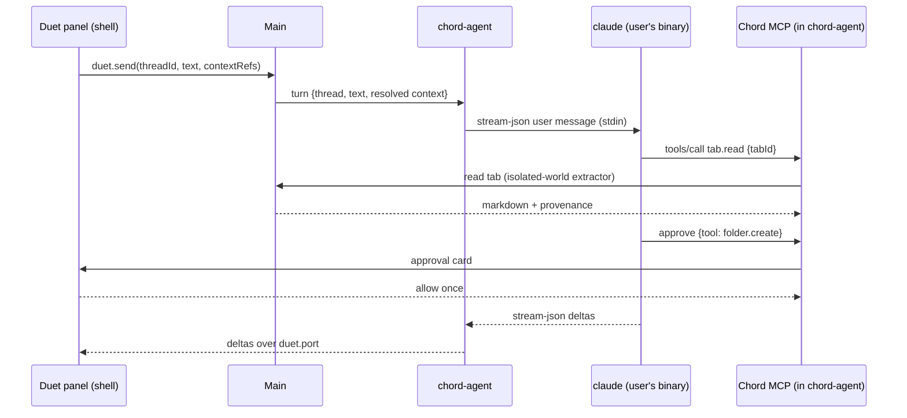

# Chord — Architecture

Status: **draft for review** · Last updated 2026-10-22 · Companion docs: [DESIGN.md](DESIGN.md), ROADMAP.md (next step)

Chord is an open-source (MPL-2.0) desktop browser for people leaving Arc. It keeps the sidebar-first workflow and the delight, with no Chord account, no telemetry, no cloud, and no lock-in. Windows, macOS, and Linux (X11 and Wayland) are equal targets.

Every library, API, and version below was checked on 2026-10-22. Anything not confirmed from a primary source is marked **⚠ unverified** and has a spike or test that settles it. [§16](#16-decisions-needed-from-you) lists the decisions that need your call.

---

## Contents

1. [Scope](#1-scope)
2. [Stack](#2-stack)
3. [Repository layout](#3-repository-layout)
4. [Process model](#4-process-model)
5. [Window composition](#5-window-composition)
6. [State model and data flow](#6-state-model-and-data-flow)
7. [Data schema](#7-data-schema)
8. [IPC contract](#8-ipc-contract)
9. [Browser engine services](#9-browser-engine-services)
10. [Command bar and search](#10-command-bar-and-search)
11. [Duet — the assistant panel](#11-duet--the-assistant-panel)
12. [Extensions](#12-extensions)
13. [Cross-platform abstractions](#13-cross-platform-abstractions)
14. [Security, updates, and the 72-hour patch process](#14-security-updates-and-the-72-hour-patch-process)
15. [Packaging, distribution, CI, testing](#15-packaging-distribution-ci-testing)
16. [Decisions needed from you](#16-decisions-needed-from-you)
17. [Risks](#17-risks)

---

## 1. Scope

**In scope**, in the priority order from the brief: vertical sidebar (pinned and Today tabs), chords with optional per-chord profiles, nestable folders, auto-archive, command bar, split view, mini window plus default-browser registration, Peek, and hidden-chrome mode. Hidden-chrome is now a **fully collapsible sidebar**: every sidebar feature folds away, leaving one Dia-style bar with basic controls and a combined `domain / title` field (DESIGN.md §3.3). Two additions:

- **Duet**, an opt-in right-side assistant panel. It uses your own Claude Code or Codex install ([§11](#11-duet--the-assistant-panel)).
- **Extensions**, needed for password managers ([§12](#12-extensions)).

**Not in v1:** browser-data import (Arc or otherwise; the schema doesn't preclude it later), sync, Boosts, Easels, mobile, background AI of any kind, and a Chord account or server.

**Performance budgets.** These are acceptance criteria, measured as described in [§15.5](#155-testing):

| Budget | Target | How it's measured |
|---|---|---|
| Cold launch to usable window | < 1.5 s on a mid-range machine | `process.hrtime` at main entry → first shell paint with interactive sidebar (`performance.mark` + IPC timestamp) |
| Command bar open | < 50 ms keydown → first painted frame | `before-input-event` timestamp → overlay `requestAnimationFrame` after `open` |
| Command bar keystroke | Results paint in the same frame as the keystroke for in-memory sources; ≤ 16 ms for history and archive | `input` event → next rAF; data-process query time logged |
| New tab ready to type | 0 extra frames: ⌘T opens the command bar, which is always mounted | same as command bar |
| Shell UI frame rate | 120 fps where the display supports it, never < 60 fps | Long Animation Frames API + Chromium trace during scripted interactions |

---

## 2. Stack

| Concern | Choice | Version today | Status / notes |
|---|---|---|---|
| Runtime | **Electron 45** (Chromium 156, Node 24.22, V8 15.6) | 45.0.0, released 2026-10-20 | ✅ Supported lines: 45, 44, 43. Electron 46 stable is expected 2027-01-05. Chrome moved to 2-week releases, so each Electron major now jumps 4 Chromium milestones. |
| Language | TypeScript, strict | **6.0.x** | ✅ TypeScript 7.0.2 (the Go-native compiler) is out, but typescript-eslint 8.72 supports only TS `<6.1`, and TS 7's JS API is still `unstable/*`. We revisit once typescript-eslint supports 7. |
| UI | React 19 + React Compiler 1.0 | Compiler 1.0 stable since 2025-10-07 | ✅ Wired through plugin-react 6's documented `reactCompilerPreset` + `@rolldown/plugin-babel`. Its other route, `compiler: true` on `oxc-transform-react`, is marked experimental in the plugin README, so we don't use it. |
| Build | Vite 8 via **electron-vite 6.0** | 6.0.0, 2026-10-14 | ✅ Works with Electron 45, verified in M1.0, with two adjustments. First, Electron 45 downloads its binary lazily and has no install script, but electron-vite looks for the `path.txt` that download writes; so `apps/desktop` runs `install-electron` on postinstall. Second, a wrapper script clears `ELECTRON_RUN_AS_NODE`, which some Electron-based hosts leak and which makes Electron start as plain Node. Sandboxed preloads are built as one self-contained CJS file each (`isolatedEntries`, no externalized deps). electron-vite has one maintainer; fallback is plain Vite configs. Forge 8's Vite plugin brings Forge's packager, which we don't want. |
| Packaging | **electron-builder 26.18.0** (pinned) | 26.18.0 is on the `v26` dist-tag | ✅ npm's `latest` tag still points at 26.15.3, so pin exact versions. v27 is in alpha. |
| Updates | **electron-updater 6.8.11** + Chord's Ed25519 manifest check | 6.8.11 (`v26` tag) | ✅ Signed manifests are built into v27 alpha only. Until then we verify through a custom provider ([§14.4](#144-auto-updates)). |
| Database | **`node:sqlite`** in a utility process, with FTS5 | Node 24 marks it "Release candidate" (1.2) | ✅ Works in Electron main without flags since 35. FTS5 is compiled in. ⚠ **utilityProcess use is inferred, not documented**; spike S1 settles it. Fallback: better-sqlite3 v13 (N-API, prebuilds bundled). A thin `Db` interface keeps the swap cheap. |
| Motion | **motion** (motion.dev, MIT) | 14.6.0 | ✅ Majors ship fast (13.0 on 2026-08-05, 14.0 on 2026-10-02), so pin. Only the MIT core is used; no Motion+ components. |
| Drag and drop | **@dnd-kit/react** | 0.5.1 (pre-1.0) | ✅ The only option with live "make room" shifting for nested trees. The legacy `@dnd-kit/core` is frozen. Pinned and wrapped behind our `SortableTree` so churn stays contained. |
| Validation | zod | 4.6.7 | ✅ |
| Ordering | fractional-indexing (CC0) | 4.0.0 (ESM-only) | ✅ |
| Fuzzy match | @leeoniya/ufuzzy (MIT) | 1.0.19 | ✅ About 0.15 ms per search over 5k items (extrapolated from the author's benchmark; we'll measure). |
| Icons | lucide-react (ISC) | 1.61.0 | ✅ Phosphor was considered and rejected: no release in 17 months. |
| UI typeface | **Onest** (SIL OFL), variable 100–900, `tnum` | — | ✅ See DESIGN.md §4.2. |
| Extensions | electron-chrome-extensions | 4.9.0 | ⚠ **License is GPL-3.0 or a paid Patron License, enforced at runtime.** Decision D1. |
| Tests | Vitest 5, Playwright `_electron` 1.64 | — | Playwright's Electron support is still experimental. See [§15.5](#155-testing). |
| Lint | ESLint 10 + typescript-eslint 8.72, stylelint 17 | — | — |
| Package manager | pnpm 10 | 10.33 locally | Electron packaging needs the hoisted layout (`nodeLinker: hoisted` in `pnpm-workspace.yaml`). Electron 45 no longer has an install script (verified in its package.json), so pnpm 10's build-script allow-list doesn't apply to it. |

---

## 3. Repository layout

The monorepo exists to enforce boundaries: `@chord/core` cannot import Electron, and renderers cannot import main.

```
chord-browser/
├─ apps/desktop/
│  ├─ src/main/                 Electron main process
│  │  ├─ app/                   lifecycle, single-instance, open-url / second-instance
│  │  ├─ windows/               WindowManager, view composition, materials
│  │  ├─ tabs/                  TabManager: WebContentsView lifecycle, navigation, sleeping
│  │  ├─ sessions/              profiles→partitions, permissions, downloads, certificates
│  │  ├─ store/                 authoritative Store (wraps @chord/core)
│  │  ├─ ipc/                   router + sender validation (one role per preload)
│  │  ├─ shortcuts/             single registry → app menu (macOS) + before-input-event
│  │  ├─ platform/              darwin.ts · win32.ts · linux.ts (see §13)
│  │  ├─ updates/               electron-updater + Ed25519 manifest verification
│  │  └─ duet/                  supervisor for the agent utility process
│  ├─ src/preload/              shell.ts · overlay.ts · popover.ts · internal.ts
│  ├─ src/renderer/
│  │  ├─ shell/                 sidebar, content frame chrome, Duet panel, onboarding
│  │  ├─ overlay/               command bar, Peek chrome, split drop zones
│  │  ├─ popover/               hover previews, permission prompts
│  │  └─ pages/                 chord://settings, chord://archive
│  ├─ src/data/                 "chord-data" utility process: SQLite, search, favicons
│  └─ src/agent/                "chord-agent" utility process: Duet providers + MCP server
├─ packages/
│  ├─ core/                     pure domain model: entities, commands, reducer, policies
│  ├─ ipc/                      channel contract, zod schemas, typed client/server helpers
│  ├─ db/                       schema, migrations, prepared queries
│  ├─ tokens/                   design tokens → CSS vars + TS; chord theme generator
│  └─ ui/                       shared React primitives (Button, Keycap, Favicon, Toast…)
├─ build/                       electron-builder config, NSIS include, entitlements, AppArmor
├─ flatpak/                     Flathub manifest (built from source)
├─ scripts/                     release, manifest signing, Electron release watcher
├─ docs/                        SECURITY-PATCHING.md, decision records, design QA captures
└─ .github/workflows/           ci.yml · release.yml · electron-watch.yml
```

---

## 4. Process model

```mermaid
flowchart LR
  subgraph Main["Main process (Node, privileged)"]
    Store[(Store<br/>@chord/core)]
    WM[WindowManager]
    TM[TabManager]
    SM[Sessions / Permissions / Downloads]
    SR[ShortcutRouter]
    UP[Updater]
  end
  subgraph Data["chord-data utilityProcess"]
    DB[(SQLite + FTS5)]
  end
  subgraph Agent["chord-agent utilityProcess (only if Duet enabled)"]
    MCP[Chord MCP server<br/>127.0.0.1, token]
    PA[Provider adapters]
  end
  PA -- stdio --> CC[[user's own `claude` CLI]]
  PA -- stdio JSON-RPC --> CX[[user's own `codex app-server`]]
  CC -- HTTP --> MCP
  CX -- HTTP --> MCP
  Shell[Shell renderer<br/>sidebar · Duet panel] <-- invoke + patches --> Main
  Overlay[Overlay renderer<br/>command bar · Peek chrome] <-- invoke --> Main
  Overlay <-- MessagePort --> Data
  Shell <-- MessagePort --> Agent
  Main <-- MessagePort --> Data
  Main <-- MessagePort --> Agent
  Web[Web content renderers<br/>sandboxed, no preload] -. CDP/events only .- TM
```

| Process | Responsibilities | Why it's separate |
|---|---|---|
| **Main** | Lifecycle, windows, WebContentsView creation and placement, sessions and profiles, navigation policy, permissions, downloads, shortcuts, menus, default browser, updates. Holds the **authoritative in-memory Store**. | Owns every native object. It is never allowed to block: no SQLite, no search, no LLM I/O. |
| **chord-data** (utilityProcess) | SQLite connection (WAL), migrations, write-behind persistence, history, archive, FTS5 search, favicon cache, backups. | Synchronous SQLite stays off main. A crash here doesn't take down windows: main buffers writes and respawns it. |
| **chord-agent** (utilityProcess, lazy) | Duet: spawns the user's provider CLIs, hosts the Chord MCP server, streams turns. | Isolates third-party CLIs and network I/O. It is **never spawned** unless Duet is enabled, and is killed after 10 minutes idle. |
| **Shell renderer** (1 per window) | React UI: sidebar, content-frame shadows and placeholders, Win/Linux top strip, Duet panel, toasts, onboarding. | Our trusted UI, still sandboxed. |
| **Overlay renderer** (1 per window, pre-warmed) | Command bar, Peek frame chrome, split-view drop zones. | Must paint above web content ([§5](#5-window-composition)). Kept mounted and hidden so it opens in < 50 ms. |
| **Popover renderer** (1 per window, pre-warmed) | Hover previews, permission prompts. Its bounds are sized to the card. | Electron views can't pass clicks through (see [§5](#5-window-composition)), so popovers must not cover the sidebar. |
| **Web content** | One WebContentsView per live tab; Chromium site isolation decides the processes. | `sandbox`, `contextIsolation`, no `nodeIntegration`, **no preload**, no `webviewTag`. |
| **Internal pages** (`chord://settings`, `chord://archive`) | Settings is its own window (⌘, / Ctrl+,), one at a time: the preferences convention on every OS, and it keeps a privileged page out of browsing tabs entirely. The archive renders as a normal tab. | Narrow `internal.ts` preload, separate in-memory `chord-ui` session. Settings sees settings and one chord's theme, never tabs or history. |

All Chord UI views use one in-memory session, `chord-ui`. The `chord://` and `chord-favicon://` protocols are registered **only on that session**, so web pages can't reach them (this also prevents history-sniffing through favicons).

---

## 5. Window composition

Each window is a `BaseWindow` whose `contentView` holds views in this z-order, bottom to top:

```
┌─ BaseWindow (material: vibrancy / Mica / solid) ───────────────────────────┐
│ 1. shellView      full window, transparent bg: sidebar, frame shadow,      │
│                   top strip (Win/Linux), Duet panel, toasts                │
│ 2. tabViews       active tab (or 2–4 split panes) at the content-frame     │
│                   rect, setBorderRadius(frame radius); background tabs     │
│                   are removed from the tree but stay alive                 │
│ 3. popoverView    hidden; when shown, bounds = card rect only              │
│ 4. overlayView    hidden; when shown, full window (command bar is modal)   │
│ 5. peekView       Peek's page, placed above the overlay's scrim + chrome   │
└────────────────────────────────────────────────────────────────────────────┘
```

Verified constraints and how they shape this:

- **No per-view mouse pass-through.** A transparent region of a view still swallows clicks. Electron #23863 is open; PR #53841 `View.setInteractive(false)` is open. So the overlay view covers the window only for modal moments: the command bar and Peek, where clicking outside closes them. Hover previews live in a separate popover view sized to the card so the sidebar keeps receiving hover events. If #53841 lands, the two collapse into one view.
- `View.setBorderRadius` (Electron 33+) takes one radius for all corners, and the cut-out corners still capture clicks. That's acceptable: the shell draws the frame's hairline and shadow beneath it. Per-corner radii are PR #51472, still open.
- `WebContentsView` starts with a **white** background. Chord views call `setBackgroundColor('#00000000')`. Each tab view starts with the page's last-known background color to avoid white flashes in dark mode.
- `View.setBackgroundBlur` (43+) blurs what is behind a view inside the window. ⚠ Whether it blurs a tab view under the overlay view convincingly is **unverified**; spike S4. Without it the command bar uses a dim scrim and no blur (DESIGN.md §6.3).
- **Layout sync.** The shell renderer owns layout. It measures the content-frame placeholder with a `ResizeObserver` and posts rects over a dedicated `MessagePort`, coalesced to one per animation frame. Main calls `setBounds`. Expect about one frame of lag during sidebar-resize drags; the placeholder is painted in the page's background color to hide it.
- **Animating the frame size** (Duet panel open/close, sidebar dock/undock) never calls `setBounds` per frame, because each call relayouts the page. Instead we capture the page with `capturePage()` (cached when the tab was last shown), animate the bitmap in the shell, then set the final bounds once and swap. Split-view divider drags do resize live, as Chrome does.
- **Minimal mode (sidebar collapsed)** needs no extra view.
  - The 40 px bar is part of the shell view and lies above the frame rect, so no tab view ever covers it.
  - Collapsing changes the frame rect; the change is animated with the snapshot technique below.
- **Sidebar peek in minimal mode** reorders views rather than adding one.
  - The shell view moves *above* the tab views, with its bounds shrunk to a 6 px hot strip at the left edge (plus the bar).
  - On hover-intent its bounds grow to the sidebar rect, and CSS slides the sidebar in over the page.
  - When the peek ends, the bounds shrink back.
  - The cost is that the page's leftmost 6 px don't receive clicks while peek-on-hover is enabled.
  - The peek setting can be turned off.
- **Closing a tab really releases it.** `removeChildView` alone does not free the renderer; `webContents.close()` does. The `WebContentsView.destroy()` request (#42884) was closed without explanation on 2026-09-25.

---

## 6. State model and data flow

### 6.1 One reducer, used on both sides

`@chord/core` is pure TypeScript (no Electron, no DOM). It defines:

- **Entities:** `Profile`, `Chord`, `Node` (folder | tab | split), `WindowState`, `ArchiveItem`, `Settings`.
- **Commands:** a discriminated union describing user intent.
- **`apply(state, command, ctx) → { state, patches, inverse, effects }`**, built on Immer's `produceWithPatches`.
- **Policies:** auto-archive eligibility, ordering (fractional ranks), the profile-boundary rule for moving tabs across chords, and frecency.

```ts
type Command =
  | { t: 'tab.open'; chordId: ChordId; url: string; at?: Position; activate?: boolean }
  | { t: 'tab.activate'; nodeId: NodeId }
  | { t: 'tab.close'; nodeId: NodeId }          // pinned → unload; today → archive('closed')
  | { t: 'tab.pin'; nodeId: NodeId; at: Position }
  | { t: 'tab.unpin'; nodeId: NodeId; at?: Position }
  | { t: 'tab.resetToPinned'; nodeId: NodeId }
  | { t: 'node.move'; nodeId: NodeId; to: Position }   // Position = {chordId, section, parentId, rank}
  | { t: 'folder.create' | 'folder.rename' | 'folder.toggle' | 'folder.delete'; /* … */ }
  | { t: 'chord.create' | 'chord.update' | 'chord.delete' | 'chord.reorder'; /* … */ }
  | { t: 'chord.activate'; windowId: WindowId; chordId: ChordId }
  | { t: 'today.clear'; chordId: ChordId }
  | { t: 'archive.restore'; archiveId: ArchiveId }
  | { t: 'split.create' | 'split.resize' | 'split.dissolve'; /* … */ }
  | { t: 'undo'; token: UndoToken };

type Effect =
  | { e: 'view.create' | 'view.destroy' | 'view.attach' | 'view.detach'; nodeId: NodeId }
  | { e: 'navigate'; nodeId: NodeId; url: string }
  | { e: 'persist'; ops: PersistOp[] }
  | { e: 'toast'; undo: UndoToken; copy: ToastCopy };
```

### 6.2 Flow

1. The renderer dispatches a `Command`. For drag-and-drop and other latency-sensitive actions, it **applies the same reducer locally first** (optimistic). Because the reducer is shared and deterministic, the optimistic state equals the authoritative one, so nothing flickers.
2. Main validates the command (zod plus semantic checks), applies it, runs the effects (view lifecycle, navigation), bumps `version`, and broadcasts `{version, patches}` to every Chord renderer.
3. Renderers apply the patches. On a version gap they request a fresh snapshot.
4. `persist` effects go to chord-data. Writes are coalesced and committed every 250 ms or when idle, flushed on quit (2-second cap), and written in WAL mode. Worst case on a hard crash is about 250 ms of sidebar edits lost. Navigation state is persisted on each committed navigation, coalesced per tab.

Live-only fields are never persisted: loading, audible, crashed, the attached-view handle, the capture cache.

### 6.3 Undo

Every destructive command returns inverse patches plus an `UndoToken`. A toast holds the token for 6 s (paused while hovered); undo replays the inverse. Behind the toast, data is also soft-retained:

- Closed Today tabs go to the archive (`reason='closed'`) with their navigation history, which `webContents.navigationHistory.restore()` brings back ✅.
- Deleted folders and chords are soft-deleted (`deleted_at`) and kept 30 days. They can be restored from Settings → Recently deleted.
- Reopen-closed-tab (⌘⇧T) walks the same archive.

---

## 7. Data schema

**Files:** `<userData>/chord.db` plus `-wal`/`-shm`. Thumbnails for hover previews are files under `<userData>/Captures/` (WebP), not blobs. Chromium's own data (cookies, cache) lives under `<userData>/Partitions/<profile>`.

| OS | `userData` |
|---|---|
| macOS | `~/Library/Application Support/Chord` (Electron default) |
| Windows | `%LOCALAPPDATA%\Chord\User Data`, set via `app.setPath` before ready. Browsers don't roam multi-GB profiles, which is why Electron's `%APPDATA%` default is wrong here. Chrome uses the same location. |
| Linux | `$XDG_CONFIG_HOME/Chord` (default `~/.config/Chord`) |

**Conventions:**
- IDs are UUIDv7 `TEXT`.
- Times are `INTEGER` Unix ms, UTC.
- Order is a fractional-index `TEXT rank`, so a drag-and-drop move is one row update.
- All tables are `STRICT`.
- JSON columns are validated by zod at the boundary.
- Pragmas: `journal_mode=WAL`, `synchronous=NORMAL`, `foreign_keys=ON`.

```sql
CREATE TABLE profile (
  id TEXT PRIMARY KEY, name TEXT NOT NULL,
  partition TEXT NOT NULL UNIQUE,              -- 'persist:default' | 'persist:p-<id>'
  is_default INTEGER NOT NULL DEFAULT 0, created_at INTEGER NOT NULL
) STRICT;

CREATE TABLE chord (
  id TEXT PRIMARY KEY, profile_id TEXT NOT NULL REFERENCES profile(id),
  name TEXT NOT NULL,
  icon TEXT NOT NULL,                          -- {kind:'emoji'|'symbol'|'letter', value}
  theme TEXT NOT NULL,                         -- ChordTheme {stops[1..3], grain, appearance}
  rank TEXT NOT NULL,
  duet_enabled INTEGER NOT NULL DEFAULT 1,     -- per-chord opt-out (global switch in settings)
  created_at INTEGER NOT NULL, updated_at INTEGER NOT NULL, deleted_at INTEGER
) STRICT;

-- The sidebar tree. Folders only in 'pinned'; splits in either section; tabs anywhere.
CREATE TABLE node (
  id TEXT PRIMARY KEY, chord_id TEXT NOT NULL REFERENCES chord(id),
  parent_id TEXT REFERENCES node(id),          -- NULL = section root
  section TEXT NOT NULL CHECK (section IN ('pinned','today')),
  kind TEXT NOT NULL CHECK (kind IN ('folder','tab','split')),
  rank TEXT NOT NULL,
  created_at INTEGER NOT NULL, updated_at INTEGER NOT NULL, deleted_at INTEGER
) STRICT;
CREATE INDEX node_children ON node(chord_id, section, parent_id, rank) WHERE deleted_at IS NULL;

CREATE TABLE folder (
  node_id TEXT PRIMARY KEY REFERENCES node(id),
  title TEXT NOT NULL, collapsed INTEGER NOT NULL DEFAULT 0
) STRICT;

CREATE TABLE tab (
  node_id TEXT PRIMARY KEY REFERENCES node(id),
  pinned_url TEXT,                             -- the pinned "home" URL; NULL for Today tabs
  custom_title TEXT,
  url TEXT NOT NULL, title TEXT NOT NULL DEFAULT '',
  favicon_key TEXT,
  nav_state BLOB,                              -- navigationHistory entries + index (for restore)
  last_active_at INTEGER NOT NULL,             -- drives auto-archive
  muted INTEGER NOT NULL DEFAULT 0, zoom REAL
) STRICT;

CREATE TABLE split (
  node_id TEXT PRIMARY KEY REFERENCES node(id),
  layout TEXT NOT NULL                         -- {dir:'row'|'column', sizes:number[]}; children = tab nodes
) STRICT;

CREATE TABLE window_state (
  id TEXT PRIMARY KEY,
  bounds TEXT NOT NULL,                        -- {x,y,w,h,displayId,maximized,fullscreen}
  active_chord_id TEXT REFERENCES chord(id),
  sidebar_width INTEGER NOT NULL,
  sidebar_mode TEXT NOT NULL DEFAULT 'docked' CHECK (sidebar_mode IN ('docked','collapsed')),
  duet_width INTEGER,                          -- NULL = panel closed
  active_tab_by_chord TEXT NOT NULL DEFAULT '{}'
) STRICT;

CREATE TABLE archive_item (
  id TEXT PRIMARY KEY, chord_id TEXT NOT NULL, url TEXT NOT NULL, title TEXT NOT NULL,
  favicon_key TEXT, nav_state BLOB,
  reason TEXT NOT NULL CHECK (reason IN ('auto','closed','cleared','folder-deleted','chord-deleted')),
  archived_at INTEGER NOT NULL, restored_at INTEGER
) STRICT;
CREATE INDEX archive_recent ON archive_item(archived_at DESC);

CREATE TABLE history_url (
  id INTEGER PRIMARY KEY, profile_id TEXT NOT NULL REFERENCES profile(id),
  url TEXT NOT NULL, title TEXT NOT NULL DEFAULT '',
  visit_count INTEGER NOT NULL DEFAULT 0, typed_count INTEGER NOT NULL DEFAULT 0,
  last_visit_at INTEGER NOT NULL, frecency REAL NOT NULL DEFAULT 0,
  UNIQUE (profile_id, url)
) STRICT;
CREATE TABLE history_visit (
  id INTEGER PRIMARY KEY, url_id INTEGER NOT NULL REFERENCES history_url(id) ON DELETE CASCADE,
  visited_at INTEGER NOT NULL, transition TEXT NOT NULL
) STRICT;

-- One FTS index for history, archive, pinned tabs and Duet thread titles; triggers keep it in sync.
CREATE VIRTUAL TABLE search_fts USING fts5(
  title, url, kind UNINDEXED, ref UNINDEXED, profile_id UNINDEXED,
  tokenize = 'unicode61 remove_diacritics 2', prefix = '2 3 4'
);

CREATE TABLE favicon (
  key TEXT PRIMARY KEY,                        -- sha256(icon URL)
  icon_url TEXT, data BLOB NOT NULL, mime TEXT NOT NULL,
  dominant_color TEXT, fetched_at INTEGER NOT NULL
) STRICT;

CREATE TABLE site_permission (
  profile_id TEXT NOT NULL, origin TEXT NOT NULL, permission TEXT NOT NULL,
  decision TEXT NOT NULL CHECK (decision IN ('allow','deny')), updated_at INTEGER NOT NULL,
  PRIMARY KEY (profile_id, origin, permission)
) STRICT;

CREATE TABLE download (
  id TEXT PRIMARY KEY, profile_id TEXT NOT NULL, url TEXT NOT NULL, path TEXT NOT NULL,
  state TEXT NOT NULL, received INTEGER, total INTEGER, started_at INTEGER NOT NULL, ended_at INTEGER
) STRICT;

CREATE TABLE setting (key TEXT PRIMARY KEY, value TEXT NOT NULL) STRICT;   -- zod schema per key

-- Duet (§11)
CREATE TABLE duet_thread (
  id TEXT PRIMARY KEY, chord_id TEXT REFERENCES chord(id),
  provider TEXT NOT NULL,                      -- 'claude-code' | 'codex' | later: 'anthropic-api' | 'openai-api' | 'local'
  model TEXT, provider_session_id TEXT,        -- for resume
  mode TEXT NOT NULL DEFAULT 'browse' CHECK (mode IN ('browse','developer')),
  project_dir TEXT,                            -- developer mode only
  title TEXT NOT NULL DEFAULT '',
  created_at INTEGER NOT NULL, updated_at INTEGER NOT NULL, deleted_at INTEGER
) STRICT;
CREATE TABLE duet_message (
  id TEXT PRIMARY KEY, thread_id TEXT NOT NULL REFERENCES duet_thread(id) ON DELETE CASCADE,
  role TEXT NOT NULL CHECK (role IN ('user','assistant','tool','approval')),
  body TEXT NOT NULL,                          -- JSON blocks: text, citations, tool calls, context refs
  created_at INTEGER NOT NULL
) STRICT;
CREATE TABLE duet_site_rule (
  origin TEXT PRIMARY KEY, rule TEXT NOT NULL CHECK (rule IN ('never','ask'))
) STRICT;
```

**Migrations** are forward-only numbered SQL files, each run in a transaction. Before every migration, and as a daily rolling copy (keep 3), we take a backup with `VACUUM INTO`. A failed migration restores the backup and opens in a read-only "something went wrong" state rather than losing data.

**Profiles.** Chords share the default profile unless "Keep sign-ins separate" is on. That creates a profile with its own persistent partition: cookies, storage, cache, extensions. Moving a tab to a chord with a **different profile** recreates it in the target session and reloads it, because a WebContents can't change session. The UI says so before the drop completes.

**Auto-archive.** A main-process timer runs every 5 minutes and on `powerMonitor` `resume`. It archives Today tabs whose `last_active_at` is older than the chord's threshold (12 h by default; 24 h, 7 d, 30 d, or never). It skips tabs that are audible, visible in any window, part of a split, or playing media. Archived items are kept 30 days by default.

---

## 8. IPC contract

**Principles:**

1. **One preload per trust role:** shell, overlay, popover, internal. Each exposes a frozen `window.chord` object through `contextBridge` with explicit methods. Raw `ipcRenderer` is never exposed.
2. **Every channel is declared once** in `@chord/ipc/contract.ts`: name, allowed roles, zod request and response schemas. Both sides import the same contract, so types and runtime validation can't drift.
3. **Main checks the sender on every message.** `event.sender.id` must be registered under an allowed role, `event.senderFrame` must be the main frame, and `senderFrame.url` must be the expected `chord://<surface>` origin. Unknown channels are dropped and logged; payloads over 256 KB are rejected. Large data (attachments, screenshots) moves by reference ID, never inline.
4. **Web content gets nothing:** no preload, no IPC. Extension pages get only what electron-chrome-extensions injects ([§12](#12-extensions)).
5. **Electron 45 constraint:** sandboxed preloads no longer have the `events`, `timers`, `url`, or `Buffer` modules, so preloads are written against browser APIs only.

**Transports:**

| Kind | Transport | Examples |
|---|---|---|
| Commands and queries | `ipcRenderer.invoke` → `ipcMain.handle` | `cmd.dispatch`, `settings.get` |
| State fan-out | `webContents.send('state.patch', {version, patches})` | sidebar updates |
| High-frequency streams | `MessagePort`. Main creates a `MessageChannelMain` and hands one end to a utility process and the other to the renderer's preload. Ports arrive in the isolated world and are wrapped there; they are not forwarded to the main world. | layout rects (shell→main), search (overlay↔data), Duet stream (agent↔shell) |

**Channels, by role:**

| Channel | shell | overlay | popover | internal | Notes |
|---|:-:|:-:|:-:|:-:|---|
| `state.snapshot` / `state.patch` | ✓ | ✓ | ✓ (subset) | — | |
| `cmd.dispatch(Command)` | ✓ | ✓ (open/activate/actions subset) | — | ✓ (archive/space subset) | |
| `layout.port` | ✓ | — | — | — | frame rects, Duet width |
| `nav.back/forward/reload/stop` | ✓ | ✓ | — | — | |
| `search.port` | — | ✓ | — | ✓ (archive page) | direct to chord-data |
| `system.info` | ✓ | ✓ | ✓ | ✓ | platform, accent, reduced motion and transparency, forced colors, window-controls geometry |
| `overlay.open/close` | ✓ | ✓ | — | — | |
| `permission.respond` | — | — | ✓ | — | |
| `settings.get/set` | read | read | — | ✓ | |
| `defaultBrowser.status/request` | ✓ (onboarding) | — | — | ✓ | |
| `updates.status/check/install` | — | — | — | ✓ | |
| `duet.port` / `duet.approve` / `duet.attach` | ✓ | — | — | — | absent if Duet is off |
| `duet.settings.*` | — | — | — | ✓ | |

Navigation guards: every Chord UI view rejects `will-navigate`, `will-frame-navigate`, and `setWindowOpenHandler` for anything other than its own `chord://` URL. Web content can never navigate to `chord://` or `chord-favicon://`, and isn't served them anyway (separate session, [§4](#4-process-model)).

---

## 9. Browser engine services

| Service | Approach |
|---|---|
| **Tabs** | TabManager owns `nodeId → WebContentsView`. Views are created lazily: on restart only the active tab of each window loads. Others load on activation (pinned tabs show their cached favicon and title until then). |
| **Sleeping tabs** | Electron has no Chromium tab discarding. Tabs hidden for more than 60 minutes (configurable) get their `nav_state` saved and `webContents.close()` called. Activation restores them with `navigationHistory.restore()` ✅. **Never slept or auto-archived** (rule borrowed from Crest): tabs that are playing media, in picture-in-picture, sharing the screen or camera, being used by an agent, or holding a pending `beforeunload`. |
| **Popups / OAuth** | `setWindowOpenHandler`: a plain `target=_blank` becomes a new Today tab (or Peek, for links from pinned tabs, later). `window.open` with features, as OAuth and payment popups use, gets a real child popup window so `window.opener` keeps working. |
| **Navigation events** | `did-navigate`, `page-title-updated`, `page-favicon-updated`, loading and audible changes are coalesced per tab (≤ 1 update per 50 ms) into store commands. History visits go to chord-data. |
| **Favicons** | Fetched through the tab's own session (`session.fetch`, so partition cookies apply), size-capped at 64 KB, sanitized (SVG rasterized to PNG in a sandboxed context), and stored by key. The shell loads them via `chord-favicon://<key>`. Fallback monograms are generated client-side (DESIGN.md §7.4). |
| **Permissions** | `setPermissionRequestHandler` and `setPermissionCheckHandler` on every profile session. Sensitive permissions (camera, mic, geolocation, notifications, display-capture, clipboard-read, MIDI-sysex) prompt in the popover. Decisions persist per profile and origin. Everything else is denied by default. **Electron 45 routes screen capture through `display-capture`**, and a picker is provided via `setDisplayMediaRequestHandler`. |
| **Downloads** | `will-download` → default Downloads folder → a progress popover from the sidebar footer. |
| **Certificates** | `certificate-error` → full-page interstitial in the tab with "Go back" as the primary action. There is no bypass for HSTS hosts. |
| **Find in page** | `webContents.findInPage`, with a small find bar in the overlay anchored to the frame's top-right. |
| **Fullscreen** | `enter-html-full-screen` hides the shell chrome and gives the tab view the full window bounds. |
| **Crashes** | `render-process-gone` reloads the page automatically, at most twice per tab (Crest's rule). After that the frame shows a friendly "This page stopped" state with Reload. |
| **Auto picture-in-picture** | When you leave a tab whose video is playing (switch tab or chord, or collapse into another page), the video pops out into a floating player, like Dia. **Mechanism:**<br>1. TabManager attaches the incoming tab's view *on top* immediately, so the switch is never delayed.<br>2. In the outgoing tab's isolated world, `executeJavaScript(…, userGesture = true)` calls `requestPictureInPicture()` on the largest playing, visible `<video>`. `userGesture` lifts the user-activation requirement (Electron docs).<br>3. The outgoing view detaches when that promise settles, or after 300 ms.<br>4. Returning to the tab calls `document.exitPictureInPicture()`, so the video continues inline.<br>**Why Chord does it itself:** Chrome's auto-PiP (Chrome 134+, browser-initiated behind a flag from 142) lives in Chrome's browser layer, which Electron doesn't ship.<br>**The floating window** is Chromium's own video PiP window, the same one Chrome and Dia show. Its hover controls (back to tab, origin, close, play/pause, the site's Media Session seek/track buttons, progress bar) come with the engine. ✅ Electron builds video PiP unconditionally (flag removed in PR #38620; PiP fixes as recent as PR #54612).<br>⚠ **Unverified (spike S7):** exactly which controls Electron 45's PiP window shows, and whether *back to tab* reaches Chord through `WebContents` activation. Chord can't restyle that window; a custom player would need Document Picture-in-Picture, which Electron doesn't support (#39633).<br>**Skipped when:** the video is muted and never audible; it's smaller than 200×112; it has `disablePictureInPicture`; another PiP is already open; or the site is on the user's "don't pop out" list.<br>On Wayland the compositor places the PiP window. |
| **Context menus** | Native `Menu.popup()` built from the `context-menu` params. This is platform-correct, accessible, and avoids overlay z-order problems. |
| **Internal pages** | `chord://settings` and `chord://archive` are served by `protocol.handle` from inside the asar, with CSP `default-src 'self'; img-src 'self' chord-favicon:; style-src 'self'; script-src 'self'`. React sets styles through the CSSOM, so no `'unsafe-inline'` is needed. |
| **Search engine** | **Google by default** (decided 2026-10-22); DuckDuckGo, Bing, Kagi, Ecosia and custom engines selectable in Settings and from the command bar. Search suggestions while typing send keystrokes to the engine; their default is open question Q2 in ROADMAP.md. |
| **User agent** | **Decided (S2):** the standard Chromium user agent, Electron's default minus the `Electron/…` and app-name tokens (`src/main/user-agent.ts`). Client-hint brands still say `Chromium`, so we don't claim to be Google Chrome. ✅ Google sign-in works by hand on Windows with this UA, and also with Electron's default. Automated (Playwright) sign-in is always blocked, because Google flags debugger-driven browsers. ⚠ Still to check by hand: Microsoft, Apple, GitHub, Cloudflare Turnstile, and Google on macOS/Linux. Electron sends no `Sec-CH-UA` on navigations (PR #53519). See docs/decisions/S2-google-signin.md. |
| **Private windows** | Non-persistent partition, no history writes, no extensions (the library doesn't support in-memory sessions), Duet unavailable. |
| **`session.webRequest`** | **Chord core does not use it.** Hooking it silently stops extensions' `chrome.webRequest` listeners from firing (electron-chrome-extensions README; also seen in Flow Browser #153). Header and policy needs go through other hooks. This constrains the built-in ad-blocker option in [§12](#12-extensions). |

---

## 10. Command bar and search

The command bar is the overlay renderer, **always mounted and hidden**:

1. ⌘T / Ctrl+T reaches main through `before-input-event` (from any focused view) or the app menu (macOS).
2. Main calls `overlayView.setVisible(true)`, focuses its webContents, and posts `open {mode, prefill}`. No React mount and no layout work happen at open time. Target: first frame under 16 ms, well inside the 50 ms budget.
3. ⌘L opens it pre-filled with the current URL, selected.

**Sources and latency per keystroke:**

| Source | Where it lives | Latency |
|---|---|---|
| Open tabs (all chords), pinned tabs, folders, chords | In-memory index in the overlay, updated from state patches | uFuzzy, about 0.15 ms per 5k items ⇒ painted the same frame |
| Actions ("New chord", "Pin this tab", "Copy URL", "Archive Today", "Split with…") | Static registry in the overlay | same frame |
| History, archive, Duet threads | chord-data FTS5 prefix query, `LIMIT 20`, ranked by `bm25 × frecency`, over the overlay's direct `MessagePort` | target ≤ 5 ms p95; merges in without reflowing rows above it |
| Inline URL autocompletion | Top host match from history (typed_count-weighted) | same frame |
| Web search row | Always last ("Search for “…”"); first if nothing else matches strongly | same frame |

Each query carries a sequence number; stale responses are dropped. The in-memory index is trimmed to what search needs (title, URL, chord, kind, favicon key).

---

## 11. Duet — the assistant panel

Duet is an **opt-in** right-side panel for chatting about what's in the browser. It uses the user's **own** Claude Code or Codex installation and subscription. Chord runs no server, never sees credentials, and spawns nothing until Duet is turned on.

### 11.1 Provider policy constraints (verified 2026-10-22)

**Anthropic** ([Claude Code legal and compliance](https://code.claude.com/docs/en/legal-and-compliance)):
- Third-party developers may not offer Claude.ai login, route requests through Free, Pro or Max credentials on users' behalf, or "collect, store, or intermediate Claude.ai credentials or session tokens".
- Products using the Agent SDK should use API keys.
- The page does **not** prevent "an end user from signing in to the unmodified Claude Code binary with their own Claude subscription".
- Running Claude Code in a product requires the Commercial Terms and that the binary be unmodified, with its authentication methods unrestricted.

**OpenAI:** `codex app-server` is the documented interface for rich clients (JSON-RPC 2.0, JSONL over stdio), and sign-in runs inside Codex. ⚠ **No published policy for third-party clients using ChatGPT subscriptions was found.**

**Design consequences:**

| Rule | How Chord complies |
|---|---|
| Use the user's unmodified binary | Chord **does not bundle** `claude` or `codex`. It detects them on `PATH` and the standard install locations and shows "Install Claude Code" / "Install Codex" links to the official instructions. |
| Sign-in completes through the provider's own flow | Chord has **no sign-in UI**. "Sign in" opens a terminal running `claude auth login` or `codex login`, or shows the command to run. Status comes from `claude auth status` (JSON; exit code 0 when logged in) and Codex's equivalent. |
| No credential handling | Chord never reads `~/.claude` or `~/.codex` credentials, never sets token environment variables in subscription mode, and never logs CLI auth output. |
| No Anthropic/OpenAI branding as our feature name | The feature is **Duet**. Copy says "works with your Claude Code or Codex app" in plain text, with no logos. |
| Avoid needing Electron as Node | We spawn the user's native `claude` binary directly, not the Agent SDK's bundled `cli.js` via `process.execPath`. The latter would require the `RunAsNode` fuse, which we disable ([§14.1](#141-hardening)). |
| Setup is the user's own step | Decided 2026-10-22: no provider agreement is sought. The user installs and signs in to their own CLI (`claude auth login` / `codex login`), the same model T3 Code uses: it drives `@anthropic-ai/claude-agent-sdk` and `codex app-server` (checked in its repo). Anthropic says it may enforce its terms "without prior notice", so R8 tracks policy changes, and the BYO-key and local-model backstops stay on the roadmap. |

A later phase adds **your own API key** (Anthropic or OpenAI APIs, stored with `safeStorage` async) and **local models** (any OpenAI-compatible local endpoint, such as Ollama or LM Studio). That keeps Duet working even if subscription access changes.

### 11.2 Runtime



**Claude Code adapter.** One long-lived `claude` process per active thread:

```
claude -p --input-format stream-json --output-format stream-json --verbose
       --include-partial-messages
       --session-id <uuid> | --resume <provider_session_id>
       --model <alias>
       --strict-mcp-config --mcp-config <inline JSON: chord MCP at 127.0.0.1:<port>, bearer token>
       --permission-prompt-tool mcp__chord__approve
       --append-system-prompt-file <duet-browse.md>
       # browse mode only:
       --restricted --tools ""
```

All flags were verified against the CLI reference on 2026-10-22.
- `--tools ""` removes every built-in tool (Bash, file edits, WebFetch), so a browse thread can only call Chord's MCP tools.
- `--restricted` (CLI v2.1.248+) loads only managed settings and `--settings`, isolating browse threads from the user's coding hooks and plugins.
- Chord enforces a minimum CLI version and asks the user to run `claude update` if theirs is older.

**Codex adapter.** One `codex app-server` per agent process: JSON-RPC over stdio, `initialize` with `clientInfo.name = "chord"`, then threads and turns. Chord's tools are offered via the same localhost MCP server, configured through config overrides, or via `dynamicTools` on `thread/start` (marked experimental).
- ⚠ **Unverified:** how to remove Codex's shell tool for browse mode.
- Until spike S5 settles it, Codex browse threads run with a read-only `sandboxPolicy` and an approval policy that sends every command to Chord's approval UI.

**Chord MCP server:**
- Streamable HTTP bound to `127.0.0.1` on a random port.
- A per-process bearer token, checked for `Host`/`Origin` to block DNS rebinding.
- Lives only as long as chord-agent.

### 11.3 Tools, in permission tiers

| Tier | Tools | Approval |
|---|---|---|
| 0 · Context | `tabs.list` (current chord; other chords only if the user allows), `tab.read` (attached or user-allowed tabs; markdown or text; ranged), `tab.screenshot`, `history.search`, `archive.search`, `page.highlight(tabId, quote)` (scrolls to the quote and marks it) | None, but scoped to what the user attached or allowed |
| 1 · Organize | `tab.open` (Peek or Today), `folder.create`, `node.move`, `tab.archive`, `space.create` | Approval card per call; "Allow for this thread" available |
| 2 · Act on pages (later) | click, type, fill | Approval per action, always. Disabled on excluded sites. |
| Developer mode | `devtools.console`, `devtools.network` (CDP via `webContents.debugger`, only for tabs the user attaches), `tab.reload`; plus the provider's normal file and shell tools in the chosen project folder | Provider's own permission flow, routed to Chord's approval UI |

### 11.4 Content extraction and prompt-injection posture

Page content is **untrusted input** handed to an agent that may hold tools.

- **Extraction:**
  - Readability plus HTML→Markdown, run in an **isolated world** (`executeJavaScriptInIsolatedWorld`) so page scripts can't tamper with the extractor.
  - It reads rendered text only: never form-field values, never `input[type=password]`, and not hidden or `aria-hidden` subtrees.
  - Capped at 100k characters, with ranged reads.
- **Provenance and delimiting:** every chunk is wrapped with its source (tab, URL, retrieved time). The Duet system prompt states that page content is data, never instructions.
- **Capability containment:**
  - Browse threads have no shell, no files, no fetch.
  - Tier 1 and 2 tools need approval.
  - `tab.open` to a URL that did not come from the user's own context needs approval even when the thread allows "organize". This closes the exfiltrate-via-URL path.
- **Exclusions:**
  - Private windows and `duet_site_rule = 'never'` origins can never be read.
  - Pages with a focused password field are skipped.
  - Each chord has a Duet off switch.
  - The **global off** removes the panel, menus, and shortcut, and chord-agent is never spawned.
- **Visibility:**
  - Context chips show exactly what will be sent with each message.
  - Tool activity is shown inline.
  - A dot on the tab marks one that Duet is watching (console/network) in developer mode.
- **Nothing in the background.** Duet only acts on a user message.

**Connect an agent (from Crest, Phase 2+).** The Chord MCP server is also offered to agents the user runs themselves. Settings → Agents copies a `claude mcp add …` or `codex mcp add …` line that points at a small `chord-mcp` stdio helper:
- **Helper:** a Node single-executable build, or Go/Rust if size matters. It can't be Electron as Node, because the RunAsNode fuse is off.
- **Transport:** a named pipe on Windows and a 0600 Unix socket elsewhere.
- **Tool names** follow chrome-devtools-mcp, which agents already know, and carry read-only/destructive hints that map onto §11.3's tiers.
- **Visibility:** every tab an agent touches gets a badge, a colored outline and a **Stop** button.

Duet becomes one client of that same server. Unlike Crest, Duet keeps per-call approvals, because it reads pages that may carry prompt injection.

**Storage.** Chord keeps its own rendering transcript in `duet_message`. Providers also keep their own local transcripts (Claude under `~/.claude/projects`, Codex under `~/.codex/sessions`); that is disclosed in settings.

---

## 12. Extensions

Verified state of the art:

- **Electron's built-in support** (`session.extensions.loadExtension`, moved in 36) covers only `devtools.*`, `scripting`, `webRequest`, partial `extension`/`management`/`runtime`/`tabs`, and `storage.local`.
  - No `action` popups, `contextMenus`, `windows`, `cookies`, `commands`, or **`declarativeNetRequest`**.
  - Unpacked extensions only, reloaded every launch.
  - The docs call full Chrome compatibility a non-goal.
- **electron-chrome-extensions 4.9.0** fills most gaps: `action`, `contextMenus`, `windows`, `cookies`, and much of `tabs`. `commands` is still missing.
  - MV3 works from Electron 35.
  - It is **GPL-3.0 or a "Patron License"**, a paid GitHub sponsorship whose `checkLicense()` throws at runtime without an accepted license.
  - It has one maintainer and 31 open issues.
  - Multi-session needs our own work (#117).
  - Password-manager reports are mixed:
    - 1Password: popup issues (#172), and #185 likely still affects it.
    - Bitwarden: the autofill context menu got stuck (fix claimed, unverified).
    - Proton Pass: popup clipped (#177).
- **electron-chrome-web-store 0.13.0** (MIT) installs from the Chrome Web Store but has **unpatched security bugs upstream**: a lookalike-host check and an unvalidated uninstall path. Both are fixed in the `iamEvanYT` fork.

**Why a library at all, when Chord is Chromium-powered?** Electron ships Chromium's rendering engine and extension *loader*. It does not ship most of Chrome's browser layer, which is where `chrome.tabs`, `chrome.action`, `chrome.contextMenus`, the toolbar, and the Web Store installer live. A browser built on Electron has to supply those, and electron-chrome-extensions is the maintained implementation.

**Plan.** Chrome extension support is a **Phase 1 requirement** (decided 2026-10-22). The license choice is decision D1.
- Integrate behind an `ExtensionHost` interface, one instance per profile session.
- Use the CWS installer with the fork's security fixes applied, or vendor those fixes.
- Contribute fixes upstream.
- **Acceptance suite:** Bitwarden, 1Password, Proton Pass, Dark Reader, a uBO Lite smoke test, and a reading-list extension, each covering popup, context menu, autofill, and multi-profile.
- **Ad blocking.** uBO Lite depends on `declarativeNetRequest`, which Electron doesn't list as supported. So realistic blocking is either the built-in **@ghostery/adblocker-electron** (MPL-2.0, 2.20.1, active), which hooks `session.webRequest` and would mute extensions' `webRequest` listeners, or none. Decision D5.
- **Electron #54685** (open on 44 and 45): loading or removing an extension with `webRequest`/`declarativeNetRequest` permissions breaks later `session.fetch` on that session. Our favicon fetches use `session.fetch`, so we'll need a workaround: fetch favicons through `net.request` with the session's cookies.

---

## 13. Cross-platform abstractions

All OS-specific code lives in `src/main/platform/{darwin,win32,linux}.ts` behind one interface. Renderers receive a `SystemInfo` snapshot and style themselves with `[data-platform]`, `[data-appearance]`, and design-token overrides. No `process.platform` checks in components.

```ts
interface PlatformServices {
  os: 'darwin' | 'win32' | 'linux';
  displayServer?: 'x11' | 'wayland';
  windowChrome(): { kind: 'traffic-lights'; inset: Rect } | { kind: 'wco'; height: number; side: 'left' | 'right' | 'both' };
  applyMaterial(win: BaseWindow, appearance: 'light' | 'dark'): 'vibrancy' | 'mica' | 'none';
  accentColor(): string | null;                 onAccentChange(cb: (hex: string) => void): void;
  prefersReducedMotion(): boolean;              prefersReducedTransparency(): boolean;
  forcedColors(): boolean;
  defaultBrowser: { status(): Promise<'yes' | 'no' | 'unknown'>; request(): Promise<'done' | 'opened-settings' | 'instructions'> };
  canPositionWindows: boolean;                  // false on Wayland
  modifier: 'Cmd' | 'Ctrl';
}
```

| Concern | macOS | Windows | Linux |
|---|---|---|---|
| Window controls | `titleBarStyle: 'hidden'`, traffic lights placed in the sidebar header via `trafficLightPosition` ✅ | `titleBarStyle: 'hidden'` + `titleBarOverlay` (Window Controls Overlay) in a 40 px top strip ✅. Snap Layouts per Microsoft for Electron 13+; ⚠ no WCO-specific confirmation, test on Win11. | WCO ✅. Button side follows the desktop's layout (43+), icons are themed from GTK/Breeze (44+), and Wayland client-side decorations work (41+). Layout reads `env(titlebar-area-*)`. |
| Material | `vibrancy: 'sidebar'` on BaseWindow ✅ | `backgroundMaterial: 'mica'` on Win11 22H2+ ✅. ⚠ Known bugs with frameless and maximize (#41824, #42393, #46753), so it's a runtime capability with a solid fallback. Win10 gets solid. | No OS material API ✅. Solid tint plus grain. |
| Accent color | `systemPreferences.getAccentColor()` ✅ | same, plus `accent-color-changed` ✅ | same (39+) ✅ |
| Reduce motion / transparency | `getAnimationSettings().prefersReducedMotion` + CSS `prefers-reduced-motion` (follows OS on all three ✅); `nativeTheme.prefersReducedTransparency` | same; `nativeTheme.inForcedColorsMode` for High Contrast | CSS follows `gtk-enable-animations` ✅ |
| Shortcuts | One registry (`packages/core/src/shortcuts.ts`, DESIGN.md §14) builds everything. **Reserved** keys are caught in `before-input-event` on every webContents, before the page sees them. **Page-first** keys are app-menu accelerators that fire only when the page didn't handle the key. Spike S8 passed on Windows; macOS is still to be confirmed by hand. | Same model; the menu is attached but never shown as a bar. Accelerators fire with `titleBarStyle: 'hidden'` (S8). | Same as Windows |
| Default browser | `Info.plist` URL schemes + `app.setAsDefaultProtocolClient`. ⚠ Electron calls the deprecated `LSSetDefaultHandlerForURLScheme`; whether the system "Keep Safari / Use Chord" prompt appears is unverified (spike S3). Fallback: a small native helper calling `NSWorkspace setDefaultApplicationAtURL`. | Installer writes `Capabilities` + `URLAssociations` + `RegisteredApplications` (HKCU) and calls `SHChangeNotify`. In-app "Make default" opens `ms-settings:defaultapps?registeredAppUser=Chord`. Programmatic default is impossible (UCPD protects UserChoice) ✅. | `.desktop` declares `x-scheme-handler/http(s)` + `text/html`; Electron's API uses GIO (`g_app_info_set_as_default_for_type`) ✅. We also run `xdg-settings set default-web-browser` when available. Flatpak shows instructions (no portal found). |
| Links from other apps | `open-url` (registered before `ready`) ✅ | `second-instance`, reading `additionalData` rather than argv (argv can be reordered) ✅ | same as Windows |
| Window placement | free | free | **Wayland can't set positions or read the global cursor** ✅. The mini window uses compositor placement there, and Peek's origin comes from the last in-page mouse-down (`input-event`), which works everywhere. |
| Chord swipe phases | `webContents.on('input-event')` `gestureScrollBegin/Update/End` on the shell view gives real phases ✅ (the old `scroll-touch-*` events were removed in 23). ⚠ Phase quality on Windows precision touchpads and libinput is unverified; fallback is end-on-idle (DESIGN.md §6.4). | | |

---

## 14. Security, updates, and the 72-hour patch process

### 14.1 Hardening

| Control | Setting |
|---|---|
| Renderer sandbox | Default since Electron 20 ✅. `app.enableSandbox()` also called. |
| Web content | `contextIsolation: true`, `nodeIntegration: false`, `webviewTag: false`, `sandbox: true`, **no preload**. `will-attach-webview` denied globally. |
| Fuses (`@electron/fuses` 2.1.3) | `RunAsNode` **off** · `EnableCookieEncryption` **on** · `EnableNodeOptionsEnvironmentVariable` **off** · `EnableNodeCliInspectArguments` **off** · `EnableEmbeddedAsarIntegrityValidation` **on** (macOS, Windows; not available on Linux ✅) · `OnlyLoadAppFromAsar` **on** · `GrantFileProtocolExtraPrivileges` **off** · `LoadBrowserProcessSpecificV8Snapshot` off for now (revisit for startup) · `WasmTrapHandlers` on (default) |
| IPC | §8 allowlist, sender validation, zod schemas |
| Internal protocols | `chord://` and `chord-favicon://` registered only on the `chord-ui` session, with CSP |
| Secrets | Only Duet BYO API keys (later). `safeStorage` **async** API, since the sync API is deprecated in 45 and removed in 46 ✅. |
| Permissions | Prompt or deny by default ([§9](#9-browser-engine-services)). `display-capture` goes through our picker. |
| Safe Browsing | ⚠ Electron has no Safe Browsing. Option: Google Safe Browsing v5 Local List mode. Its terms allow non-commercial use and require attribution and disclosure. Decision D7. |
| Duet | [§11.4](#114-content-extraction-and-prompt-injection-posture) |

### 14.2 Dependency automation (Renovate)

- `electron` is **exempt from `minimumReleaseAge`**. Patch and minor bumps automerge once CI is green on all OSes. Majors get a manual PR.
- Everything else waits `minimumReleaseAge: 7 days` (supply-chain buffer). Security alerts bypass it.
- Groups: `electron` + `@electron/*`; build tooling; UI libraries. Renovate has no Electron preset, so we use `groupName` ✅.

### 14.3 The 72-hour Chromium security process

Electron security advisories **only cover Electron's own bugs**. Chromium fixes appear as "Backported fixes" lines in release notes, so Renovate's vulnerability alerts never fire for them ✅. Hence:

- **`electron-watch.yml`** runs hourly. It polls `releases.electronjs.org/releases.json` for new releases on our major. If the notes contain security backports, it opens a P0 issue, assigns the on-call maintainer, and triggers Renovate.
- **Runbook** (`docs/SECURITY-PATCHING.md`):

| T+ | Step |
|---|---|
| 0 h | Electron publishes a patched release (precedent: a V8 zero-day was fixed in Chrome 2025-06-30 and Electron 37.2.0 on 2025-07-02 ✅) |
| ≤ 1 h | Watcher opens an issue; Renovate PR is up |
| ≤ 8 h | CI green on the full matrix (unit, E2E on macOS, Windows, Linux X11, Linux Wayland, arm64 + x64) |
| ≤ 12 h | Tag `vX.Y.Z` → release workflow builds, signs, notarizes, and signs manifests |
| ≤ 24 h | Publish at `stagingPercentage: 20`; Flathub PR opened; apt/rpm repos updated |
| ≤ 48 h | Staged rollout → 100% after crash-free check (local crash logs only, since there is no telemetry; we watch issue reports) |
| ≤ 72 h | All channels patched: GitHub/updater, Cloudsmith repos, Flathub merged |

To pull a bad release we ship a higher version (electron-updater has no rollback ✅).

**Bus factor:** at least two maintainers must hold release approval rights before 1.0 (risk R9).

### 14.4 Auto-updates

| Platform | Mechanism | Integrity |
|---|---|---|
| macOS | electron-updater (dmg plus **zip**, needed by Squirrel.Mac) | Squirrel.Mac checks the update against the running app's code-signing requirement ✅, plus sha512, **plus Chord's Ed25519 manifest signature** |
| Windows | electron-updater with NSIS, differential via blockmap | Authenticode signer must match `publisherName` ✅ (⚠ the check is skipped if PowerShell can't run, so the Ed25519 check is the backstop), plus sha512, plus Ed25519 |
| Linux AppImage | electron-updater, differential | sha512 only upstream ✅ → **Chord's Ed25519 check is required** |
| Linux deb/rpm | Signed apt/yum repos on **Cloudsmith** (OSS tier: 50 GB storage, 200 GB/month ✅). The in-app updater only notifies, because electron-updater's deb/rpm install uses `--allow-unauthenticated` / `--nogpgcheck` ✅. | GPG-signed repo metadata (`Signed-By`) |
| Flatpak | Flathub | Flathub's GPG-verified remotes ✅ |

**While builds are unsigned** (§15.2), the preview builds work like this:
- **Phase 1:** a notify-only update check on every platform ("Chord 0.2 is ready · Download").
- **Phase 3:** in-app install on Windows and AppImage, still gated by the Ed25519 check.
- **macOS:** stays notify-and-download until it's signed.

**Ed25519 manifest signing:**
- The release workflow signs `latest*.yml` with a key held in a protected GitHub Environment.
- The public key is baked into the app.
- A custom electron-updater provider (`provider: 'custom'` ✅) wraps the GitHub provider and verifies the signature before any download.
- When electron-builder v27's built-in signed manifests go stable, we switch to them.

---

## 15. Packaging, distribution, CI, testing

### 15.0 App identity (hard to change later, so fixed now)

| Identifier | Value | Where it matters |
|---|---|---|
| Product name | Chord | window titles, menus, installer |
| App ID (reverse DNS of **chordbrowser.com**, which we control) | `com.chordbrowser.Chord` | macOS bundle ID, Windows AppUserModelID, Linux `.desktop` file name, Flatpak/Flathub app ID (Flathub verifies domain ownership), `userData` folder name |
| Executable | `chord` (Linux), `Chord.exe`, `Chord.app` | packaging, default-browser registration |
| Internal schemes | `chord://`, `chord-favicon://` | only on the `chord-ui` session (§4) |
| Future web uses of the domain | site, install guides, `security@` contact for SECURITY.md (Cloudflare Email Routing), optional `dl.` CNAME for package repos | no rush |

### 15.1 Targets

| Platform | Artifact | Notes |
|---|---|---|
| macOS | Signed, notarized **universal** (arm64 + x64) `.dmg` + `.zip` | Developer ID; notarization via notarytool API key. electron-builder's docs say to base64 the key, but the code wants a **file path**: write the `.p8` to disk in CI ✅. Entitlements start with `allow-jit` only and are added only when a test fails ✅. Icon: Icon Composer `.icon` for macOS 26 Liquid Glass, supported since electron-builder PR #9279 ✅. |
| Windows | **NSIS**, per-user, one combined x64 + arm64 installer ✅ | Recommended over MSIX: it works with electron-updater, has no virtualized AppData surprises, and uses classic default-browser registration through a custom NSIS include (electron-builder writes none of those keys ✅). MSIX can declare a browser via `uap3:Protocol` ✅ but updates only through the Store or App Installer. A future Store channel would come from the same build. |
| Linux | **deb + rpm** (primary, Cloudsmith repos), **Flatpak** (Flathub, built from source with `org.electronjs.Electron2.BaseApp` + zypak ✅), **AppImage** | electron-builder's deb/rpm post-install adds an AppArmor `userns` profile or a setuid `chrome-sandbox` as needed ✅. **AppImage:** electron-builder's launcher silently adds `--no-sandbox` when user namespaces are blocked (Ubuntu 23.10+) ✅. We override that so Chord **refuses to run unsandboxed** and points the user to the deb or Flatpak. |

### 15.2 Code signing

> **Deferred (decided 2026-10-22): focus on open source first.** Until signing is set up, builds ship unsigned. Consequences we design around:
>
> | Platform | Unsigned behavior | What Chord does |
> |---|---|---|
> | macOS | Gatekeeper blocks first launch. On macOS 15+ the user must allow it under System Settings → Privacy & Security → *Open Anyway*. **Squirrel.Mac can't auto-update unsigned apps.** ⚠ Apple Silicon requires at least an ad-hoc signature to run at all; electron-builder's ad-hoc behavior without an identity is verified in M1.6. | Install guide with screenshots; in-app update is notify-and-download only. |
> | Windows | SmartScreen shows "Windows protected your PC" → *More info* → *Run anyway*. | Install guide; electron-updater still works (no `publisherName` pin), integrity comes from the Ed25519 manifest check. |
> | Linux | Unaffected: AppImage/deb/rpm don't use OS code signing; repos and Flathub use free GPG signing. | Normal. |
>
> Everything below is the plan for when signing is switched on (roadmap Phase 4). Each piece is additive, so nothing built now has to change.

| Platform | Plan |
|---|---|
| macOS | Apple Developer Program membership (decision D3). |
| Windows | **Azure Artifact Signing** (formerly Trusted Signing): $9.99/month, `win.azureSignOptions` ✅. Individuals are eligible **only in the US or Canada**; organizations in more countries. Validation takes 1–20 business days. Fallback: **SignPath Foundation** (free for OSS, but requires an existing release history, manual approval per release, and the cert subject reads "SignPath Foundation") ✅. EV certificates no longer give instant SmartScreen reputation ✅. We keep one signing identity forever, because `publisherName` pins it for updates. |
| Linux | GPG key for repos and for AppImage detached signatures; Ed25519 update key. |

### 15.3 Releases come only from CI

Tags `v*` trigger `release.yml`:
1. Build the matrix.
2. Sign through a **protected GitHub Environment** (`release`). Signing secrets are available only to tag builds on `main`, with required reviewers.
3. Notarize.
4. Sign the manifests.
5. Upload a draft GitHub Release.
6. Run an install smoke test on clean runners.
7. A maintainer publishes.

A laptop never holds signing keys.

### 15.4 CI matrix (GitHub-hosted, free for public repos ✅)

| Job | Runner |
|---|---|
| macOS arm64 build + tests | `macos-26` |
| macOS Intel smoke | `macos-15-intel` (the last Intel image; Intel runners end August 2027 ✅) |
| Windows x64 / arm64 | `windows-latest` / `windows-11-arm` |
| Linux x64 / arm64 | `ubuntu-24.04` / `ubuntu-24.04-arm` |
| Linux X11 E2E | `xvfb-run` ✅ |
| Linux Wayland E2E | headless Weston (`--backend=headless-backend.so`), copied from Electron's own `run-tests-wayland.sh` ✅. Wayland is the default since Electron 38 ✅. |

Every PR runs lint, typecheck, unit tests, E2E, and **visual captures** on all of the above.

### 15.5 Testing

| Layer | Tooling | Covers |
|---|---|---|
| Unit | Vitest | `@chord/core` reducer and policies (property tests for ordering and undo round-trips), `@chord/tokens` (contrast guarantees across random themes), `@chord/db` migrations and queries against real SQLite |
| Component | Vitest + Testing Library | sidebar tree keyboard navigation, command bar ranking |
| E2E | Playwright `_electron` 1.64 (experimental) | ✅ Verified in M1.0: `app.windows()` returns both the tab and the `chord://shell/` page inside `WebContentsView`s, and tests drive them directly. `browserWindow(page)` fails for `BaseWindow`, so we don't use it. Tests set `CHORD_HOME_URL` (dev builds only) so they never need the network. ⚠ Verified in M1.1: Playwright's synthetic key presses **never reach Electron's `before-input-event`**, so tests can't press reserved shortcuts. Real OS input does reach it. E2E tests open the command bar through the shell's API, and the shortcut router is covered by unit tests on the registry. A **test-only** IPC for querying state arrives with the Store in M1.1. |
| Visual | Playwright screenshots of shell and overlay | Uploaded as CI artifacts per OS × light/dark × 3 chord themes. Reviewed against DESIGN.md before any UI change is shown to you. |
| Performance | Startup, command bar, and frame-time probes | Run in CI for trends. **Enforced** on reference hardware locally, since CI runners are noisy. |

**What gets verified where.** Windows is the primary platform, so features are built and checked there first.
- **Windows 11:** locally on your machine (144 Hz display, good for the 120 fps target).
- **Linux:**
  - WSL2/WSLg on this machine (Wayland, plus X11 through XWayland).
  - Your Linux VM.
  - CI on X11 and Weston.
- **macOS:**
  - CI captures.
  - Your Apple Silicon MacBook, for vibrancy, traffic-light placement, ProMotion 120 Hz (⚠ unverified in Electron) and trackpad gestures. I'll list exactly what to check after each change.

---

## 16. Decisions

| # | Decision | Status |
|---|---|---|
| **D1** | Extension library license | **Open; needed by milestone M1.5.** Chrome extensions themselves are decided (Phase 1). The options for the library: (a) ship Chord *binaries* as a GPL-3 combined work (MPL-2.0 §3.3 allows this; every Chord source file stays MPL-2.0; free); (b) the Patron License (an ongoing GitHub sponsorship; keeps binaries non-GPL); (c) clean-room our own `chrome.*` layer (months). **Recommendation, now that the focus is open source and no spending:** (a), with a note in README and About. The `ExtensionHost` seam keeps (b) and (c) available later. Not legal advice. |
| **D2** | Duet provider access | **Decided:** no provider agreement. Users run `claude auth login` / `codex login` themselves, as with T3 Code (§11.1). |
| **D3** | Code signing | **Deferred:** open source first, unsigned builds, with the consequences handled in §15.2. Signing becomes roadmap Phase 4. |
| **D4** | DRM (Netflix, Spotify, Disney+) | **Open; needed by M1.6.** (a) Stock Electron: no Widevine, fastest security patches. (b) castLabs ECS: Widevine on macOS/Windows, none on Linux. Its latest stable is 44.5.1+wvcus (2026-10-03) while upstream 44 is at 44.9.3, so it trails on patches. **Recommendation: (a) for v1**, with honest copy. |
| **D5** | Ad blocking | Open; not needed until Phase 3. Built-in Ghostery engine (MPL-2.0, opt-in) vs none. uBO Lite needs `declarativeNetRequest`, which Electron lacks. |
| **D6** | Default search engine | **Decided:** Google; others selectable. |
| **D7** | Phishing and malware protection | Open; not needed until Phase 3. Safe Browsing v5 Local List (non-commercial terms, attribution) vs none. |
| **D8** | Duet timing | **Proposed in ROADMAP.md:** Phase 2, browse mode first; developer mode in Phase 4. |

## 17. Risks

| # | Risk | Likelihood / impact | Mitigation |
|---|---|---|---|
| R1 | **Sign-in blocked or bot checks failing** (Microsoft, Apple, GitHub, Cloudflare; no client-hint headers on navigation) | Low for Google (passed S2 by hand on Windows) / severe if it hits | Manual checks in M1.1 once the address bar exists. Track Electron PR #53519. Never judge sign-in from automated runs. |
| R2 | **Password managers unreliable** through the extension layer | High / severe | Extension acceptance suite. Move extension support as early as the roadmap allows. Upstream fixes. Interim: desktop apps' system autofill. |
| R3 | **Time to Arc's shutdown (2026-12-22, 61 days)** | High / high | Phase 1 scoped to a usable browser on all three OSes; Duet and everything else after. ROADMAP will be explicit about what lands before Dec 22. |
| R4 | electron-vite or @dnd-kit/react churn (single maintainer / pre-1.0) | Medium / medium | Pin versions; wrap behind our own modules; eject paths documented. |
| R5 | Mica and frameless bugs on Windows | Medium / low | Runtime capability detection; solid fallback; visual tests on Win11. |
| R6 | Memory with many tabs (no Chromium discarding) | Medium / medium | Sleeping tabs (§9); lazy restore; auto-archive. |
| R7 | Linux sandbox breakage (AppArmor userns, AppImage) | Medium / high | deb/rpm/Flatpak primary; AppImage refuses to run unsandboxed. |
| R8 | Duet policy change by a provider | Medium / medium | BYO API key and local models; feature isolated in chord-agent. |
| R9 | 72-hour patch SLA depends on one person | High / high | A second maintainer with release rights before 1.0; automation does everything except the publish click. |
| R10 | Prompt injection through page content | High / high | Browse threads have no shell or files; approval tiers; URL-exfiltration rule; exclusions (§11.4). |
| R11 | `node:sqlite` is "release candidate" and untested in utilityProcess | Low / medium | Spike S1; `Db` interface; better-sqlite3 v13 fallback. |
| R12 | 120 Hz in Electron unverified on ProMotion | Low / medium | Measure on your Mac; Chromium flags if needed. |

**Spikes (first week of Phase 1, each about a day):**
- **S1** `node:sqlite` + FTS5 in utilityProcess on all OSes.
- **S2** Sign-in and bot-check matrix.
- **S3** macOS default-browser prompt.
- **S4** `setBackgroundBlur` over a tab view.
- **S5** Codex browse-mode tool restriction (in Duet's phase).
- **S6** Trackpad gesture phases per OS.
- **S8** Keyboard routing: reserved keys via `before-input-event` and page-first app-menu accelerators, with WebContentsView inside BaseWindow, on all three OSes (including hidden menus on Windows/Linux and whether macOS menu key equivalents preempt the page). **Pass on Windows** ([docs/decisions/S8-keyboard-routing.md](docs/decisions/S8-keyboard-routing.md)); Linux in CI; macOS by hand.
- **S7** Auto picture-in-picture: controls present in Electron 45's PiP window, *back to tab* routing, and video rendering after the source view is detached (see Electron PR #50264 on occluded video).
