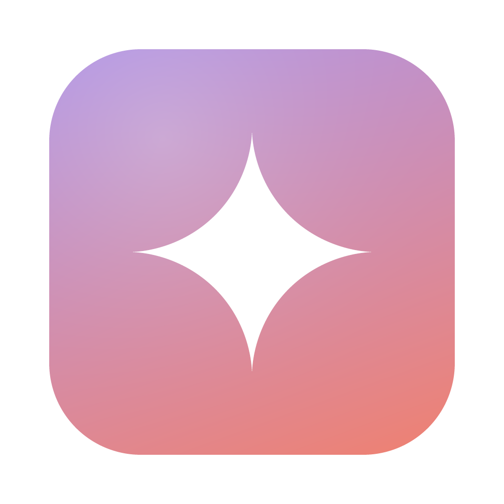
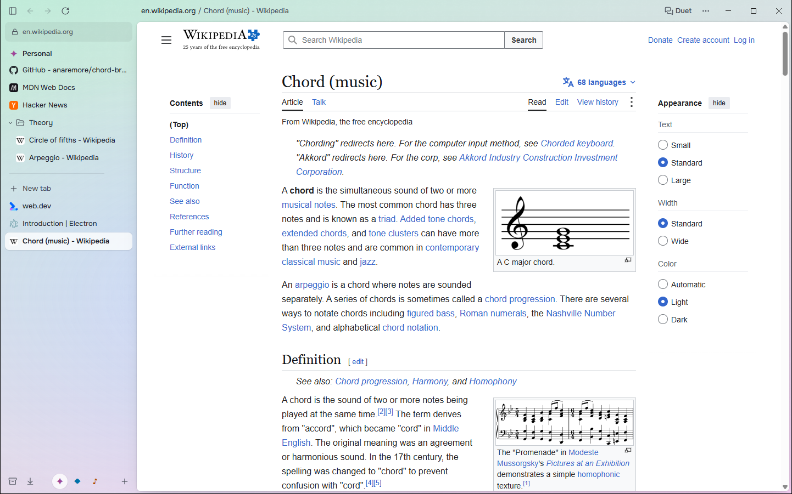
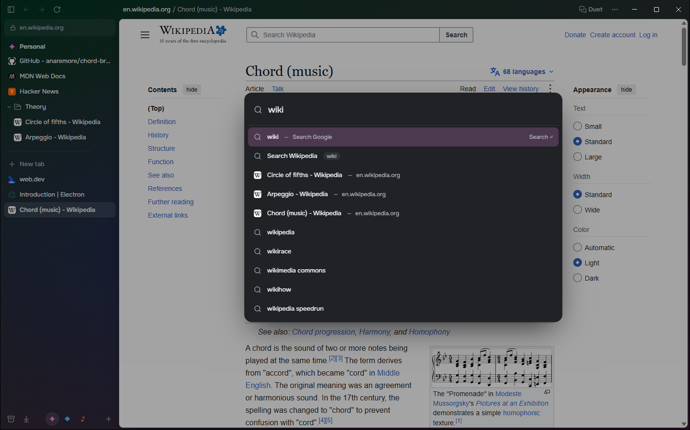
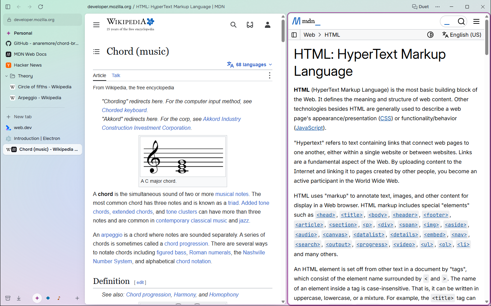
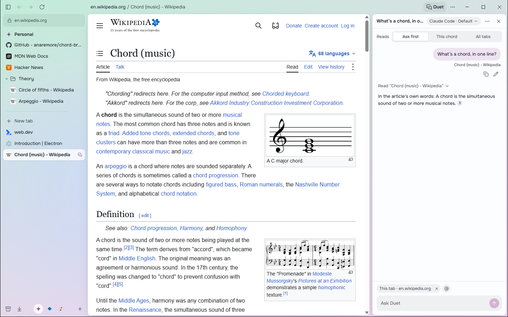
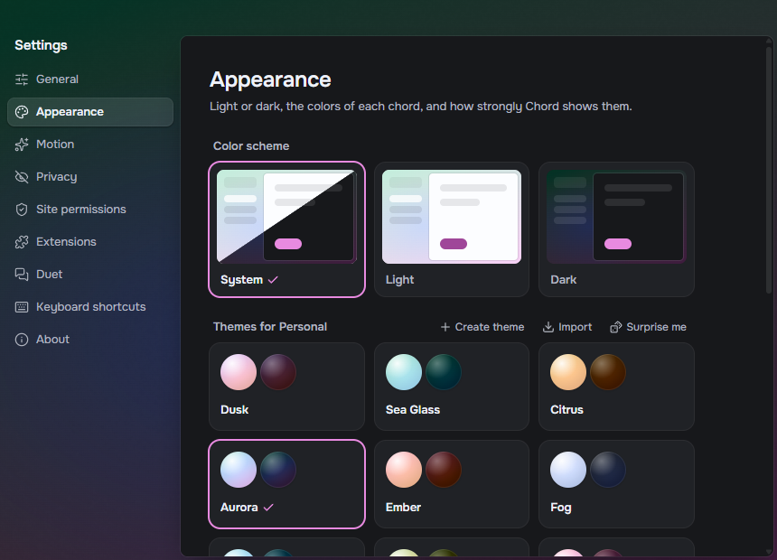

<p align="center"></p>

# Chord

A calm, colorful, open-source browser built around a vertical sidebar. Tabs live in **chords**: sets of pinned and everyday tabs, each with its own color. A command bar reaches everything. No account, no telemetry, no lock-in.

Windows, macOS, and Linux (X11 and Wayland) are all first-class.

> **Status: early development.** Unsigned preview builds appear on [Releases](https://github.com/anaremore/chord-browser/releases) as they're cut; the first preview (0.1) is planned for mid-December 2026. See the [roadmap](ROADMAP.md).

<picture>
  <source media="(prefers-color-scheme: dark)" srcset="docs/images/chord-dark.png">
  
</picture>

## What's in it

Everything here works on `main` today and comes with the first preview.

- **Vertical sidebar:** pinned tabs that remember their home page, Today tabs that tidy themselves into an archive, nestable folders, and drag-and-drop everywhere.
- **Chords:** separate sets of tabs, each with its own color theme and, optionally, separate sign-ins. Switch with ⌘/Ctrl+1–9 or a swipe.
- **Command bar** (⌘/Ctrl+T): one place to search open tabs, pinned tabs, history, the archive, and actions.
- **Minimal mode:** collapse the sidebar and Chord shrinks to one slim bar.
- **Split view:** two to four tabs side by side, kept together in the sidebar.
- **Peek and the mini window:** links from pinned tabs open in a Peek over the page, and links from other apps in a small window you can move into a chord.
- **Chrome extensions**, including password managers.
- **Pop-out video:** a playing video floats into picture-in-picture when you switch tabs.
- **Safe Browsing:** a warning before suspected phishing and malware sites and downloads, from Google's lists, checked on your computer. Release builds only (it needs Chord's API key); off in Google-free mode.
- **Duet** (⌘/Ctrl+E): a side panel for quick conversations, using your own Claude Code or Codex app and subscription. It can read the page or your tabs when you let it, cites what it read, and never sees your sign-in. Turn it off in Settings and it's gone.

| | |
|---|---|
|  |  |
| **Command bar:** tabs, history, the archive and actions in one place. | **Split view:** pages side by side, one entry in the sidebar. |
|  |  |
| **Duet:** answers from your tabs, with citations you can click. | **Themes:** each chord has its own colors, light or dark. |

## Try the preview

Download the file for your system from the latest [release](https://github.com/anaremore/chord-browser/releases). `arm64` builds (`aarch64` for the `.rpm`) are for Apple silicon Macs and ARM PCs; `x64` (`amd64` or `x86_64` on Linux) for Intel and AMD.

Previews aren't code-signed yet, so Windows and macOS warn you before the first launch; the steps below get you past that. Once releases are signed (each release's notes say whether it is), the Gatekeeper and SmartScreen steps go away. Each release lists the files' SHA-256 checksums in `SHA256SUMS.txt`. Chord tells you when a new version is out (you can turn that off in Settings → About), but it doesn't install updates itself yet: download the new version and install it over the old one. Your tabs and settings stay.

**Windows 10 and 11:** run `Chord-<version>-win-<arch>-setup.exe`. It installs for your account only, with no admin prompt.
- If SmartScreen says *Windows protected your PC*, click **More info**, then **Run anyway**. Signed releases don't need this, though SmartScreen may still warn about a new release for its first few days.

**macOS:** open `Chord-<version>-mac-<arch>.dmg` and drag Chord to Applications. A signed release just opens. Until then, the first time you open it, macOS says it can't verify Chord. Click **Done**, then:
- **macOS 15 and later:** open **System Settings → Privacy & Security**, scroll to *Security*, click **Open Anyway** next to Chord, and confirm with your password.
- **macOS 14 and earlier:** Control-click Chord in Applications, choose **Open**, then **Open** again.
- After an update, macOS may ask whether Chord can use *Chord Safe Storage* in your keychain (it encrypts your cookies). Click **Always Allow**. Until you answer, Chord shows its window but can't load pages, so if pages stay blank after an update, look for that prompt behind the window. The first signed release asks once more; after that, updates don't ask.

**Linux:**
- **Debian and Ubuntu:** `sudo apt install ./Chord-<version>-linux-<arch>.deb`. The package sets up the browser sandbox, including on Ubuntu 23.10 and later.
- **Fedora, RHEL and derivatives:** `sudo dnf install ./Chord-<version>-linux-<arch>.rpm`.
- **AppImage:** `chmod +x Chord-<version>-linux-<arch>.AppImage`, then run it. Chord never runs without its sandbox, which needs unprivileged user namespaces. Ubuntu 23.10 and later block those for apps without an AppArmor profile, so use the `.deb` there.

**Linux package repositories (coming soon).** These repositories aren't live yet, so the commands below don't work today; use the `.deb` or `.rpm` above. Once they are, `apt upgrade` and `dnf upgrade` keep Chord up to date, and a `.deb` or `.rpm` you installed by hand moves over by itself.

- **Debian and Ubuntu:**
  ```sh
  curl -fsSL https://dl.cloudsmith.io/public/chord-browser/chord/gpg.key | sudo gpg --dearmor -o /usr/share/keyrings/chord-archive-keyring.gpg
  echo "deb [signed-by=/usr/share/keyrings/chord-archive-keyring.gpg] https://dl.cloudsmith.io/public/chord-browser/chord/deb/any-distro any-version main" | sudo tee /etc/apt/sources.list.d/chord.list
  sudo apt update && sudo apt install chord
  ```
- **Fedora and RHEL:**
  ```sh
  sudo tee /etc/yum.repos.d/chord.repo <<'EOF'
  [chord]
  name=Chord
  baseurl=https://dl.cloudsmith.io/public/chord-browser/chord/rpm/any-distro/any-version/$basearch
  enabled=1
  gpgcheck=1
  repo_gpgcheck=1
  gpgkey=https://dl.cloudsmith.io/public/chord-browser/chord/gpg.key
  EOF
  sudo dnf install chord
  ```
- The repositories are signed. The key's fingerprint will be listed here when they go live.

**Flatpak (coming soon).** Chord isn't on Flathub yet. To build the Flatpak from source yourself, see [docs/releasing/flathub.md](docs/releasing/flathub.md#build-it-yourself).

To try a build without touching your everyday profile, start it with `--user-data-dir=<folder>`, as you would Chrome.

**Make Chord your default browser:** Settings → General → **Make default**. On Windows this opens Windows Settings at Chord's entry: Windows doesn't let apps make themselves the default. On macOS, the system asks you to confirm.

**Where your data lives:**

| OS | Profile folder |
|---|---|
| Windows | `%LOCALAPPDATA%\Chord\User Data` |
| macOS | `~/Library/Application Support/Chord` |
| Linux | `~/.config/Chord` |
| Linux (Flatpak) | `~/.var/app/io.github.anaremore.chord-browser/config/Chord` |

Deleting that folder resets Chord. To uninstall, use Windows' *Installed apps*, drag Chord to the Trash on macOS, or run `sudo apt remove chord` (Debian, Ubuntu) or `sudo dnf remove chord` (Fedora, RHEL).

## Documents

- [ARCHITECTURE.md](ARCHITECTURE.md): how Chord is built, and why.
- [DESIGN.md](DESIGN.md): principles, design tokens, motion, components, and key flows.
- [ROADMAP.md](ROADMAP.md): phases and milestones.
- [docs/releasing/](docs/releasing/patch-runbook.md): the 72-hour security-patch runbook, [Flathub](docs/releasing/flathub.md), and the [apt and dnf repositories](docs/releasing/linux-repos.md).

## Building from source

Requires Node.js 24 and pnpm 10.

```sh
pnpm install
pnpm dev
```

To build an installer for your own OS and architecture (written to `apps/desktop/release/`), then smoke-test it:

```sh
pnpm --filter @chord/desktop package
pnpm --filter @chord/desktop test:packaged
```

`package:dir` skips the installer and builds only the app folder.

## Contributing

See [CONTRIBUTING.md](CONTRIBUTING.md). Please report security issues privately, as described in [SECURITY.md](SECURITY.md).

## License

[MIT](LICENSE). One file, the command bar's ranking (`packages/core/src/rank.ts`), is adapted from [Crest](https://github.com/pauljoda/Crest) and stays under the [Mozilla Public License 2.0](LICENSES/MPL-2.0.txt).

Release builds include [electron-chrome-extensions](packages/chrome-extensions) for Chrome extension support. That library is GPL-3.0, so Chord's release builds are distributed under the [GPL-3.0](LICENSES/GPL-3.0.txt), with the source at each release's tag. Chord's own source stays MIT.

Duet reads PDFs with Mozilla's [pdf.js](https://github.com/mozilla/pdf.js) (`pdfjs-dist`), under the [Apache License 2.0](LICENSES/Apache-2.0.txt). Every build ships the files in [LICENSES](LICENSES) in its `licenses` resources folder.
